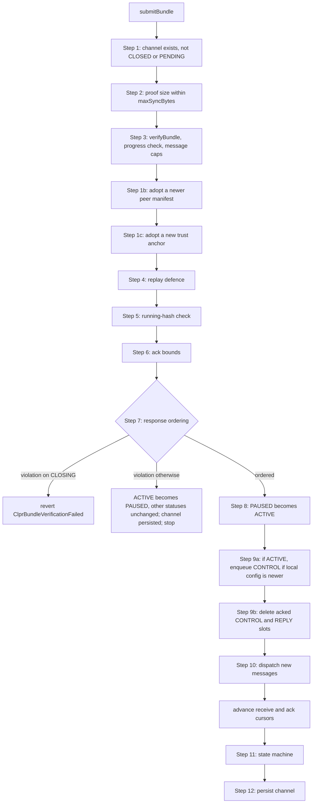

# Bundle Processing Flow

Read this when touching `BundleLib`, `BundleLogic.submitBundle`, or any
inbound message handling. Pairs with the spec's bundle-verification, enqueue,
response-ordering and slashing sections.

> Step numbers below are the `// ── Step N` labels in `BundleLib`, not the
> spec's numbering.
>
> **Decode failures are not uniformly isolated.** A garbled DATA message
> degrades to a per-message reply, but an unknown wire field, an unknown CONTROL
> oneof variant, a truncated CONTROL, or any malformed REPLY reverts the whole
> bundle. The exact triage is in
> [Per-message dispatch](#per-message-dispatch-_dispatchmessages) below — read
> that rather than assuming isolation.

> **Sender stamping:** `sendMessage` stamps `abi.encodePacked(msg.sender)` as the
> sender of outbound DATA messages; the public ABI takes no caller-supplied
> `sender`. Destination-side applications may rely on the `sender` argument of
> `onClprMessage` to identify the source caller, but must not trust any in-band
> "from" claim inside `messageData`. See `quirks.md`.

## Entry

`ClprService.submitBundle(channelId, proofBytes)` → DELEGATECALL →
`BundleLogic.submitBundle`. `submitBundle` is the only function in
`BundleLogic`; it is kept out of `MessagingLogic` so both stay under the EIP-170
24 KB runtime limit.

1. **Permissionless** — any caller may submit. Bundle correctness is secured by
   the channel's verifier, not by who sends the transaction. `msg.sender` is
   recorded as the bundle submitter and receives connector charges and slash
   proceeds. There is no endpoint-registration gate and no endpoint signature.
2. Guarded by `nonReentrant`, `onlyService`, and `whenEnabled`.
3. Calls `BundleLib.processBundle` with storage references to `_channels`,
   `_channelExists`, `_messageQueues`, `_connectors`, `_connectorExists`,
   `_connectorInflightCount`, `_connectorQueueCounts`, `_pendingWithdrawals`,
   `_peerEndpointManifests`, the `_connectorCount` slot, and a
   `ProcessBundleParams {channelId, bundleSubmitter: msg.sender,
   decodeHelperAddr: _bundleDecodeHelper, fallbackRecipient: _getOwner(),
   config: _config, econ: economicConfig}`.

The router holds all state; `BundleLib` mutates it via the passed-in
references. Every throttle the pipeline checks is the **local**
`_config.throttles` — the receiver's limits.

## Pipeline

`processBundle` calls `_validateAndPrepare` (Steps 1–7, with 1b and 1c inside
Step 3's block), then `_applyBundle` (Steps 8–11), and persists at Step 12. The
split keeps each stack frame small enough for `forge coverage --ir-minimum`
(the "STACK STRATEGY" note on `BundleLib`).



| Step | What | Code |
|---|---|---|
| 1 | Channel lookup: `_channelExists[channelId]`, else `ClprChannelNotFound`. A stored status of `CLOSED` or `PENDING` reverts `ClprInvalidChannelStatus` | `_validateAndPrepare` |
| 2 | `proofBytes.length ≤ throttles.maxSyncBytes`, else `BundleTooLarge` | `_validateAndPrepare` |
| 3 | `IClprVerifier(channel.verifier).verifyBundle(proofBytes, channel.trustAnchor, channel.channelContext)` → `(metadata, messagePayloads, newTrustAnchor, newTrustAnchorId, newEndpointManifest)`; a verifier revert propagates. Then the progress check (`NoProgress`, see below), then caps on message count (`TooManyMessages`) and per-payload size against `maxMessagePayloadBytes` (`ClprPayloadTooLarge`) | `_validateAndPrepare`, `_checkBundleProgress` |
| 1b | Endpoint-manifest update: when `newEndpointManifest.version > channel.endpointManifestVersion`, truncate it to `maxPeerEndpoints` (0 = no limit), write it to `_peerEndpointManifests[channelId]`, and set `channel.endpointManifestVersion`. A verifier signals "no manifest" with version 0 | `_validateAndPrepare` |
| 1c | Trust-anchor update: when `newTrustAnchor` is non-empty, set `channel.trustAnchor` and `channel.trustAnchorId` | `_validateAndPrepare` |
| 4 | Replay defense: unconditionally reject `metadata.nextMessageId < channel.receivedMessageId + 1`; when the bundle carries messages, also reject `metadata.lastMessageId >= metadata.nextMessageId OR metadata.lastMessageId < messagePayloads.length OR metadata.lastMessageId < channel.receivedMessageId OR metadata.lastMessageId - channel.receivedMessageId > messagePayloads.length` | `_validateAndPrepare:257-277` |
| 5 | Running-hash check: seed with `channel.receivedRunningHash` (32 zero bytes while `receivedMessageId == 0`), fold `sha256(prev‖sha256(payload))` over the new payloads with the `sha256` precompile, and compare with `metadata.sentRunningHash`, else `ClprRunningHashMismatch`. The comparison also runs when there are no new payloads: the peer's `sentRunningHash` must then equal the stored `receivedRunningHash` | `_validateAndPrepare` |
| 6 | Ack bounds on `metadata.receivedMessageId` (the peer's ack of our messages): not below `channel.ackedMessageId`, and if changed, `< channel.nextMessageId`; else `ClprAckVerificationFailed` | `_validateAndPrepare` |
| 7 | Response-ordering pre-scan over the new payloads (see below). **Violation: CLOSING → revert `ClprBundleVerificationFailed`; ACTIVE → PAUSED (emits `ChannelStatusChanged`); PAUSED or DRAINED → status unchanged.** In the two non-reverting cases the channel is written back with its Step 1b/1c updates and processing stops: nothing is dispatched and neither cursor advances. Otherwise `channel.nextExpectedReplyId` takes the scan's result | `_validateAndPrepare`, `_checkResponseOrdering` |
| 8 | Auto-resume: PAUSED → ACTIVE (emits `ChannelStatusChanged`) | `_applyBundle` |
| 9a | Lazy config propagation: only when `channel.status == ACTIVE` (Step 8 already resolves PAUSED), if `_config.nanosSinceEpoch > channel.lastConfigTimestamp`, update `lastConfigTimestamp` and enqueue `ClprProtobuf.encodeControlMessage(_config)` as a CONTROL message. CLOSING or DRAINED channels are skipped | `_applyBundle` → `_enqueueMessage` |
| 9b | For outbound ids in `(oldAcked, newAcked]`, delete queued CONTROL and REPLY slots. DATA slots stay until their REPLY arrives | `_deleteAckedNonDataMessages` |
| 10 | Per-message dispatch of the new payloads, with inbound ids from `expectedFirstId` | `_dispatchMessages` |
| — | If there were new messages, `receivedMessageId = expectedFirstId + newMessageCount − 1` and `receivedRunningHash` = the Step 5 result; `ackedMessageId = metadata.receivedMessageId` | `_applyBundle` |
| 11 | State machine: apply `_stepStatus(channel.status, metadata.state, dataAcked, allAcked)` until it is stable, emitting `ChannelStatusChanged` per hop; then emit `BundleProcessed(channelId, receivedMessageId, ackedMessageId, messagePayloads.length)` | `_applyStateMachine` → `_stepStatus` |
| 12 | Subtract the connectors banned during dispatch from `_connectorCount` (a direct `sstore` on its slot), then `_channels[channelId] = channel` | `processBundle` |

Step 1b writes `_peerEndpointManifests` directly, before Step 12. That is safe
because every later revert unwinds the whole transaction, and the Step 7 early
exit persists the channel with the matching `endpointManifestVersion`.

For an EVM peer, `ClprEvmBundleVerifier` reads `metadata` from the peer's proven
`Channel` slots, so `nextMessageId − 1` is the peer's newest outbound message at
the proven block. The pipeline itself only requires that the payloads end at
that message: a bundle may start anywhere at or before `receivedMessageId + 1`,
and splitting a run of messages across several bundles leaves the channel in
the same state as one bundle (`test/logic/bundle-logic/BundleLogic_PartialBundle.t.sol`).

### Bundle progress criteria (`_checkBundleProgress`)

Step 3 rejects no-op bundles with `NoProgress`, a DoS guard. It runs right after
`verifyBundle` — before the message caps, Steps 1b/1c, and the replay check, so
a replayed stale bundle that carries no new trust anchor or manifest reverts
`NoProgress` rather than `ClprReplayDetected`.
A bundle makes progress if **at least one** of these holds, checked in this
order:

1. New messages: `metadata.nextMessageId > channel.receivedMessageId + 1`. A
   bundle of only leading duplicates does not count.
2. Trust-anchor advancement: `newTrustAnchor` is non-empty.
3. Endpoint-manifest advancement: `newEndpointManifest.version >
   channel.endpointManifestVersion`.
4. Ack progress: `metadata.receivedMessageId > channel.ackedMessageId`.
5. A state transition: `_stepStatus` returns a status other than the current
   one. It looks ahead with `max(channel.ackedMessageId,
   metadata.receivedMessageId)`, because the new ack is only written to
   `channel.ackedMessageId` after dispatch.

`EmptyBundle` is declared but never thrown — `NoProgress` is the live error.
Auto-resume (Step 8) is not a criterion: `_stepStatus` has no PAUSED → ACTIVE
rule, so an otherwise-empty bundle to a PAUSED channel reverts `NoProgress`.

### Response ordering (`_checkResponseOrdering`)

Every inbound REPLY must answer the oldest outbound DATA message still owed a
reply, tracked across bundles in `channel.nextExpectedReplyId`. The scan walks
the payloads from `messageStartIndex`, skipping the leading duplicate prefix
exactly as Steps 5 and 10 do: a retransmitted, already-consumed REPLY compared
against the advanced `nextExpectedReplyId` would otherwise read as a backward
reply and pause the channel
(`test/logic/bundle-logic/BundleLogic_Ordering.t.sol`,
`test_overlappingBundle_replayedReply_doesNotPauseOrDropNewData`).

For each new payload that `ClprProtobuf.tryGetMessageType` identifies as a
REPLY (other types are skipped here):

- decode it with `ClprProtobuf.decodeReplyMessage` — a malformed REPLY reverts
  the whole bundle at this point;
- `replyId ≥ channel.nextMessageId` (a reply to a message never sent) →
  violation;
- `replyId < nextExpectedReplyId` → duplicate, skipped;
- advance `nextExpectedReplyId` to `replyId`; passing over a slot that still
  holds live DATA → violation. CONTROL, REPLY and deleted slots are
  passed over silently;
- step past `replyId` and past any following non-DATA slots.

After the walk, a live DATA slot anywhere in `[nextExpectedReplyId,
newAckedMessageId]` is a violation: the peer acked a DATA message without
replying to it. "Live DATA" means a slot whose payload is non-empty and decodes
as DATA (`_isMessageValueOfTypeData`).

### State machine (`_stepStatus`)

`_stepStatus` is the single definition of the transition rules. Step 11 applies
it; `_checkBundleProgress` only asks whether it would fire. It implements the
spec's peer-close propagation and drain-and-close rules:

| From | To | Condition |
|---|---|---|
| ACTIVE or PAUSED | CLOSING | Peer `metadata.state` is CLOSING, DRAINED or CLOSED |
| CLOSING | DRAINED | `_allDataAcked`: `lastDataMessageId == 0` or `ackedMessageId ≥ lastDataMessageId` — REPLYs may still be in flight |
| DRAINED | CLOSED | Peer is DRAINED or CLOSED, **and** `_allOutboundAcked`: `nextMessageId == 1` or `ackedMessageId ≥ nextMessageId − 1` |

Step 8 runs first, so a channel that entered the bundle PAUSED is ACTIVE by
Step 11.
Step 11 evaluates after dispatch, so a REPLY this bundle enqueued counts toward
`_allOutboundAcked`: DRAINED → CLOSED waits until the peer acks it. Step 9a's
ACTIVE gate keeps a CLOSING or DRAINED channel from adding a new CONTROL
message to that same wait. Several hops can happen in one bundle. Owner-driven
transitions are in `lifecycle.md`.

## Per-message dispatch (`_dispatchMessages`)

Strict wire-format policy first: after version negotiation, both services share
the exact same wire vocabulary, so malformed input is triaged by what it proves
about the sender:

- **Message type.** `ClprProtobuf.getMessageType` reads the `ClprMessage` oneof
  tag. An empty payload reverts the ENTIRE bundle with
  `ClprBundleVerificationFailedEmptyPayload`; a tag outside 1–4 reverts it with
  `ClprUnknownWireField`. The sender runs the wrong protocol version or emits
  malformed output; its data cannot be trusted.
- **Unknown field inside any protocol message** (DATA body, REPLY body, CONTROL
  configuration, timestamp, throttles, …) → `ClprUnknownWireField`, whole
  bundle rejected. The decoders in `ClprProtobuf` revert instead of skipping,
  and the DATA and CONTROL `catch` blocks re-throw this error rather than
  degrading it.
- **Any other DATA decode failure** (truncated input, varint overflow, wrong
  wire type, a `connectorId` that is not 32 bytes) → per-message recovery:
  `BundleParseFailed` plus an `APPLICATION_ERROR` reply with empty data. The
  rest of the bundle processes, and the source application can react.
- **Malformed REPLY message** → the ENTIRE bundle reverts (it is decoded without
  `try/catch`, in Step 7 and again in dispatch). A reply that cannot be decoded
  can never be matched against the outbound queue, so response ordering could
  never advance past it; there is no in-protocol recovery. The channel stays
  blocked until the remote CLPR Service is fixed (permanently, if that contract
  is immutable).
- **CONTROL decode failure** → `ClprBundleVerificationFailedOneOfVariant` (an
  unknown `ClprControlMessage` variant), `ClprUnknownWireField`,
  `TruncatedInput` and `VarintOverflow` revert the ENTIRE bundle. Any other
  failure (e.g. a `uint32` throttle field out of range) emits
  `BundleParseFailed` and the message is skipped with no reply.
- **Enum value out of range** (`ReplyStatus` in a REPLY, `ChannelStatus` in
  `ClprProtobuf.decodeBundleContent`) → bounds-checked before the cast, reverting
  `ClprBundleVerificationFailed`: never a silent truncation onto another variant.

Reverts raised after a successful decode — inside
`_processControlMessageDecoded` or `_processDataMessageDecoded` — are outside the
`catch` and revert the whole bundle. Rejection is atomic: messages dispatched
before the offending one are unwound with the rest of the transaction, so no
part of the bundle is applied.

Four cases, switching on `MessageType`:

### CONTROL (`_processControlMessageDecoded`)

A no-op unless `control.config.nanosSinceEpoch > 0`. Otherwise, in order:

- reverts the whole bundle with `ClprProtocolVersionMismatch` if the peer's
  `protocolVersion` differs from the local one;
- reverts `ClprReplayDetected` if `nanosSinceEpoch <= channel.peerConfigTimestamp`
  — the stale/replayed config guard;
- stores `peerConfigTimestamp` (raw `uint96` nanoseconds) and, after
  `ClprTypes.validateThrottles` (`ClprInvalidConfiguration`), `peerThrottles` on
  the in-memory `Channel`.

The other configuration fields in the message are not adopted. CONTROL messages
never produce a reply.

### DATA (`_processDataMessageDecoded`)

```
if connector not registered on this channel:    reply CONNECTOR_NOT_FOUND; return
gasLimit = throttles.maxGasPerMessage
if tx.gasprice > 0:
    affordableGas = balance*100 / ((100+margin)*tx.gasprice)
    if affordableGas == 0:                      slash + reply CONNECTOR_UNDERFUNDED; return
    gasLimit = min(gasLimit, affordableGas)
status = APPLICATION_ERROR
if targetApplication is 20 bytes with code:
    callWithExactGas(onClprMessage, gasLimit)   # too little gas left: revert the bundle
        on success, well-formed bytes:          status = SUCCESS, data = returned bytes
        on success, malformed return:           data = raw return bytes
        on revert:                              data = raw revert bytes
    gasUsed = gasBefore - gasleft()
totalCharge = gasUsed*tx.gasprice * (1 + margin/100)   # actual cost, not a ceiling
if totalCharge > 0 and ConnectorLib.charge(totalCharge) fails:   # payForExecution, connectorPaymentGasLimit gas
                                                slash    # reply status unchanged
if stipend > 0: best-effort onInboundMessage, stipend gas   # not only on success
enqueue reply(status, data)
```

`balance` is the connector contract's native balance and `margin` is
`economicConfig.endpointMarginPercent`. Things here that are easy to get wrong:

- There is **no channel-status check** on this path: a CLOSING or DRAINED
  channel still calls the application and enqueues the reply.
- Charging is by **actual execution cost**, computed after the call from
  `gasBefore - gasleft()`, on both the success and the revert path.
  `economicConfig.messageExecutionCost` plays no part.
- A failed charge slashes the connector but does **not** change the reply status.
- A `targetApplication` that is not a 20-byte address with code gets an
  `APPLICATION_ERROR` reply with empty data and no charge.

The reply is enqueued outbound by `_enqueueReplyAndEmit`, which also emits
`MessageDispatched`.

### REPLY (`_processReplyMessageDecoded`)

Looks up the original outbound message by `replyId`:

- the queued slot is read and **deleted immediately**, before any callback;
- the connector is identified by `MessageValue.connectorIdForReply`. A
  `bytes32(0)` value (a CONTROL/REPLY original, or an empty slot) emits
  `ReplyDelivered` and returns;
- `_connectorInflightCount` and `_connectorQueueCounts` are decremented for the
  DATA original;
- if the status is `CONNECTOR_NOT_FOUND` or `CONNECTOR_UNDERFUNDED`,
  **source-side slash** of the local connector;
- best-effort `IClprApplication.onClprResponse` to the original sender, with
  `throttles.maxGasPerMessage` gas, only when the sender is exactly 20 bytes and
  has bytecode;
- emits `ReplyDelivered`.

## Reentrancy & ordering

- `submitBundle`, `sendMessage`, `removeConnector` and `collectPending` are
  `nonReentrant` and share one transient guard, so an application or connector
  callback cannot re-enter them.
- The channel is an in-memory copy, persisted at Step 12 (or at the Step 7 early
  exit). The queue, connector counters, connector records and
  `_pendingWithdrawals` are written in place as each message is processed; a
  REPLY's queue slot and counters are updated before its `onClprResponse`
  callback. During any callback `_channels[channelId]` still holds the
  pre-bundle cursors, so a view read at that moment sees inconsistent state.
  That is acceptable only because no CLPR view serves another contract as an
  on-chain oracle (the REENTRANCY INVARIANT note in
  `_processReplyMessageDecoded`).
- Application calls get `min(throttles.maxGasPerMessage, affordableGas)`, so the
  submitter never performs work the connector's balance cannot pay for.
  `payForExecution` gets `economicConfig.connectorPaymentGasLimit`. The connector's inbound
  notification gets `economicConfig.connectorInboundGasStipend`, is not called
  when that is 0, and emits `ConnectorInboundCallbackFailed` when it fails.
- Every callback gets its budget, less the CALL's own cost, or not at all.
  `ExactGasCall.callWithExactGas` reverts the bundle with `InsufficientGasForCall`
  when the remaining gas is below `budget + budget / 63`, the least that forwards
  the budget under the EIP-150 63/64 rule, so a submitter cannot choose a
  transaction gas that starves a callback while the bundle still applies. The
  CALL's own cost (account access under EIP-2929 and, for an EIP-7702 account,
  its delegate) comes out of the budget, so no fixed overhead depends on the
  chain's gas schedule. An honest submitter needs `budget + budget / 63` of gas
  left at each callback. An `eth_estimateGas` without fee fields
  runs at gas price 0, which skips the affordability bound and the charge, so it
  can under-estimate; size the gas from the configured budgets instead.

## Slashing

The spec's slashing section defines when the source and destination sides slash.
Code path: `ConnectorLib.slash` compares `slashCount + 1` against
`slashBanThreshold`:

- **At or above the threshold**: the connector is deleted (banned) and its
  **entire remaining stake** is confiscated — the geometric formula is skipped.
- **Below the threshold**: the penalty is
  `basePenalty * penaltyMultiplier^slashCount` (saturating), capped at
  `lockedStake`. If that leaves zero stake the connector is also deleted.

Slash proceeds go to the bundle submitter through `_transferWithFallback`
(submitter → owner → submitter's `_pendingWithdrawals`). Each ban during a
bundle is subtracted from `_connectorCount` at Step 12.

## Common footguns

- **No-progress rejection.** A bundle that meets none of the five progress
  criteria reverts with `NoProgress` (not `EmptyBundle`, which is declared but
  never thrown). A bundle that only drives a state transition already counts
  as progress. To submit an otherwise-empty bundle in a test, move the trust
  anchor (`verifier.setNewTrustAnchor(...)`, or
  `BundleProcessorTestBase._emptyBundleWithTrustAnchor`). See `testing.md`.
- **Auto-resume needs a real bundle.** A PAUSED channel resumes only on a bundle
  that makes progress for another reason and passes Step 7.
- **In-memory Channel copy.** `_validateAndPrepare` / `_applyBundle` and their
  helpers mutate a memory copy, and `processBundle` does
  `_channels[id] = channel` at the end. Don't mix in-place `_channels` writes
  with this pattern — you'll lose updates. (Step 1b's manifest write and the
  Step 7 early-exit write are the deliberate exceptions.)
- **DATA messages aren't deleted on ack.** DATA slots survive ack so the peer's
  REPLY can still be matched against a live payload for sender recovery and
  quota/in-flight accounting. The connectorId itself is kept separately in
  `MessageValue.connectorIdForReply`.
  `_deleteAckedNonDataMessages` is named accurately.
- **`BundleProcessed.messageCount`** is `messagePayloads.length`, leading
  duplicates included.
