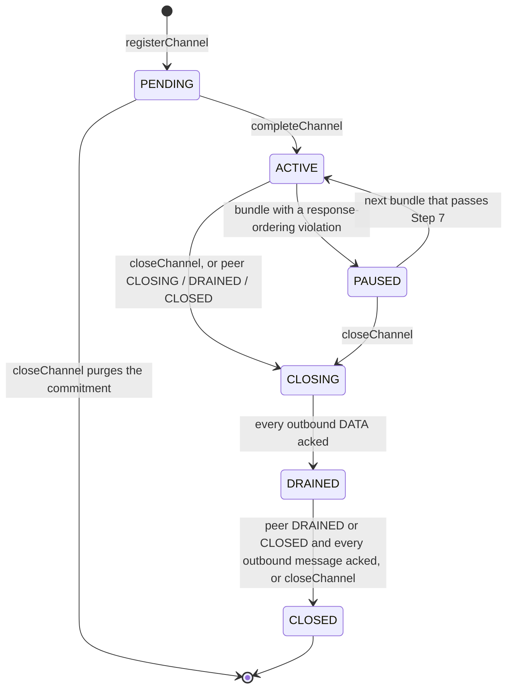

# Channel & Connector Lifecycle (EVM specifics)

Read this when changing commit-reveal flows, ID derivation, signature
verification, channel status transitions, or endpoint admission. Pairs with the
spec's channel-registration and connector-registration sections.

> **EVM bindings in force** (details below):
> - Reveal signatures are over `keccak256(id ‖ address(this))`, binding each
>   signature to one router deployment.
> - Public keys are 64-byte uncompressed secp256k1 (X‖Y, no 0x04 prefix). The
>   spec also permits 33-byte compressed keys; EVM does not support them (there
>   is no native decompression opcode). This is a ledger-specific binding — see
>   `quirks.md` "EVM pubkey encoding is 64-byte uncompressed".
> - `closeChannel` handles completed channels and pending commitments alike;
>   `registerChannel` takes the `channelId` so it can build the reverse index
>   that makes this possible.
> - The kill switch `setClprEnabled(false)` makes every mutating operation
>   revert `ClprDisabled`, except `setClprEnabled`, `initialize` and
>   `collectPending`.
> - Channel IDs use the derived formula below (`keccak256(loChain ‖ hiChain ‖
>   pubKey ‖ salt)`, chains sorted by `keccak256`). The spec does not document it
>   (DRIFT-REVIEW S-4); every peer implementation must derive the same bytes.

The spec defines *what* is signed and *how* IDs derive. This doc records the
EVM-specific encodings: byte-for-byte hash inputs, `ecrecover` quirks, the
significance of `address(this)` under DELEGATECALL, etc.

## Channel status machine

`Channel.status` is a `ClprTypes.ChannelStatus`. Transitions come from three
places: the commit-reveal in `ChannelLogic`, the owner's `closeChannel`, and
bundle processing (`BundleLib`, see `bundle-flow.md`).



| Transition | Trigger | Code |
|---|---|---|
| → PENDING | `registerChannel` records a commitment; no `Channel` record exists yet | `ChannelLogic.registerChannel` |
| PENDING → ACTIVE | `completeChannel` | `ChannelLogic._createChannel` |
| PENDING → removed | Owner `closeChannel` deletes the commitment and the reverse-index entry | `ChannelLogic.closeChannel` |
| ACTIVE → PAUSED | A bundle fails the response-ordering pre-scan | `BundleLib._validateAndPrepare` (Step 7) |
| PAUSED → ACTIVE | The next bundle that passes Step 7 | `BundleLib._applyBundle` (Step 8) |
| ACTIVE or PAUSED → CLOSING | Owner `closeChannel`; or a bundle whose proven peer status is CLOSING, DRAINED or CLOSED. On the bundle path a PAUSED channel passes through ACTIVE at Step 8 first | `ChannelLogic.closeChannel`, `BundleLib._stepStatus` |
| CLOSING → DRAINED | After a bundle, every outbound DATA message is acked (`_allDataAcked`: `lastDataMessageId == 0` or `ackedMessageId ≥ lastDataMessageId`) | `BundleLib._stepStatus` |
| DRAINED → CLOSED | A bundle proves the peer DRAINED or CLOSED and every outbound message is acked (`_allOutboundAcked`); or owner `closeChannel` (force-close) | `BundleLib._stepStatus`, `ChannelLogic.closeChannel` |

What each status permits:

| Status | `sendMessage` | `submitBundle` | `closeChannel` |
|---|---|---|---|
| PENDING (not completed) | `ClprChannelNotFound` | `ClprChannelNotFound` | Purges the commitment |
| ACTIVE | Yes | Yes | → CLOSING |
| PAUSED | `ClprInvalidChannelStatus` | Yes; resumes on a bundle that passes Step 7 | → CLOSING |
| CLOSING | `ClprInvalidChannelStatus` | Yes; a response-ordering violation reverts `ClprBundleVerificationFailed` | `ClprInvalidChannelStatus` |
| DRAINED | `ClprInvalidChannelStatus` | Yes | → CLOSED |
| CLOSED | `ClprInvalidChannelStatus` | `ClprInvalidChannelStatus` | `ClprInvalidChannelStatus` |

The drain gates count different things. CLOSING → DRAINED waits only for
outbound DATA (`lastDataMessageId`), because REPLY messages generated while
closing may still be in flight. DRAINED → CLOSED waits for every outbound
message (`nextMessageId − 1`), including those REPLYs. A CLOSING or DRAINED
channel still dispatches inbound DATA to applications and enqueues their
replies, and each of those replies must be acked before the channel can close.

## PENDING state

A channel is **PENDING** between `registerChannel` (commitment recorded) and
`completeChannel` (signature reveal and verifier wired up). PENDING is not a
stored status: during PENDING the only storage entries are

- `_pendingCommitments[commitment] = true` — proves the commitment was seen;
- `_channelIdToCommitment[channelId] = commitment` — reverse index that lets
  `closeChannel` find and purge the pending entry.

There is no `_channelExists` or `_channels` entry, so `getChannel`,
`sendMessage` and `submitBundle` revert `ClprChannelNotFound` for a PENDING
channel. `ChannelStatus.PENDING` is value 0, so an unwritten `_channels` entry
reads as PENDING: do not treat a missing `_channels` entry as an error without
first checking for a pending commitment. `BundleLib` Step 1 also rejects a
stored status of PENDING (`ClprInvalidChannelStatus`) as a defensive guard.

An admin may abort a PENDING channel with `closeChannel(channelId)`. There is no
on-chain timeout; commitments are otherwise permanent unless completed or
explicitly closed.

### `closeChannel`

Router `onlyOwner`; module `onlyService` + `whenEnabled`. `ChannelLogic.closeChannel`
handles these cases:

| Current state | Result |
|---|---|
| ACTIVE / PAUSED | → CLOSING (graceful drain), emits `ChannelStatusChanged`. Also deletes any leftover pending commitment for this channelId (through the reverse index, else `ownershipCommitment`) |
| DRAINED | → CLOSED directly — the admin force-close recovery path for when the endpoint cannot deliver the close-notification bundle. The outbound DATA is already acked at DRAINED |
| CLOSING / CLOSED | Reverts `ClprInvalidChannelStatus` |
| No channel; pending commitment found via `_channelIdToCommitment` | Deletes the commitment and the reverse-index entry; emits no event |
| Neither | Reverts `ClprChannelNotFound` |

## Channel: commit-reveal

### Phase 1 — `registerChannel(channelId, commitment)`

- `commitment = keccak256(channelId ‖ pubKey)` where `pubKey` is the
  64-byte uncompressed secp256k1 public key (X‖Y, **no 0x04 prefix**).
- `channelId` is the value from `deriveChannelId(peerChainId, pubKey, salt)`.
  It is passed explicitly so the service can build a reverse index
  (`channelId → commitment`) that lets `closeChannel` purge pending entries. The
  service does NOT validate `channelId` at this phase — validation happens at
  `completeChannel`.
- Sets `_pendingCommitments[commitment] = true`, and
  `_channelIdToCommitment[channelId] = commitment` only if that entry is still
  empty — the first registration for a channelId keeps the reverse index.
  Emits `ChannelRegistered`. Permissionless (`onlyService` + `whenEnabled`);
  re-registering the same commitment changes no state.

### Phase 2 — `completeChannel(channelId, pubKey, sig, salt, verifier, configProof, endpointManifestProof)`

`ChannelLogic.completeChannel` runs its guards in this order, then delegates
record creation to `_createChannel`:

1. `pubKey.length == 64`, else `ClprInvalidSignature` (the selector is reused for
   this structural check).
2. Channel cap: if `economicConfig.maxChannels > 0` and `_channelCount` has
   reached it, revert `ClprTooManyChannels` (`0` means unlimited).
3. The channel must not exist yet (`ClprChannelAlreadyExists`) — checked
   *before* the commitment.
4. Recompute `keccak256(channelId ‖ pubKey)` and assert it is pending
   (`ClprCommitmentMismatch`).
5. Verify `sig` with `ECDSA._verifySignature(channelId, pubKey, sig)`:
   - `msgHash = keccak256(channelId ‖ address(this))` — domain-separated to the
     specific router deployment, so a signature cannot be replayed on a
     different CLPR service that derives the same `channelId`.
   - `ECDSA._ecrecoverCheck`: `sig` must be 65 bytes (`r‖s‖v`); prepend
     `"\x19Ethereum Signed Message:\n32"`, hash, `ecrecover`, and require a
     non-zero result equal to `address(uint160(uint256(keccak256(pubKey))))`.
     Every failure reverts `ClprInvalidSignature`. The expected address is
     derived from the pubkey bytes — not from a separate signing address — so
     the protocol can carry the full pubkey in the commitment (needed for
     cross-platform parity).
6. `verifier.code.length > 0`, else `ClprInvalidVerifierContract`.
7. `_createChannel` calls `IClprVerifier.verifyConfig(configProof, channelId,
   endpointManifestProof)` → `(channelContext, peerChainId, peerServiceAddress,
   peerConfigNanos, peerThrottles, initialTrustAnchor, initialTrustAnchorId,
   endpointManifest)`. The trust anchor, peer throttles, and initial peer
   endpoint manifest come from the verifier — callers do not supply them. The
   returned `peerThrottles` must pass `ClprTypes.validateThrottles`
   (`ClprInvalidConfiguration`).
8. Re-derive `channelId` from the **verifier-returned** `peerChainId` plus
   `pubKey` and `salt`, and assert it matches the one supplied
   (`ClprInvalidChannelId`).
9. Populate the `Channel`: `status = ACTIVE`, `nextMessageId = 1`,
   `nextExpectedReplyId = 1`, `lastConfigTimestamp = uint96(block.timestamp) *
   1e9` (**nanoseconds**, not seconds), `peerConfigTimestamp = peerConfigNanos`,
   plus `chainId`, `peerServiceAddress`, `verifier`, `salt`,
   `ownershipCommitment`, `peerThrottles`, `trustAnchor`, `trustAnchorId` and
   `channelContext`. The manifest is truncated to the local `maxPeerEndpoints`
   throttle (`0` = no limit), stored out-of-line in
   `_peerEndpointManifests[channelId]`, and its version copied to
   `channel.endpointManifestVersion`. An empty `endpointManifestProof` is a
   bring-up path: a verifier that accepts it returns a version-0 manifest, and
   the first manifest-carrying bundle populates the manifest via BundleLib
   Step 1b.
10. Set `_channelExists`, increment `_channelCount`, delete the pending
    commitment and the reverse-index entry, and emit `ChannelCompleted` (with
    `keccak256(verifier.code)` as a fingerprint) and
    `ChannelStatusChanged(ACTIVE)`.

### `deriveChannelId(peerChainId, pubKey, salt)`

Sorts the local and peer chainIds by `keccak256` so both peers compute
**byte-identical** ids:

```
(loChain, hiChain) = sortByKeccak(localChainId, peerChainId)
channelId       = keccak256(loChain ‖ hiChain ‖ pubKey ‖ salt)
```

The local chainId comes from `_config.chainId` (set in the router constructor
and never changed). An empty chainId on either side reverts
`ClprInvalidChainId` (`ChannelLogic._sortChains`).

### Verifier immutability

After `completeChannel`, the channel's verifier address cannot be changed.
There is no setter; enforced by absence.

## Connector: commit-reveal

### Phase 1 — `registerConnector(commitment)`

- `commitment = keccak256(connectorId ‖ pubKey)`.
- `connectorId = keccak256(channelId ‖ pubKey ‖ salt)`. Computed via
  `deriveConnectorId` (the only `pure` STATICCALL in the router).
- Sets `_pendingConnectorCommitments[commitment] = true`. Anyone may commit
  (`onlyService` + `whenEnabled`).

### Phase 2 — `completeConnector(connectorId, pubKey, sig, salt, channelId, connectorContract, admin) payable`

`ConnectorLogic.completeConnector` first asserts the parent channel exists
(`ClprChannelNotFound`) and that `_connectorCount` has not reached
`economicConfig.maxConnectors` (`ClprTooManyConnectors`, `0` = unlimited). The
channel's status is not checked. It then calls
`ConnectorLib.completeRegistration`, which runs its guards in this order:

1. `msg.value >= minLockedStake`, else `ClprInsufficientStake` — checked **first**.
2. The commitment from `(connectorId, pubKey)` is pending, else
   `ClprCommitmentMismatch`.
3. Re-derive `connectorId` from `(channelId, pubKey, salt)`; a mismatch reverts
   `ClprInvalidChannelId` (selector reused).
4. No connector exists at `keccak256(channelId ‖ connectorId)`
   (`ClprConnectorAlreadyExists`), and `connectorContract.code.length > 0`
   (`ClprInvalidConnectorContract`).
5. Signed message is `keccak256(connectorId ‖ address(this))`. Note:
   - Under DELEGATECALL, `address(this)` is the **router** address, so the
     signature binds to a specific router deployment.
   - This is the EVM equivalent of the spec's "service_address" binding.
6. `ECDSA._ecrecoverCheck` against the `keccak256(pubKey)`-derived address (same
   scheme as channel completion) — the signature is checked **last**, after the
   cheap structural guards. This path has no explicit `pubKey.length` check; a
   signature can only match a real 64-byte key's address.
7. Store the `Connector` with `lockedStake = msg.value`, delete the pending
   commitment, emit `ConnectorRegistered`; `ConnectorLogic` then increments
   `_connectorCount`.

`topUpConnectorStake(channelId, connectorId, amount)` adds `amount` to
`lockedStake`: native mode requires `msg.value == amount`, token mode pulls it with
`transferFrom`. Any caller may top up; `amount == 0` reverts `ClprInsufficientStake`, a
`msg.value` mismatch `ClprNativeValueMismatch` and an unknown connector `ClprConnectorNotFound`.

### `deregister` (`removeConnector`)

- The connector must exist (`ClprConnectorNotFound`) and the caller must be its
  `admin` (`ClprConnectorUnauthorized`).
- `_connectorInflightCount[key] == 0` required (no DATA awaiting a REPLY),
  else `ClprConnectorHasInflightMessages`.
- Deletes the entry, emits `ConnectorDeregistered`, and decrements
  `_connectorCount`; the connector can be re-registered later under a new
  commitment.
- Returns the `lockedStake` to `recipient` with a direct ETH transfer; a failed
  transfer reverts the whole call with `ClprTransferFailed`. There is no owner
  fallback and no pull-payment credit on this path — `_transferWithFallback` is
  used only for charge and slash proceeds.

### Slashing

`ConnectorLib.slash` is invoked from `BundleLib`. It compares `slashCount + 1`
against `slashBanThreshold`:

- **at or above the threshold**: the entry is deleted and the **entire remaining
  stake** is confiscated — the geometric formula is skipped entirely;
- **below the threshold**: penalty = `basePenalty * penaltyMultiplier^slashCount`,
  capped at `lockedStake`; if that leaves zero stake the entry is also deleted;
- proceeds go to the bundle submitter via `_transferWithFallback`.

## Endpoint registration (two-step admission)

Endpoint registration does not gate `submitBundle` — that call is
permissionless. The manifest *is* the endpoint registry (`ManifestLib` over
`_endpointManifest`); there is no bond top-up.

`registerEndpoint(Endpoint endpoint) payable` — permissionless
self-registration. Reverts `ClprEndpointAlreadyRegistered` if the caller already
has an entry, then `ClprInsufficientBond` if `msg.value <
economicConfig.minEndpointBond`, then validates the discovery data
(`EndpointValidation`: `ClprInvalidEndpointAddress`,
`ClprInvalidEndpointCertificate`). Creates a **PENDING**
`EndpointManifestEntry {endpoint, bond, status}` for `msg.sender`; the endpoint
is not advertised and the manifest version does not change.

The owner admits a registrant with `addEndpoint(registrant, endpoint)` or the
batch `updateEndpointManifest(add[], remove[])`, promoting PENDING → LIVE. A
promotion uses the registrant's self-registered data; the `endpoint` argument is
only used (and validated) for a direct add with no bond. Adding a registrant
that is already LIVE reverts `ClprEndpointAlreadyRegistered`; exceeding
`throttles.maxLocalEndpoints` (`0` = no limit) reverts `ClprEndpointManifestFull`.
The batch applies removals before additions, so a swap succeeds at full
capacity; removals of unknown registrants are skipped. Each change to the LIVE
set bumps the manifest version (once per batch) and recomputes
`EndpointManifestState.commitment`.

`removeEndpoint(registrant)` — callable by the registrant **or** the owner
(else `ClprEndpointUnauthorized`); an unknown registrant reverts
`ClprEndpointNotRegistered`. Credits the bond **in full** to
`_pendingWithdrawals[registrant]`, withdrawn later via `collectPending()`. The
bond is always pull, never push, so a contract registrant that rejects ETH
cannot block its own removal. Endpoint bonds are **never slashed** — slashing
applies only to connectors. The manifest version is bumped only if the entry
was LIVE.

## Cross-platform byte-equivalence checklist

When changing any of the following, audit against the peer-ledger
implementation (Hiero, etc.) for matching bytes:

| Quantity | Formula |
|---|---|
| `channelId` | `keccak256(loChain ‖ hiChain ‖ pubKey ‖ salt)`, chainIds sorted by `keccak256` |
| `connectorId` | `keccak256(channelId ‖ pubKey ‖ salt)` |
| Channel commitment | `keccak256(channelId ‖ pubKey)` |
| Connector commitment | `keccak256(connectorId ‖ pubKey)` |
| Channel-reveal sig over | `"\x19Ethereum Signed Message:\n32" ‖ keccak256(channelId ‖ address(this))` (domain-separated to router address) |
| Connector-reveal sig over | `"\x19Ethereum Signed Message:\n32" ‖ keccak256(connectorId ‖ address(this))` |
| Message running hash | `sha256(prev ‖ sha256(payload))` over each queued `ClprMessage` payload. The sender's chain starts from 32 zero bytes (`Channel.sentRunningHash`); the receiver seeds with 32 zero bytes while `receivedMessageId == 0`, else `receivedRunningHash`, and compares with the proven `sentRunningHash` |
| Endpoint-manifest commitment | `keccak256(ClprProtobuf.encodeEndpointManifest(manifest))` over the LIVE manifest, stored in `_endpointManifest.commitment` (slot 18) |
| `Channel` slots an EVM peer proves | Base `keccak256(abi.encode(channelId, 15))`; members +1, +2, +4, +5, +16 (`ClprEvmBundleVerifier._channelMetadataSlots`) |

`pubKey` everywhere means the **64-byte uncompressed** secp256k1 representation
(X‖Y), no 0x04 prefix. The spec also allows 33-byte compressed, but EVM does
not support it — see `quirks.md` "EVM pubkey encoding is 64-byte uncompressed."
Hash function defaults: `keccak256` for IDs and commitments; `sha256` only for
the message running hash.
