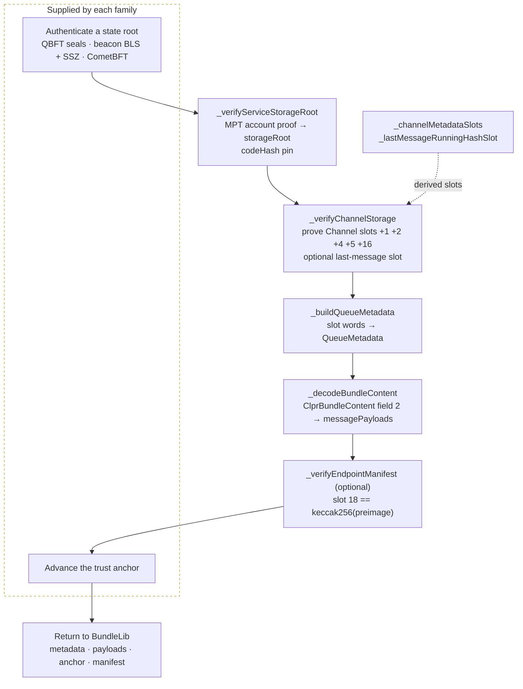
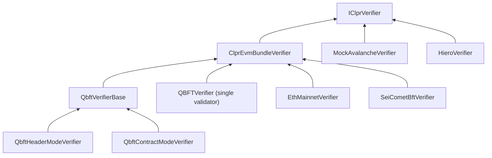
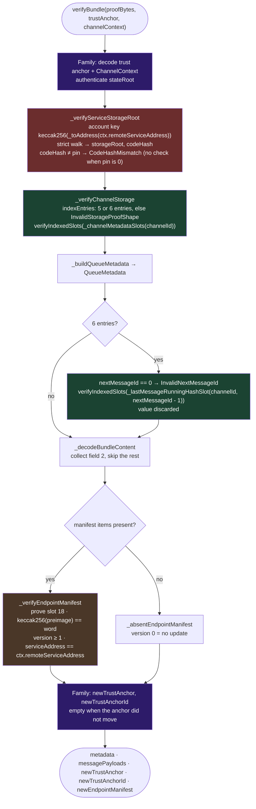
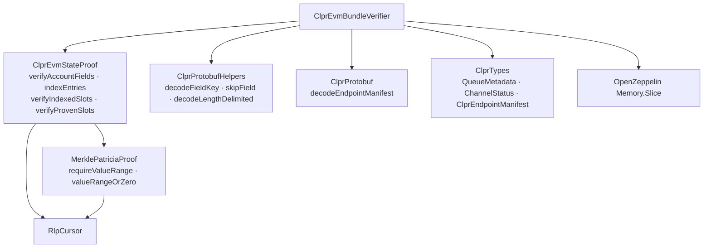

# ClprEvmBundleVerifier

> **Source**: [ClprEvmBundleVerifier.sol](./ClprEvmBundleVerifier.sol)
> **Interface**: [IClprVerifier.sol](../../../interfaces/IClprVerifier.sol)
> **Storage binding**: [docs/evm-platform-spec.md](../../../../docs/evm-platform-spec.md) (E-10)

---

## 1. The big picture

A verifier for a peer ledger with EVM-style state answers one question: *"is this bundle what
the peer CLPR service's storage says it is?"* It proves the peer's `Channel` record for this
channel, and the service then checks that the message payloads hash-chain to the running hash in
that record. Only the first link — how a state root is authenticated — depends on the peer's
consensus. Everything after it is shared, and lives in `ClprEvmBundleVerifier`.

`ClprEvmBundleVerifier` is an `abstract` contract with no storage, no constructor and only
`internal pure` helpers. It implements neither `IClprVerifier` method: each concrete verifier
writes `verifyBundle` and `verifyConfig` and calls the helpers.



> [!IMPORTANT]
> **Slot numbers are derived, never read from the proof.** The verifier computes the slots it
> needs from `channelId` and the CLPR storage layout, and each proof entry must prove one of
> them. A relay cannot point a read at another channel's storage, reorder values, or substitute a
> slot of its choosing. The proof carries no values either: an entry is `[slot, proofNodes]`,
> and the value is read from the trie leaf.

---

## 2. The families: what they share and what they supply



| Verifier | Extends | State root authenticated by | Trust anchor | `channelId` for slots | Spec |
|---|---|---|---|---|---|
| `QBFTVerifier` | `ClprEvmBundleVerifier` | Besu header `stateRoot`, carrying at least `MIN_COMMITTED_SEALS` seals, one from the anchored validator; epoch headers hand over to the next validator | 128 B `abi.encode(validator, codeHash, epochLength, epochNumber)` | `channelContext` | — |
| `QbftHeaderModeVerifier` | `QbftVerifierBase` | Besu header `stateRoot`, sealed by a quorum of the set listed in `extraData`; hop headers rotate the set | 128 B `abi.encode(uint8 0, setCommitment, codeHash, anchorBlockNumber)` | `channelContext` | [qbft-header-mode.md](../qbft/qbft-header-mode.md) |
| `QbftContractModeVerifier` | `QbftVerifierBase` | Besu header `stateRoot`, sealed by a quorum of the set read from a validator contract's storage | 224 B `abi.encode(uint8 1, setCommitment, codeHash, validatorContract, arraySlot, anchorBlockNumber, validatorCodeHash)` | `channelContext` | [qbft-contract-mode.md](../qbft/qbft-contract-mode.md) |
| `EthMainnetVerifier` | `ClprEvmBundleVerifier` | sync-committee BLS over a beacon header, then an SSZ branch to the execution `state_root` | flat 428 B window anchor | the anchor's `channelId` | [ethereum/README.md](../ethereum/README.md) |
| `SeiCometBftVerifier` | `ClprEvmBundleVerifier` | CometBFT commit (Ed25519, > 2/3 voting power), then an ICS-23 multistore proof of the `evm` store root | `abi.encode(chainId, SeiValidator[])` | `channelContext` | [sei/README.md](../sei/README.md) |
| `MockAvalancheVerifier` | none — implements `IClprVerifier` directly | nothing is proven | none | — | test harness only |

Which base helpers each family calls:

| Helper | QBFT (all three) | `EthMainnetVerifier` | `SeiCometBftVerifier` |
|---|---|---|---|
| `_verifyServiceStorageRoot` | yes | yes | no — Sei has no account trie |
| `_verifyChannelStorage` | yes | yes | no — its own `_bindChannelSlots` over IAVL proofs |
| `_channelMetadataSlots`, `_lastMessageRunningHashSlot`, `_buildQueueMetadata` | through `_verifyChannelStorage` | through `_verifyChannelStorage` | called directly |
| `_verifyEndpointManifest` | yes | yes | no — `_verifySeiEndpointManifest`, same checks and errors |
| `_decodeBundleContent` | yes | yes | yes |
| `_uninitializedEndpointManifest`, `_absentEndpointManifest` | yes | yes | yes |
| `_toAddress` | yes | yes | no — `_toBytes20`, same `InvalidServiceAddressLength` |
| `_toBytes4` | — | the fork version | — |

Notes on the families:

- **`QbftVerifierBase`** groups the base calls for the two mode verifiers in
  `_verifyStorageAndContent`, and holds the shared payload, header and config-proof decoding.
  See [qbft-verifier.md](../qbft/qbft-verifier.md).
- **`QBFTVerifier`** is the single-validator verifier. Its source carries a TODO (#443) to remove
  the file. `deployCore.deployQbftVerifier`, which `bin/verifier.sh qbft` runs, still deploys it
  with `MIN_COMMITTED_SEALS = 1`; the `e2e-with-qbft-verifier` deploy mode deploys
  `QbftHeaderModeVerifier` instead. It rejects an epoch header that lists more than one validator
  (`MultiValidatorNotSupported`).
- **`SeiCometBftVerifier`** reuses the slot derivation, the queue-metadata decode, the bundle
  content decode, the manifest sentinels and the `Manifest*` and `InvalidServiceAddressLength`
  errors. Its storage proofs are ICS-23/IAVL proofs against the `evm` store root, so it does not
  use the MPT helpers (see *Sei: positional slot binding* below).
- **`MockAvalancheVerifier`** takes `proofBytes` as a bare `ClprBundleContent` and returns the
  metadata carried in its field 1 (`ClprProtobuf.decodeBundleContent`). Nothing is proven, so it
  exists for test harnesses only. Its `verifyBundle` returns an empty trust anchor and an absent
  (version 0) manifest.
- **`HieroVerifier`** is not in this family. It proves a protobuf `ClprChannel` state item
  (`ClprStateProof`, `ClprProtobuf.decodeChannelFromMemory`); see
  [hiero-verifier.md](../../hiero/hiero-verifier.md).

---

## 3. The proven storage slots

| Constant | Value | Pins (`storage-layout.json`) |
|---|---|---|
| `CHANNELS_BASE_SLOT` | 15 | `_channels` |
| `MESSAGE_QUEUES_BASE_SLOT` | 1 | `_messageQueues` |
| `ENDPOINT_MANIFEST_COMMITMENT_SLOT` | 18 | `_endpointManifest` (17) + `commitment` member (1) |

```solidity
// _channelMetadataSlots(channelId): the five Channel slots, in this order
bytes32 cBase = keccak256(abi.encode(channelId, CHANNELS_BASE_SLOT));
// cBase + 1, cBase + 2, cBase + 4, cBase + 5, cBase + 16

// _lastMessageRunningHashSlot(channelId, messageId)
bytes32 qBase = keccak256(abi.encode(channelId, MESSAGE_QUEUES_BASE_SLOT));
bytes32 msgBase = keccak256(abi.encode(messageId, qBase)); // messageId is a uint64
return bytes32(uint256(msgBase) + 1); // MessageValue.runningHashAfterProcessing
```

Both ends of a channel key it by the same `channelId`, because the derivation sorts the two chain
IDs. The verifier therefore derives the peer's slots from its own `channelId`.

`_buildQueueMetadata` decodes the five proven words. Solidity packs struct members from the
low-order end of a word, so the first-declared member sits at the right:

| Index | Slot | Packed members | `QueueMetadata` field |
|---|---|---|---|
| 0 | `cBase + 1` | `verifier` (20 B) · `status` (1 B) · `nextMessageId` (8 B) | `state = uint8(w >> 160)`, `nextMessageId = uint64(w >> 168)` |
| 1 | `cBase + 2` | `ackedMessageId` · `receivedMessageId` · `nextExpectedReplyId` (8 B each) | `receivedMessageId = uint64(w >> 64)` |
| 2 | `cBase + 4` | `sentRunningHash` | `sentRunningHash = w` |
| 3 | `cBase + 5` | `receivedRunningHash` | `receivedRunningHash = w` |
| 4 | `cBase + 16` | `endpointManifestVersion` (8 B) | `endpointManifestVersion = uint64(w)` |
| 5 (optional) | `_lastMessageRunningHashSlot(channelId, nextMessageId - 1)` | `runningHashAfterProcessing` | none — proven, value discarded |

The full `Channel` member table is in `docs/evm-platform-spec.md` (E-10).

---

## 4. Proof shapes

### Channel storage proof

An RLP list of **5 or 6** entries, each `[slot, proofNodes]`:

- Five entries must prove the five `Channel` slots. A sixth entry, when present, must prove the
  last-message running-hash slot. Order does not matter: `ClprEvmStateProof.verifyIndexedSlots`
  finds each derived slot by its label.
- Any other count reverts `InvalidStorageProofShape`. A 6-entry proof for a channel whose proven
  `nextMessageId` is 0 reverts `InvalidNextMessageId`.
- The count is not tied to the bundle's messages; either shape is accepted for any bundle. The
  verifiers' NatSpec describes 5 entries for an ACK-only bundle and 6 for one that carries
  messages.

### Manifest proof

A storage proof for slot 18 plus the manifest protobuf preimage. The verifiers document the proof
as a single entry; extra well-formed entries are ignored. `keccak256(preimage)` must equal the
proven word.

### Where each family puts them

| Item | QBFT (all three): RLP list of 5, or 7 with a manifest | `EthMainnetVerifier`: RLP list of 11, or 13 with a manifest | `SeiCometBftVerifier`: protobuf `ClprSeiBundlePayload` |
|---|---|---|---|
| Account proof | item 2 | item 7 | — |
| Channel storage proof | item 3 | item 8 | IAVL entries inside field 1 (`state_proof`) |
| Bundle content | item 4 (byte string) | item 9 (byte string) | field 2 |
| Manifest storage proof | item 5 | item 11 | field 4 (one IAVL storage entry) |
| Manifest preimage | item 6 | item 12 | field 5 |

---

## 5. Step-by-step verification flow

The shared part of every EVM-family `verifyBundle`, as the QBFT and Ethereum verifiers run it:



The purple steps are family-specific. `SeiCometBftVerifier` replaces the account and storage
steps with its own IAVL checks and verifies the manifest before its chain-id and trust-anchor
checks.

### verifyConfig and the initial manifest

Each family decodes its config proof in its own way. The manifest part follows one pattern:

1. An empty `endpointManifestProofBytes` returns `_uninitializedEndpointManifest(serviceAddress)`:
   version 0 with the peer's service address. The channel then starts with
   `endpointManifestVersion = 0`.
2. Otherwise the QBFT and Ethereum verifiers authenticate a state root under the config's
   initial authority (the config validator set, or the config sync committee), call
   `_verifyServiceStorageRoot`, and then `_verifyEndpointManifest` against the config's
   `serviceAddress`. `SeiCometBftVerifier` proves the commitment slot against the store root that
   its config proof has already authenticated.

At config time the QBFT verifiers pass `bytes32(0)` as the code hash, so the service's code is not
pinned on this path; their trust anchor pins it for bundles. `EthMainnetVerifier` pins the
config's `codeHash` on this path too.

### What the service does with the result

`BundleLib._validateAndPrepare` consumes the return values:

| Returned value | Used for |
|---|---|
| `metadata.nextMessageId` | replay defense and the number of new messages |
| `metadata.sentRunningHash` | the running-hash check over the new payloads (`ClprRunningHashMismatch`) |
| `metadata.receivedMessageId` | acknowledgement verification (`ClprAckVerificationFailed`) |
| `metadata.state` | the channel state machine |
| `newEndpointManifest` | stored when `version > Channel.endpointManifestVersion` |
| `newTrustAnchor`, `newTrustAnchorId` | stored when `newTrustAnchor` is non-empty and differs from `Channel.trustAnchor` |

`metadata.receivedRunningHash` and `metadata.endpointManifestVersion` are returned but not read.
See [bundle-flow.md](../../../../docs/bundle-flow.md) for the full pipeline.

---

## 6. Deep dives

### Binding the proof to the peer contract and the channel

- **Service address.** It comes from `ChannelContext.remoteServiceAddress`, which `verifyConfig`
  produces and the service stores on the channel. `_toAddress` requires exactly 20 bytes
  (`InvalidServiceAddressLength`), and the account-trie key is `keccak256(address)`, so the proof
  cannot choose the account.
- **Channel id.** The QBFT verifiers and Sei use `ChannelContext.channelId`. `EthMainnetVerifier`
  uses the `channelId` inside its trust anchor, seeded from `verifyConfig`'s `channelId` and
  carried through every window advance.
- **Code hash.** `_verifyServiceStorageRoot` compares the account's `codeHash` with the pinned
  value; `bytes32(0)` disables the check. No verifier rejects a zero `codeHash` at `verifyConfig`,
  and the anchors carry it unchanged through every advance, so a channel configured with 0 stays
  unpinned. `QbftContractModeVerifier` also pins the validator contract's code hash
  (`WrongValidatorCodeHash`). `SeiCometBftVerifier` proves no account and pins no code hash.
- **Manifest owner.** The decoded manifest must declare the channel's peer service address. The
  check is skipped only for an empty expected address; the EVM families never pass one, because
  they convert it with `_toAddress` (or Sei's `_toBytes20`) first.

### Metadata comes from storage, not from the bundle content

`ClprBundleContent` field 1 also carries a `QueueMetadata`. The base ignores it:
`_decodeBundleContent` collects field 2 and skips everything else, so metadata a relay attaches
has no effect. The payloads are bound to the proof only through the running hash that `BundleLib`
recomputes. `_decodeBundleContent` scans the buffer twice (count, then collect) because Solidity
memory arrays have a fixed size. Unknown fields are skipped; a wire type other than 0 or 2 reverts
with the string `"Unsupported wire type"`.

### The sixth entry carries no value

`_verifyChannelStorage` proves the last-message running-hash slot and discards the result.
`BundleLib` checks its recomputed chain against `sentRunningHash` (`cBase + 4`). The proven slot
can legitimately be zero: the source deletes acknowledged CONTROL and REPLY messages, and a DATA
message once its REPLY arrives, from `_messageQueues`.

### An unset slot proves as zero

Storage lookups use `MerklePatriciaProof.valueRangeOrZero`: a valid proof that the key is absent
yields 0 instead of reverting. The account lookup uses the strict `requireValueRange`, so a
missing account reverts. Sei matches this with ICS-23 non-existence proofs, which read as zero
(`NonExistenceSlotNotEmpty` if a value comes with one).

### Duplicate labels

`verifyIndexedSlots` keeps a rotating cursor, so entries in derived order are found in one probe
each; any order is accepted. When several entries carry the same label, the lookup takes the first
one the cursor reaches. That is sound, because every accepted entry must hash-chain from
`storageRoot` at the derived key, and two valid proofs under one root and key cannot disagree. A
list that mixes a valid and a broken proof for one slot may pass or revert depending on layout.

### The two manifest sentinels

| Helper | Returned by | `version` | `serviceAddress` |
|---|---|---|---|
| `_uninitializedEndpointManifest(serviceAddress)` | `verifyConfig` with no manifest proof | 0 | the peer's |
| `_absentEndpointManifest()` | `verifyBundle` with no manifest items | 0 | empty |

Both use version 0. `BundleLib` applies a manifest only when its version is strictly greater than
`Channel.endpointManifestVersion`, so a version-0 return never overwrites anything, and a channel
that starts at 0 accepts the peer's real version-1 manifest. A version-1 placeholder would block
that first manifest.

### Sei: positional slot binding

Sei's IAVL keys carry the slot number (`0x03 ‖ serviceAddress ‖ slot`). `_bindChannelSlots`
compares the proven slot numbers **positionally**, reverting `StorageKeyMismatch`: entries 0–4
with `_channelMetadataSlots`, then, after `_buildQueueMetadata`, entry 5 with
`_lastMessageRunningHashSlot(channelId, nextMessageId - 1)` (a proven `nextMessageId` of 0 also
reverts `StorageKeyMismatch`). Unlike the MPT families, order matters here. A count outside 5–6 reverts
`StorageProofFailed`, and a manifest proof without its preimage (or the reverse) reverts
`ManifestProofPairMismatch`.

---

## 7. Error catalogue

| Error | Raised by | Condition |
|---|---|---|
| `CodeHashMismatch()` | `_verifyServiceStorageRoot` | the proven `codeHash` differs from a non-zero pin |
| `InvalidStorageProofShape()` | `_verifyChannelStorage` | the entry count is neither 5 nor 6 |
| `InvalidNextMessageId()` | `_verifyChannelStorage` | 6 entries, but the proven `nextMessageId` is 0 |
| `ManifestCommitmentMismatch()` | `_verifyEndpointManifest` | `keccak256(preimage)` differs from the proven slot-18 word |
| `ManifestVersionZero()` | `_verifyEndpointManifest` | the decoded manifest has version 0 |
| `ManifestServiceAddressMismatch()` | `_verifyEndpointManifest` | the manifest's `serviceAddress` differs from the expected peer address |
| `InvalidServiceAddressLength()` | `_toAddress` | the service address is not 20 bytes |

`SeiCometBftVerifier._verifySeiEndpointManifest` raises the three `Manifest*` errors under the
same conditions, and `SeiCometBftVerifier._toBytes20` raises `InvalidServiceAddressLength`.

Propagated from the libraries on this path:

- [`ClprEvmStateProof`](../../../libraries/proof/evm/ClprEvmStateProof.sol) — `InvalidAccount`,
  `InvalidStorageProof`, `InvalidStorageEntry`, `SlotNotProven(bytes32 slot)`.
- [`MerklePatriciaProof`](../../../libraries/proof/evm/MerklePatriciaProof.sol) — `MPTEmptyProof`,
  `MPTInvalidHashRef`, `MPTInvalidNode`, `MPTInlineNodeUnsupported`, `MPTKeyMismatch`,
  `MPTKeyAbsent`, `MPTProofEndedEarly`, `MPTInvalidPathPrefix`.
- [`RlpCursor`](../../../libraries/proof/evm/RlpCursor.sol) — `RlpCursorOutOfBounds`,
  `RlpCursorScalarTooLong`, `RlpCursorUnexpectedList`.
- [`ClprProtobufHelpers`](../../../libraries/codec/ClprProtobufHelpers.sol) — `TruncatedInput`,
  `VarintOverflow`; `skipField` reverts with the string `"Unsupported wire type"`.
- [`ClprProtobuf.decodeEndpointManifest`](../../../libraries/codec/ClprProtobuf.sol) —
  `ClprUnknownWireField` for an unknown field inside an endpoint, `ClprBundleVerificationFailed`
  for a port above 65535.

---

## 8. Library dependency map



| Library | Purpose |
|---|---|
| [ClprEvmStateProof](../../../libraries/proof/evm/ClprEvmStateProof.sol) | account proof → `(storageRoot, codeHash)`; storage entries matched to caller-derived slots |
| [MerklePatriciaProof](../../../libraries/proof/evm/MerklePatriciaProof.sol) | MPT walk: strict for accounts, absent-as-zero for storage; hash-referenced nodes only |
| [RlpCursor](../../../libraries/proof/evm/RlpCursor.sol) | allocation-free RLP reads over bounded memory ranges |
| [ClprProtobufHelpers](../../../libraries/codec/ClprProtobufHelpers.sol) | fail-closed varint and length-delimited reads for `_decodeBundleContent` |
| [ClprProtobuf](../../../libraries/codec/ClprProtobuf.sol) | `ClprEndpointManifest` decode |

Proof items travel as OpenZeppelin `Memory.Slice` views into the in-memory copy of the proof.
`_decodeBundleContent` and `_verifyEndpointManifest` take `bytes memory`, which is why the
families call `RLP.readBytes` for the bundle content and the manifest preimage.

The EVM-side encodings and the running-hash rule these helpers rely on are specified in
[docs/evm-platform-spec.md](../../../../docs/evm-platform-spec.md) (E-10 to E-13).

---

## 9. Conformance and pinning

The slot constants and packing offsets in `ClprEvmBundleVerifier.sol` must match the service's
storage layout. Both sides are pinned in several places, so a change on either side fails in CI:

- [`storage-layout.json`](../../../../storage-layout.json) — the CI `Lint` job fails when the
  regenerated `ClprService` layout differs from this snapshot.
- [`test/invariants/ClprStorageLayoutGuard.t.sol`](../../../../test/invariants/ClprStorageLayoutGuard.t.sol)
  — `test_channelProvenMemberSlotsMatchLayout` pins the proven `Channel` members' slots and
  offsets, and `test_manifestCommitmentMemberSlotMatchesLayout` pins the commitment member behind
  slot 18.
- [`test/verifiers/compliance/ClprEvmStorageComplianceTest.sol`](../../../../test/verifiers/compliance/ClprEvmStorageComplianceTest.sol)
  — the EVM-family layer of the conformance suite. It hardcodes slots 15 and 18 independently of
  the verifier, and covers cross-channel proofs, a wrong service address, a 3-entry proof, a wrong
  slot index and the exact manifest rejection reasons. Its adapters are `QBFTComplianceTest`
  (header mode), `QbftContractModeComplianceTest`, `EthMainnetComplianceTest` and
  `SeiComplianceTest`. `QBFTVerifier` has no adapter and no Forge test.
- `test/libraries/proof/evm/` — `ClprEvmStateProof.t.sol`, `MerklePatriciaProof.t.sol` and
  `RlpCursor.t.sol` cover the proof libraries.
- [`test/e2e/lib/storageSlots.ts`](../../../../test/e2e/lib/storageSlots.ts) — the e2e relay's copy
  of the slot derivation, and every other relay that builds these proofs.

A silent slot shift would make every peer verifier read the wrong storage on a live chain, so the
layout is pinned in several independent places to fail in CI instead.
