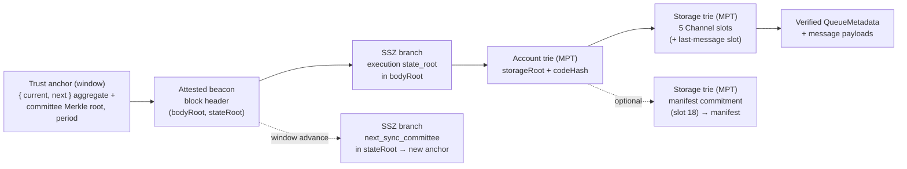
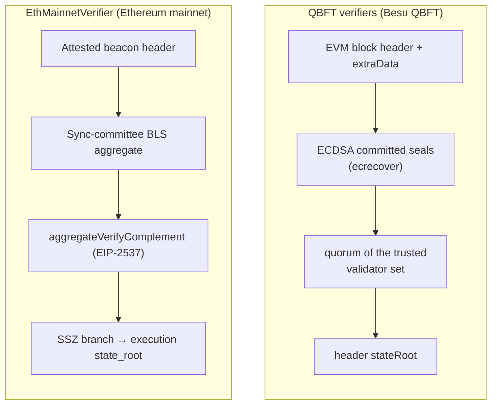
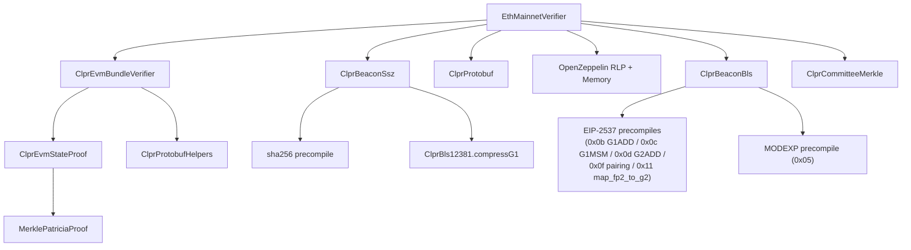

# EthMainnetVerifier

> **Source**: [EthMainnetVerifier.sol](./EthMainnetVerifier.sol)
> **Base contract**: [ClprEvmBundleVerifier.sol](../common/ClprEvmBundleVerifier.sol)
> **Interface**: [IClprVerifier.sol](../../../interfaces/IClprVerifier.sol)
> **Gas report**: [GAS_REPORT.md](../GAS_REPORT.md)

---

## 1. The big picture

The CLPR protocol needs to **trustlessly verify state from a peer Ethereum chain** entirely on-chain. `EthMainnetVerifier` answers: *"prove to me that this bundle of cross-chain messages actually existed in the peer CLPR service contract's storage on Ethereum mainnet."*

It is a real **consensus-layer light client**: it builds a chain of cryptographic trust from a sync-committee BLS signature down to individual storage slots.



Each arrow is a proof the contract verifies on-chain. If any link breaks, the whole call reverts. There is **no EVM block header**: the execution `state_root` is proven *directly* against the beacon `bodyRoot` via SSZ.

The contract has no constructor and no storage. The peer service address comes from the per-channel `ChannelContext`, and the expected code hash from the trust anchor.

> [!IMPORTANT]
> **All points are EIP-2537 *uncompressed*.** On-chain decompression needs a field square root and is gas-infeasible, so the relayer supplies uncompressed keys (the non-signers' per bundle, the full next committee at a window advance) and an uncompressed signature. The contract only *compresses* (no square root), and only to rebuild the beacon SSZ committee root at a window advance. The BLS aggregate verification runs fully on-chain through the EIP-2537 precompiles — see [BLS verification](#7-bls-verification).

---

## 2. Differences with the QBFT verifiers

Ethereum mainnet uses **Proof of Stake with sync-committee BLS signatures**, not QBFT committed seals, and it commits to its execution state through SSZ rather than an RLP block header.

The QBFT family has three contracts (overview: [qbft-verifier.md](../qbft/qbft-verifier.md)):

| Verifier | Validator set | Quorum |
|---|---|---|
| [`QbftHeaderModeVerifier`](../qbft/QbftHeaderModeVerifier.sol) | `extraData.validators` of each header ([qbft-header-mode.md](../qbft/qbft-header-mode.md)) | committed-seal quorum checked by `ClprQbftQuorum` (`⌈2n/3⌉` of a set, `QbftValidators.quorum`) |
| [`QbftContractModeVerifier`](../qbft/QbftContractModeVerifier.sol) | storage of an on-chain validator contract ([qbft-contract-mode.md](../qbft/qbft-contract-mode.md)) | committed-seal quorum checked by `ClprQbftQuorum` (`⌈2n/3⌉` of a set, `QbftValidators.quorum`) |
| [`QBFTVerifier`](../qbft/QBFTVerifier.sol) | one validator address in the anchor (an epoch header listing more than one reverts `MultiValidatorNotSupported`) | at least `MIN_COMMITTED_SEALS` seals, one of them from the anchored validator |

`QBFTVerifier` carries a `TODO #443` to remove it; `bin/verifier.sh qbft` deploys it (`deployCore.deployQbftVerifier`). The two mode verifiers extend `QbftVerifierBase`.



The **shared** part is the bottom half, inherited from [ClprEvmBundleVerifier](../common/ClprEvmBundleVerifier.sol): the MPT account proof, the channel storage-slot derivation and queue-metadata decode ([ClprEvmStateProof](../../../libraries/proof/evm/ClprEvmStateProof.sol)), the endpoint-manifest proof, and the protobuf bundle-content decode. Only "how do we trust this state root?" differs. See [section 9](#9-ethmainnetverifier-vs-the-qbft-verifiers) for a side-by-side table.

---

## 3. Configuration & trust anchor

The **trust anchor** is a **flat packed 428-byte layout** (fixed offsets, no RLP) using a **window encoding**: it holds a *set* of currently valid authorities — `{ current committee, next committee }` — and the verifier accepts a bundle signed by either. The 512 keys of each are **not stored**; the anchor commits to them with a keccak Merkle root ([ClprCommitteeMerkle](../../../libraries/proof/beacon/ClprCommitteeMerkle.sol)):

```
gvr32 ‖ forkVersion4 ‖ channelId32 ‖ codeHash32 ‖ period8 ‖ [aggregate128 ‖ committeeRoot32] × 2
```

| Offset | Field | Bytes | Description |
|---|---|---|---|
| 0 | `genesisValidatorsRoot` | 32 | Chain-pinning root, folded into the BLS signing domain. |
| 32 | `forkVersion` | 4 | Fork version folded into the signing domain. Set at channel creation and carried unchanged through every advance; no code path in the verifier or `ChannelLogic` changes it, so a beacon fork-version change breaks BLS verification for the channel. |
| 36 | `channelId` | 32 | The CLPR channel this anchor authenticates. Seeded from `verifyConfig`'s `channelId`, carried through every advance, and used to derive the storage slots the bundle must prove. |
| 68 | `codeHash` | 32 | Expected `codeHash` of the peer CLPR service account. Zero disables the check (`ClprEvmBundleVerifier._verifyServiceStorageRoot`). |
| 100 | `period` | 8 | Sync-committee period of the **current** member, big-endian. The window covers `[period, period + 1]`. |
| 108 | `current.aggregatePubkey` | 128 | Precomputed aggregate (uncompressed EIP-2537 G1). Feeds the pairing directly at full participation. |
| 236 | `current.committeeMerkleRoot` | 32 | keccak Merkle root over the 512 uncompressed member pubkeys. Per bundle the relay supplies only the **non-signers'** keys (proof item 10), each authenticated against the *selected* member's root. |
| 268 | `next.aggregatePubkey` | 128 | Same shape as `current` — committee `i` sits at `108 + 160·i`, so selection is one offset multiply and an advance is one contiguous 160-byte copy. |
| 396 | `next.committeeMerkleRoot` | 32 | |

At 428 bytes the service's per-bundle anchor SLOAD and per-advance SSTORE take 15 storage words, against ~4,110 for two committees stored as keys.

**Why the period is in the anchor.** `BundleLib` calls `verifyBundle(proofBytes, channel.trustAnchor, channel.channelContext)` — never with `Channel.trustAnchorId`, where the period is also recorded. Nor can the period be recovered from a committee: the BLS aggregate and the Merkle root are both one-way functions of the key set. Selection is a comparison, so the period has to travel inside the bytes.

### Config payload

`verifyConfig` takes an RLP list of **7 items**. Both committees are required — the anchor is a
width-2 window from the first bundle, and `next` cannot be derived on-chain:

| # | Item | Contents |
|---|---|---|
| 0 | `slot` | Beacon slot the config is taken at. `slot / 8192` becomes the window's start `period`. |
| 1 | `currentCommittee` | `[uncompressedPubkeys[512], uncompressedAgg128]` — the committee signing at `slot`. |
| 2 | `nextCommittee` | Same shape, for the following period. Its Merkle root must differ from `currentCommittee`'s (`ConfigWindowNotDistinct`); seeding one committee twice would let selection accept a signature from `period + 1` against a committee that never signed then. |
| 3 | `gvr` | Genesis validators root. |
| 4 | `forkVersion` | 4 bytes (`InvalidConfigPayload` otherwise). |
| 5 | `ledgerConfiguration` | protobuf `ControlMessage`; its `config` supplies `chainId`, `serviceAddress`, `nanosSinceEpoch` and `throttles`. |
| 6 | `codeHash` | Expected CLPR service code hash. |

Every key and both aggregates must be valid G1 points (`ClprBeaconBls.requireOnCurveG1`). Neither committee is verified against a beacon state root: both are trusted input supplied to `ClprService.completeChannel` at channel setup. `initialTrustAnchorId` is `slot / 8192` as 8 big-endian bytes.

The optional endpoint-manifest proof (`verifyConfig`'s third argument) is an RLP list of **8 items**, verified against `currentCommittee`:

```
[attestedHeader, syncAggregate, nonSignerProofs, executionStateRoot, executionBranch,
 accountProof, manifestStorageProof, manifestPreimage]
```

It has no `signatureSlot`: the attested header itself must sit inside `period` (`ConfigManifestPeriodMismatch`). The account proof is taken at the config's `serviceAddress` and checked against item 6's `codeHash`. An empty proof returns the uninitialized (version 0) manifest; the first manifest-carrying bundle then populates the channel's peer manifest.

**Why a window.** A single-authority anchor is *replaced* on rotation. Since the attested header may sit anywhere inside a period, the successor would be installed early and every proof from the committee still signing on the beacon chain rejected until the boundary — including anything already in flight. With a window the outgoing committee stays valid until the chain leaves its period, so the advance is decoupled from the boundary. This mirrors Altair's [`LightClientStore`](https://ethereum.github.io/consensus-specs/specs/altair/light-client/sync-protocol/), which holds both the current and the next sync committee.

---

## 4. Proof layout

The bundle proof is a **top-level RLP list of 11 items**, or **13** when the bundle also carries an endpoint-manifest update (`InvalidPayloadShape` for any other count):

| # | Item | Contents |
|---|---|---|
| 0 | `attestedHeader` | `[slot, proposerIndex, parentRoot, stateRoot, bodyRoot]` |
| 1 | `signatureSlot` | The slot the committee **signed at** — strictly after `attestedHeader.slot`, and in a period at most one beyond the attested one (`InvalidSignatureSlot`). Its period selects the window member, mirroring Altair's `update_signature_period`. It cannot be derived from the attested slot: the two sit in different periods for one slot per period. The signature does not cover it, so this bound is its only constraint. |
| 2 | `syncAggregate` | `[bits(64 B), signature(256 B uncompressed G2)]` |
| 3 | `executionStateRoot` | 32-byte execution-layer state root (the SSZ leaf) |
| 4 | `executionBranch` | 9 SSZ sibling hashes (gindex 802) |
| 5 | `nextCommittee` | window-advance committee `[uncompressedPubkeys[512], uncompressedAgg128]` (128 B EIP-2537 keys), or an empty RLP **string** if absent. The contract derives the compressed form on-chain to rebuild the SSZ root. |
| 6 | `nextCommitteeBranch` | 6 SSZ siblings (gindex 87), or an empty RLP **list** if absent |
| 7 | `accountProof` | MPT account proof against `executionStateRoot` |
| 8 | `storageProof` | 5 × `[slot, proofNodes]` (ACK-only) or 6 (with outbound messages) against the account `storageRoot` — see [Step 5 & 6](#step-5--6--evm-state-proofs-mpt) |
| 9 | `bundleContent` | protobuf `ClprBundleContent` |
| 10 | `nonSignerProofs` | one 416-byte entry `uncompressedKey(128) ‖ 9 Merkle siblings (288)` per **clear** participation bit, in ascending index order; each is authenticated against the *selected* member's `committeeMerkleRoot`. Empty RLP list at full 512/512 participation. |
| 11 | `manifestStorageProof` | *(13-item shape only)* one `[slot, proofNodes]` entry for the peer's endpoint-manifest commitment slot (18) |
| 12 | `manifestPreimage` | *(13-item shape only)* the `ClprEndpointManifest` protobuf, whose `keccak256` must equal the proven commitment |

The advance pair (5 & 6) is **both-present or both-absent** (`RotationPairMismatch`).

---

## 5. Step-by-step verification flow

This is the core of [`verifyBundle`](./EthMainnetVerifier.sol). Step labels match the comments in the source:

```mermaid
flowchart TD
    START(["verifyBundle(proofBytes, trustAnchor, channelContext)"]) --> A
    A["Step 1 · decode trust anchor (flat 428 B)\ngvr, forkVersion, channelId, codeHash,\nperiod, { current, next } committees\n+ decode 11- or 13-item payload"] --> S2
    S2["Step 2 · beacon header\nhash_tree_root → beaconBlockRoot"] --> S2B
    S2B["Step 2b · window selection\nsignatureSlot bound (InvalidSignatureSlot)\np = period(signatureSlot)\np == anchorPeriod → current\np == anchorPeriod+1 → next\nelse SignaturePeriodOutOfWindow"] --> S3
    S3["Step 3 · BLS (EIP-2537)\nparticipants by bits ≥ ⅔\nnon-signer keys (item 10) Merkle-\nauthenticated vs the SELECTED\nmember's committeeMerkleRoot\ndomain = f(forkVersion, gvr)\nsigningRoot = sha256(root ∥ domain)\naggregateVerifyComplement(...)"] --> S4
    S4["Step 4 · execution state root\nSSZ verifyProof(stateRoot, branch,\n  bodyRoot, gindex 802)"] --> S5
    S5["Step 5 · account proof (MPT)\nat ChannelContext.remoteServiceAddress\n→ storageRoot, codeHash\ncodeHash == anchor codeHash?"] --> S6
    S6["Step 6 · storage proof (MPT)\n_verifyChannelStorage(anchor channelId)\n→ QueueMetadata"] --> S6B
    S6B["bundle content\nprotobuf field 2 → messagePayloads[]"] --> S6C
    S6C["endpoint manifest (13-item shape)\nprove slot 18 vs storageRoot,\nbind preimage by keccak\n→ newEndpointManifest (else version 0)"] --> S7
    S7["Step 7 · window advance (optional)\nif nextCommittee present:\n  SSZ verifyProof(committeeRoot,\n    branch, stateRoot, gindex 87)\n  p == anchorPeriod → widen (no move)\n  p == anchorPeriod+1 → shift"] --> OUT
    OUT(["Returns: metadata · messagePayloads[] ·\nnewTrustAnchor · newTrustAnchorId ·\nnewEndpointManifest"])

    style S3 fill:#2d1b69,color:#fff
    style S4 fill:#1b4332,color:#fff
    style S5 fill:#6b2d2d,color:#fff
    style S6 fill:#1b4332,color:#fff
    style S6B fill:#4a3728,color:#fff
    style S6C fill:#4a3728,color:#fff
    style S2B fill:#2d1b69,color:#fff
    style S7 fill:#4a3728,color:#fff
```



| Step | Principal reverts |
|---|---|
| 1 | `InvalidTrustAnchor` (length ≠ 428), `InvalidPayloadShape` |
| 2 | `InvalidBeaconHeader` |
| 2b | `InvalidSignatureSlot`, `SignaturePeriodOutOfWindow` |
| 3 | `InvalidSyncAggregate`, `InsufficientParticipation`, `NonSignerProofCountMismatch`, `NonSignerProofInvalid`, `ClprBeaconBls.BlsSignatureInvalid` |
| 4 | `InvalidBranch`, `ExecutionBranchInvalid` |
| 5 | `InvalidServiceAddressLength`, `ClprEvmStateProof.InvalidAccount`, `CodeHashMismatch` |
| 6 | `InvalidStorageProofShape`, `InvalidNextMessageId`, `ClprEvmStateProof.SlotNotProven` |
| manifest | `ManifestCommitmentMismatch`, `ManifestVersionZero`, `ManifestServiceAddressMismatch` |
| 7 | `RotationPairMismatch`, `RotationPeriodStraddle`, `BlsPointNotOnCurveG1`, `NextCommitteeBranchInvalid`, `WindowNextCommitteeMismatch` |

### Advancing the window

Let `p` be the signature slot's period. The `next_sync_committee` branch is proven against `attestedHeader.stateRoot`, so the committee it commits to is the successor of the *attested* period — while the committee that signed is chosen by the *signature* period. An advance therefore requires the two to be equal (`RotationPeriodStraddle` otherwise), which makes them one integer and rules out installing a window that never existed. Bundles without an advance may straddle a boundary freely.

| Case | Effect | Returns |
|---|---|---|
| `p == anchorPeriod` | The proven committee is the one already stored as `next`. The window does not move. | **Empty** anchor. Returning bytes would satisfy `BundleLib`'s trust-anchor progress condition for free, so a zero-message no-op could be replayed as progress forever. A proven committee whose Merkle root or aggregate *differs* from the stored `next` reverts `WindowNextCommitteeMismatch` — two distinct state-proven successors to one period is a corrupted anchor or a chain fork, not a no-op. |
| `p == anchorPeriod + 1` | `_shiftWindow`: `current ← next`, `next ← proven`, `period ← p`. | The 428-byte successor anchor; `gvr`, `forkVersion`, `channelId` and `codeHash` are carried through unchanged. |

> **Endpoint note.** Because a widen returns an empty anchor, a widen bundle that makes no other
> progress (no new messages, no acknowledgement progress, no manifest advance, no channel-state
> transition) fails `BundleLib._checkBundleProgress` with `NoProgress` — the endpoint must not
> submit one. A widen is only ever a side effect of a bundle that makes progress some other way. A
> shift does satisfy the trust-anchor progress condition on its own.

`newTrustAnchorId` is the window's **start period** as an 8-byte big-endian value — the period the source chain has already reached. It is a compact, monotonic handle, not a hash of the anchor, and is empty when the window did not move.

**Catch-up.** A bundle carries at most one advance. An endpoint that has missed N rotations submits N advances, each verified under the window installed by its predecessor, so committee history cannot be skipped (`EthMainnetWindow.t.sol`, `test_catchUp_period1ToPeriod5_thenBundleVerifies`).

---

## 6. Deep dive: key steps

### Step 3 — sync-committee BLS

The sync committee (512 validators, rotated every 8192 slots, ~27 h) co-signs each beacon block. Verification reads the 64-byte `bits` vector, requires a **2/3 supermajority** of 512, collects the non-signers' keys from proof item 10 — each Merkle-authenticated against the selected window member's `committeeMerkleRoot` at its **committee index** (positional binding, so a relay cannot pass an arbitrary point as a "non-signer") — derives the signing domain, and verifies the aggregate signature via `aggregateVerifyComplement` (recovering the participant aggregate as `committeeAggregate − Σ(non-signers)` — cost scales with the non-signer count) over:

```
signingRoot = sha256( beaconBlockRoot ∥ domain )
domain      = 0x07000000 ∥ sha256( pad32(forkVersion) ∥ genesisValidatorsRoot )[0:28]
```

Bit `i` of `bits` is bit `i % 8` of byte `i / 8` (LSB-first), matching the beacon `Bitvector[512]`. `computeSyncCommitteeDomain` and the SSZ helpers live in [ClprBeaconSsz](../../../libraries/proof/beacon/ClprBeaconSsz.sol); the on-chain aggregation and pairing in [ClprBeaconBls](../../../libraries/proof/beacon/ClprBeaconBls.sol) — see [BLS verification](#7-bls-verification).

### Step 4 & 7 — SSZ Merkle branches

The execution `state_root` and `next_sync_committee` sit at fixed positions in SSZ binary trees. [`ClprBeaconSsz.verifyProof`](../../../libraries/proof/beacon/ClprBeaconSsz.sol) walks the generalized index bit-by-bit (`sha256(left ∥ right)`):

| Leaf | Tree root | gindex | depth / index |
|---|---|---|---|
| `execution_payload.state_root` | `bodyRoot` | **802** | 9 / 290 |
| `next_sync_committee` | `stateRoot` | **87** | 6 / 23 |

The committee root is `sha256(merkleize(512 × sha256(pad64(pubkey48))) ∥ sha256(pad64(aggregate48)))` over the **compressed** 48-byte keys (the beacon-native encoding the proof commits to). The relayer ships only the **uncompressed** next committee, so `syncCommitteeRootFromUncompressed` derives each compressed key on-chain (`ClprBls12381.compressG1`) and merkleizes — reconstructing that exact root. Matching the proven root authenticates the uncompressed keys in one pass (fail-closed: `compressG1` is injective on valid points, so a wrong key can't reproduce the committed root). Before that, `requireOnCurveG1` rejects any key or aggregate that is not a valid G1 point. The successor anchor then stores only the **keccak Merkle root** over those uncompressed keys ([ClprCommitteeMerkle.root](../../../libraries/proof/beacon/ClprCommitteeMerkle.sol)) plus the new aggregate — not the keys themselves.

### Step 5 & 6 — EVM state proofs (MPT)

Inherited from [ClprEvmBundleVerifier](../common/ClprEvmBundleVerifier.sol), over [ClprEvmStateProof](../../../libraries/proof/evm/ClprEvmStateProof.sol); the QBFT verifiers run the same code.

- **Account proof** — `_verifyServiceStorageRoot` walks the state trie from `executionStateRoot` to `keccak256(ChannelContext.remoteServiceAddress)`, yielding `[nonce, balance, storageRoot, codeHash]`. `codeHash` must equal the anchor's `codeHash` unless that field is zero.
- **Storage proof** — `_verifyChannelStorage` derives every expected slot from the anchor's `channelId` (`_channelMetadataSlots`, `_lastMessageRunningHashSlot`); the slots are never read from the proof as trusted input. `ClprEvmStateProof.indexEntries` validates every entry's shape, then `verifyIndexedSlots` finds, for each derived slot, the entry labelled with it and verifies its Merkle proof at `keccak256(slot)`. Entries may come in any order; a derived slot with no matching entry reverts `SlotNotProven`, and an MPT exclusion proof yields zero. So the proven values are bound to *this* channel's `Channel` struct — a relay cannot substitute another channel's slot.

With `cBase = keccak256(abi.encode(channelId, 15))` (`_channels` base slot, `storage-layout.json`):

| Entry | Slot | Holds | Decoded |
|---|---|---|---|
| 0 | `cBase + 1` | `verifier(20) ‖ status(1) ‖ nextMessageId(8)` | `state = uint8(slot >> 160)`, `nextMessageId = uint64(slot >> 168)` |
| 1 | `cBase + 2` | `acked(8) ‖ received(8) ‖ nextExpectedReply(8)` | `receivedMessageId = uint64(slot >> 64)` |
| 2 | `cBase + 4` | `sentRunningHash` | `sentRunningHash` |
| 3 | `cBase + 5` | `receivedRunningHash` | `receivedRunningHash` |
| 4 | `cBase + 16` | `endpointManifestVersion` | `endpointManifestVersion = uint64(slot)` |
| 5 (with outbound messages) | `_messageQueues[channelId][lastMessageId]`| `runningHashAfterProcessing` | `lastMessageRunningHash`; `lastMessageId` is the id in `[ackedMessageId + messageCount, nextMessageId - 1]` whose slot matches. Absent: the bundle ends at `nextMessageId - 1` / `sentRunningHash` |

A count other than 5 or 6 reverts `InvalidStorageProofShape`.

### Endpoint manifest

In the 13-item shape, `_verifyEndpointManifest` proves the fixed, channel-independent slot **18** (`EndpointManifestState.commitment`: `_endpointManifest` base 17 + 1) against the same `storageRoot`. The preimage (item 12) must `keccak256` to the proven commitment (`ManifestCommitmentMismatch`), decode with `version >= 1` (`ManifestVersionZero`), and carry the channel's peer service address (`ManifestServiceAddressMismatch`). In the 11-item shape the verifier returns a version-0 manifest, which `BundleLib` treats as "no update".

---

## 7. BLS verification

`_verifyBls` selects the window member's aggregate and Merkle root from the anchor and hands them to `_verifyBlsCore`, which runs the real on-chain BLS12-381 check via [ClprBeaconBls](../../../libraries/proof/beacon/ClprBeaconBls.sol) (EIP-2537 precompiles). All points arrive **uncompressed** (the relayer's wire format), so there is **no on-chain decompression**:

0. **Select the window member**: `period(signatureSlot)` equal to the anchor's `period` picks `current`, one beyond picks `next`, anything else reverts `SignaturePeriodOutOfWindow`. Steps 1–2 read that member's `aggregatePubkey` and `committeeMerkleRoot` — the anchor holds two of each, so "the committee" always means the selected one.
1. **Count participants** from `bits`, and require `3·participants ≥ 2·512` (`InsufficientParticipation` otherwise) before touching any key material. The non-participants' keys arrive in proof item 10 (one 416-byte `key ‖ proof` entry per clear bit, ascending order; `NonSignerProofCountMismatch` on a count mismatch) and each is Merkle-authenticated against the selected member's `committeeMerkleRoot` (`ClprCommitteeMerkle.verifyAndExtractKey`; `NonSignerProofInvalid` on failure). With full participation the item is an empty list and no key material is needed.
2. **Recover the participant aggregate by complement**: the selected member's `aggregatePubkey` minus the non-participants, `aggregate + Σ nonParticipant·(r−1)`, in a single `BLS12_G1MSM` (0x0c) — `1 + |non-signers|` terms (≤ ⅓ of the committee at the supermajority), and no MSM at all when everyone signed.
3. **Reject degenerate inputs**: an all-zero participant aggregate or an all-zero signature (the EIP-2537 encoding of the point at infinity) reverts `BlsSignatureInvalid`.
4. **Hash-to-G2** the signing root per RFC 9380 (`expand_message_xmd` → field reduction via `MODEXP` (0x05) → 2× `MAP_FP2_TO_G2` (0x11) → `G2ADD` (0x0d)) under the ETH2 POP ciphersuite.
5. **Pairing**: `BLS12_PAIRING_CHECK` (0x0f) of `e(aggPubkey, H(signingRoot)) · e(−G1, sig) == 1`; a failed check reverts `BlsSignatureInvalid`.

Committee keys never enter the anchor un-validated: `verifyConfig` and `_verifyRotation` both call `ClprBeaconBls.requireOnCurveG1`, which feeds the 512 keys and the aggregate through `BLS12_G1ADD` (0x0b) two at a time — the precompile validates encoding and curve membership of both inputs — and reverts `BlsPointNotOnCurveG1`.

On-chain **compression** is used only at a window advance, to rebuild the beacon SSZ committee root from the uncompressed keys ([Step 4 & 7](#step-4--7--ssz-merkle-branches)). Gas scales with the **non-signer** count, so high participation is cheapest. From the `script/gas/baselines.yml` benchmarks of [GasUsage.t.sol](../../../../test/verifiers/evm/ethereum/GasUsage.t.sol):

| Metric | Gas |
|---|---|
| `aggregateVerifyComplement`, 342/512 (170 non-signers) | ~1.35M |
| `aggregateVerifyComplement`, 512/512 | ~0.22M |
| `syncCommitteeRootFromUncompressed`, 512 keys | ~1.19M |

End-to-end `submitBundle` costs are in [GAS_REPORT.md](../GAS_REPORT.md).

---

## 8. Library dependency map



| Library | Purpose | Shared with QBFT? |
|---|---|---|
| [ClprEvmBundleVerifier](../common/ClprEvmBundleVerifier.sol) | Base contract: account proof, channel slot derivation, queue-metadata decode, manifest proof, bundle-content decode | Shared |
| [ClprBeaconSsz](../../../libraries/proof/beacon/ClprBeaconSsz.sol) | SSZ Merkle branches, header/committee `hash_tree_root`, signing domain | ETH-only |
| [ClprCommitteeMerkle](../../../libraries/proof/beacon/ClprCommitteeMerkle.sol) | keccak Merkle commitment over the 512 committee keys: `root` at config and advance, `verifyAndExtractKey` per non-signer per bundle | ETH-only |
| [ClprBeaconBls](../../../libraries/proof/beacon/ClprBeaconBls.sol) | BLS12-381 curve checks and aggregate verification (G1MSM aggregation + hash-to-G2 + pairing, EIP-2537) | ETH-only |
| [ClprBls12381](../../../libraries/proof/beacon/ClprBls12381.sol) | G1 compression (uncompressed → 48-byte) | ETH-only |
| [ClprEvmStateProof](../../../libraries/proof/evm/ClprEvmStateProof.sol) | MPT account + storage proofs | Shared |
| [ClprProtobuf](../../../libraries/codec/ClprProtobuf.sol) / [ClprProtobufHelpers](../../../libraries/codec/ClprProtobufHelpers.sol) | Bundle-content, ledger-config and manifest decode | Shared |

---

## 9. EthMainnetVerifier vs the QBFT verifiers

| Aspect | `QbftHeaderModeVerifier` / `QbftContractModeVerifier` | `QBFTVerifier` | EthMainnetVerifier |
|---|---|---|---|
| Proof items | 5 (7 with manifest) | 5 (7 with manifest) | **11 (13 with manifest)** |
| Block authentication | QBFT committed seals, `ClprQbftQuorum` quorum over the trusted set | at least `MIN_COMMITTED_SEALS` seals, one from the anchored validator | Sync-committee BLS over the attested beacon header, ≥ ⅔ of 512 |
| Signature scheme | ECDSA secp256k1 (`ecrecover`) | ECDSA secp256k1 (`ecrecover`) | BLS12-381 aggregate (EIP-2537, uncompressed points) |
| Execution state commitment | `stateRoot` field of the EVM block header | `stateRoot` field of the EVM block header | execution `state_root` proven **directly** via SSZ branch (no EVM header) |
| Trust anchor | header mode 128 B `abi.encode(mode, setCommitment, codeHash, anchorBlockNumber)`; contract mode 224 B, adding `validatorContract`, `arraySlot`, `validatorCodeHash` | 128 B `abi.encode(validator, codeHash, epochLength, epochNumber)` | flat 428 B window: `gvr ‖ forkVersion ‖ channelId ‖ codeHash ‖ period ‖ [aggregate ‖ committeeRoot] × 2` |
| Trust-anchor id | block number (8 B) | epoch number (8 B) | window start period (8 B) |
| Peer contract identity | `ChannelContext` address + anchor `codeHash` | `ChannelContext` address + anchor `codeHash` | `ChannelContext` address + anchor `codeHash` |
| Storage slots | caller-derived from `channelId` (`ChannelContext`) | caller-derived from `channelId` (`ChannelContext`) | caller-derived from `channelId` (trust anchor) |
| Rotation | validator-set hops in proof item 1 | one epoch header per epoch crossed | SSZ `next_sync_committee` branch advances a `{ current, next }` window |
| Hash functions | keccak256 (MPT) | keccak256 (MPT) | sha256 (SSZ) + keccak256 (MPT) |
