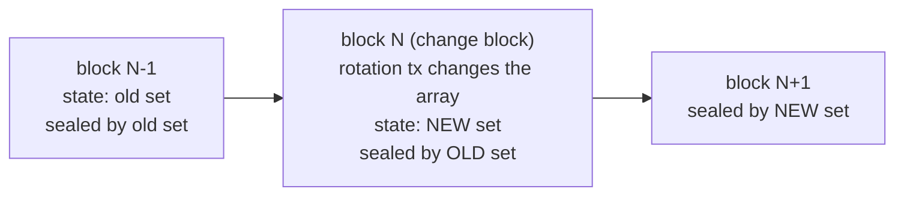
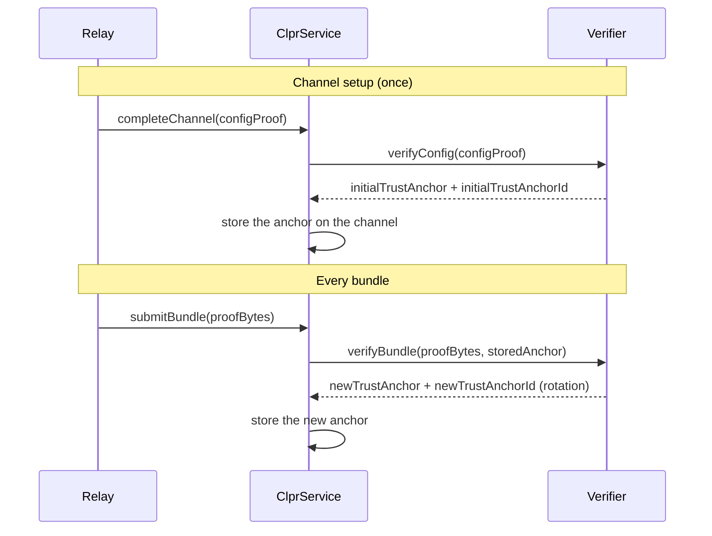
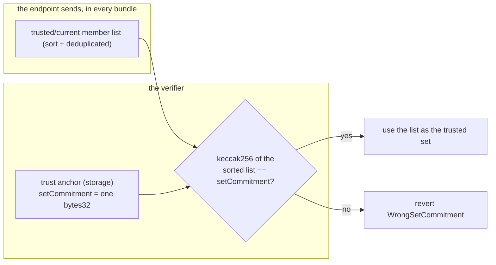
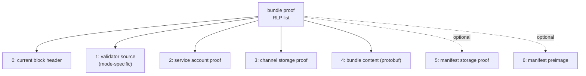
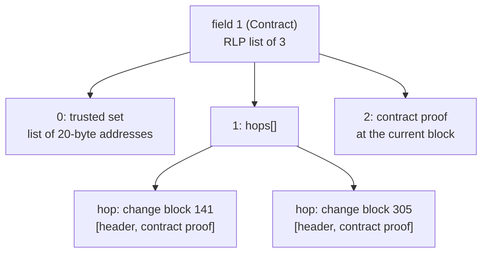
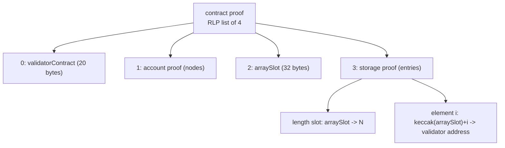
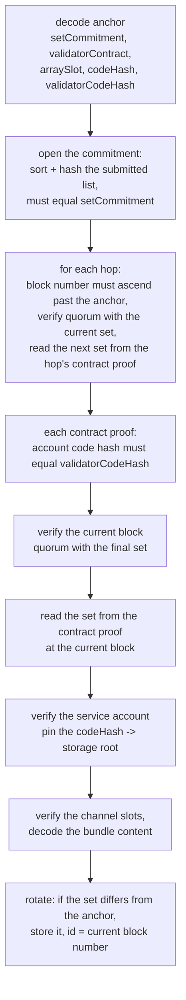

# QBFT validators - Contract mode

A QBFT chain keeps its validator set in one of two places: in each block header, or in a validator
contract on the chain. The trust anchor starts with one mode byte, and this byte selects the
source. This guide describes **Contract mode**: set the mode byte to 1. One channel keeps one mode
for its full life.

We want the verifier to support:

- many validators, with a real quorum,
- the validator contract as the only source of the set,
- set changes at **any block**, with many members changed at one time.

## 1. How this mode works

The contract storage is the only source for validators. `extraData` in header holds **no** validator list.
The set for block `N` comes from the state of block `N-1`. This is a one-block lag.

The seals still live in the header: the `committedSeals` list in `extraData`. There is no other
source for seals.

A rotation is a transaction that changes the `address[] validators` array. If this transaction is
in block `N`:

- the state of block `N` holds the **new** set,
- block `N` is sealed by the **old** set (the lag),
- block `N+1` is sealed by the **new** set.



Block `N` is the **change block**. It is the only block that is sealed by the old set and holds the
new set in state. A contract call can change **many** members at one time, so seal overlap cannot
help here. The verifier must cross the change at block `N` exactly.

## 2. Who builds what

The relay builds the **proof bytes** for each bundle. The relay also builds the **config proof** one
time, at channel setup. The verifier builds and stores the **trust anchor**.



**Relay rule:** track two things. First, the anchor **id** (`newTrustAnchorId`): a **block number**
(8 bytes, big-endian). Use it as a cut-off when you select change blocks for the next proof.
Second, the **member list at that block**: the anchor stores only a hash of it, and every bundle
must carry the full list. Read the list from the contract at the anchor block.

## 3. The trust anchor (the verifier remembers this)

The anchor is an `abi.encode` value. Word 0 is always the mode. The anchor stores **one hash of the
trusted set**, not the list. A list of tens of validators in storage would be too expensive. The
**relay sends the full list in every bundle**, and the verifier compares its hash with the anchor.



`setCommitment = keccak256(abi.encode(sortedMembers))`. One flat hash.
Why not use merkle tree here? The seals
are ECDSA, so the verifier needs **every** member for the membership test and the set size for the
quorum. With the full list always present, one hash is cheaper than member proofs.
(For example Ethereum's sync
committee needs only non-signer proofs because BLS aggregates. ECDSA does not aggregate, we need all.)

| Word | Field | Type | Meaning |
|------|-------|------|---------|
| 0 | mode | uint8 | 1 = Contract |
| 1 | setCommitment | bytes32 | keccak256 of the sorted, deduped trusted set |
| 2 | codeHash | bytes32 | the CLPR service code hash. Pins the account |
| 3 | validatorContract | address | the contract that holds the array |
| 4 | arraySlot | bytes32 | the storage slot of the `address[] validators` array |
| 5 | anchorBlockNumber | uint64 | the block whose state gave this set |
| 6 | validatorCodeHash | bytes32 | the validator contract's code hash. Pins its code |

Encoded as `abi.encode(uint8, bytes32, bytes32, address, bytes32, uint64, bytes32)`, 224 bytes. The
anchor has a fixed size, for any set size.

The verifier checks every contract proof against the pinned `validatorContract`, `arraySlot` and
`validatorCodeHash`. A proof for a different contract or slot reverts (`WrongValidatorContract`,
`WrongArraySlot`). A proof whose validator account carries a different code hash reverts
`WrongValidatorCodeHash`.

**Why pin the validator code.** Besu reads the set by calling the contract. The verifier reads a raw
storage slot. A code change under the same address can move the array while Besu's call keeps
working; the verifier would then read another slot as the set. With the pin, the channel halts
instead, and a new channel confirms the slot against the new code. The pin sees the code at the
address: for a proxy, that is the proxy, not the implementation behind it.

## 4. The bundle proof bytes (the relay builds this)

The bundle proof is one RLP list. It has 7 fields.



| Field | Name | What it holds                                                                                                                                                      |
|-------|------|--------------------------------------------------------------------------------------------------------------------------------------------------------------------|
| 0 | current block header | the block to verify. Holds the state root and the block number                                                                                                     |
| 1 | validator source | starts with the trusted member list. Then the hops and the contract proof |
| 2 | service account proof | proves the CLPR service account under the block state root |
| 3 | channel storage proof | proves the channel slots under the service storage root |
| 4 | bundle content | the protobuf messages |
| 5 | manifest storage proof | optional |
| 6 | manifest preimage | optional |

### Field 1: the hops and the contract proof

**How a rotation works in Contract mode.** In this mode, `extraData` has no validator list. The
contract storage is the only source. The set for block `N` comes from the state of block `N-1`. This
is a one-block lag.

A rotation is a transaction that changes the `address[] validators` array. If this transaction is in
block `N`:

- the state of block `N` holds the **new** set,
- block `N` is sealed by the **old** set (the lag),
- block `N+1` is sealed by the **new** set.


Block `N` is the **change block** for Contract mode. It is the only block that is sealed by the old
set and holds the new set in state. A contract call can change **many** members at one time, so seal
overlap cannot help here. The verifier must cross the change at block `N` exactly.

**How to detect a change.** The headers do not show it. Watch the contract:

1. For each block, read the array with `eth_getStorageAt` (the length slot, then the element slots).
2. Compare the values with the values of the last block.
3. If the values differ, this block is a change block. Store its number.

You can also use rpc call to `eth_getValidatorSetByBlockNumber` to track the change. If the change occurred on
block `n` you need to submit the data from block n-1.

**The shape of field 1.** Field 1 is an RLP list of 3 items:

| Item | Name | What it holds |
|------|------|---------------|
| 0 | trusted set | the full member list behind the anchor's `setCommitment` (sort + dedup, the hash must equal it). An RLP list of 20-byte address items; anything else reverts `InvalidTrustedSet` |
| 1 | hops | a list of rotation hops. Empty when no rotation occurred |
| 2 | contract proof | the contract proof at the **current** block, as a byte string (see below) |

A **hop** is one crossed rotation: `RLP([blockHeader, contractProof])`. The block header is the
change block. The contract proof is taken under the state root of **that** header, and is carried
as a byte string (see below).



**Rules for the hops:**

1. Put the hops in ascending block order. No repeats.
2. Include only hops with a block number after the anchor id.
3. Include one hop for each change after the anchor id. One bundle can cross many rotations.
4. Each hop must use the change block itself. A later block is sealed by the new set and fails.
5. If no change occurred, send an empty hop list. This is the normal case.

**The contract proof.** Each hop, item 2 of field 1, and config field 5 use the same shape: an RLP
list of 4 items, **wrapped in an RLP byte string**. The verifier strips that envelope in place
(`RlpCursor.payloadSlice`) and then reads the list. A bare list in its place reverts
`RlpCursorUnexpectedList`.

```
contractProofItem = RLP(bytes(RLP([validatorContract, accountProof, arraySlot, storageProof])))
```



The storage proof must contain:

- 1 entry for the **length slot**. The slot is `arraySlot`. Its value is `N`.
- `N` entries for the **element slots**. Element `i` is at `keccak256(arraySlot) + i`.

Send the elements in the contract storage order. Do not sort them. The verifier sorts and dedupes.

**How to find `arraySlot`.** Read the storage layout of the deployed validator contract. To verify
the slot, read it with `eth_getStorageAt`. The value must equal the length of the validator list.

## 5. The config proof bytes

The config proof is one RLP list of 8 fields. It creates the first trust anchor.

| Field | Name | What it holds |
|-------|------|---------------|
| 0 | service address | the peer service address |
| 1 | chain id | for example `eip155:1` |
| 2 | peer config nanos | the config time |
| 3 | throttles | RLP list, 5 or 7 items |
| 4 | trust anchor descriptor | `RLP([1, serviceAddress, codeHash, validatorContract, arraySlot])` — 5 items. The validator contract's code hash is not declared here: the verifier takes it from the proven account in field 5 and pins it |
| 5 | validator contract proof | required. The same 4-item shape as in the bundle, wrapped in a byte string |
| 6 | block header | a recent block whose state root proves the contract (field 5) |
| 7 | epoch length | kept for shape. Contract mode does not use it |

## 6. How the verifier checks a bundle



The last step mirrors the Header-mode harvest. The contract proof at the current block refreshes the
anchor on every bundle. One bundle can cross many rotations, one hop for each change block.

**Quorum** means: recover every seal, keep the signers that are in the set, and count the distinct
ones. The count must be at least `ceil(2N/3)`. This matches Besu.

## 7. A mode change on the chain is not supported

A chain can move from Header mode to Contract mode at some block, or back. Besu calls this a
transition.

There is no on-chain proof of a transition. The transition lives in the chain config file, not in
state or headers. An admin swap of the trust anchor can bridge it. But then trust comes from the
admin, not from proofs. The channel is then not trustless.

**For this reason, a channel never changes its verifier.** If the chain makes a transition:

1. Stop the bundles on the old channel.
2. Establish a new channel, with a config proof in the new mode.
3. Continue on the new channel.

**Relay rule:** one channel keeps one mode for its full life. Never send a mode that differs
from the anchor mode.

## 8. Validator-set size: a gas ceiling, not a hard cap

The verifier caps the set at `ClprQbftQuorum.MAX_VALIDATORS = 256`. That cap is structural (the
signer bitmask is one 256-bit word), not a design limit on set size. There is deliberately no
lower hard limit: a chain running with a higher block gas limit must not be locked out by a
number chosen for a block, and the same rule applies elsewhere in the protocol (message counts
are not hard-limited either).

The binding constraint is gas. Every contract-mode bundle re-proves the **whole** array, so cost
grows with the set (see `GAS_REPORT.md` §2), and a rotation proves it twice. Measured on a 30M
block: a 52-validator steady-state bundle is ~2.5M and a 51 → 52 rotation ~4.8M in total, with
calldata already over 40% of the execution cost. Extrapolating from the per-validator terms, a
one-hop rotation crosses ~20M around 200 validators and approaches the block limit near the 256
cap; two hops in one bundle roughly halve those numbers. Before deploying against a Besu network
that expects a validator set in the low hundreds, measure the target block gas limit against
`GAS_REPORT.md` - above that, contract mode is not usable on that chain.
