# QBFT validators - Header mode

A QBFT chain in header mode lists its validator set in every block header.
`QbftHeaderModeVerifier` reads the validator set from the header's `extraData`. Nothing else is
needed to know who may seal a block.

The verifier supports:

- many validators, with a real quorum,
- set changes at **any block**, crossed by a chain of headers,
- **one member per change**, as Besu applies it: every accepted header may add or remove one
  member, and must be sealed by (almost) a quorum of the set the verifier already trusts.

One channel keeps one mode for its full life. The trust anchor starts with a mode byte; Header mode
is mode `0`. The shared payload, storage proof and revert catalogue are in
[qbft-verifier.md](qbft-verifier.md).

## 1. How this mode works

Every block header carries the full validator list in `extraData`:

```
extraData = RLP([vanity(32), validators[], vote, round, committedSeals[]])
```

Two fields matter:

- `validators[]` — the validator set this header lists.
- `committedSeals[]` — the validators' seals over this header.

A **rotation** is a vote that adds or removes a member. Besu applies at most **one** change per
block. So two neighbouring headers list sets that differ by at most one member. The **change block**
is the first header whose `validators[]` lists the new set.

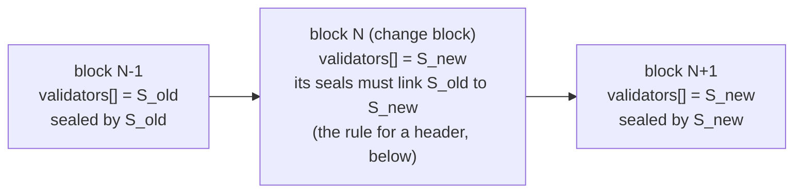

The verifier does not check every block. It checks the headers the relay sends: the **hops** and
the **current block**. Each accepted header may move the trusted set by one member, and it must be
sealed by the set that was trusted before it. So the relay sends one hop for every change block
between the anchor block and the current block. The current header may itself be the one change
block.

## 2. The rule for a header

For a header `H` with validator list `V_H` and seals `seals_H`, while the verifier trusts the set
`T` of size `n`, with quorum `q = ceil(2n / 3)`:

1. **One change at most.** `V_H` is `T`, or `T` plus one member, or `T` minus one member.
   Besu applies one vote per block, so two neighbouring headers never differ by more.
2. **The old set sealed it.** Count the distinct members of `T` among the signers of `H`:

   | Change | Signers of `T` required |
   |---|---|
   | none (`V_H == T`) | `q` |
   | one member removed | `q − 1`, and at least 1 |
   | one member added, and the new member signed | `q − 1`, and at least 1 |
   | one member added, and the new member did **not** sign | `q` |

3. **Own quorum.** At least `ceil(2·|V_H| / 3)` distinct members of `V_H` signed `H`.
   This is the QBFT finality rule, the same one Besu applies.

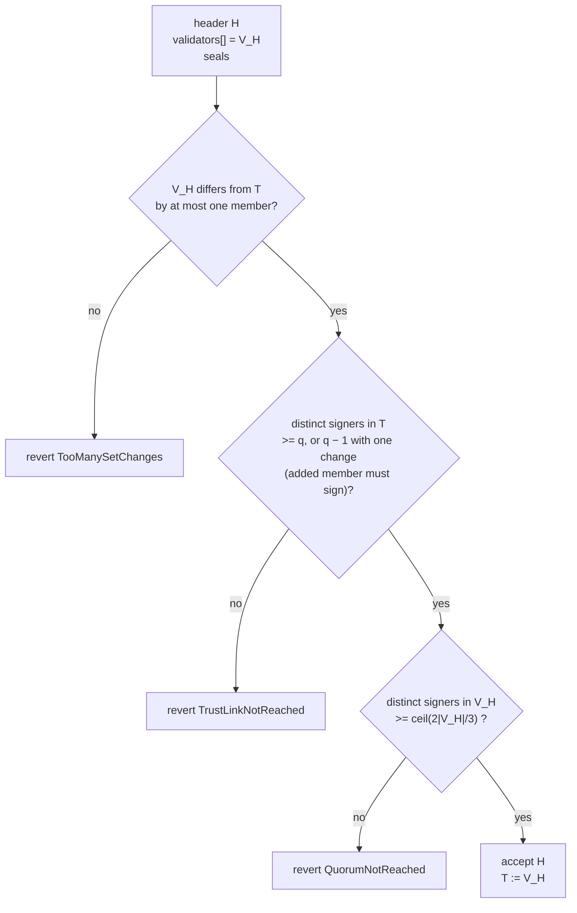

When `V_H == T` the three checks collapse into the plain quorum check.

**Why rule 1 exists.** Rule 3 alone proves that *some* set finalized `H`. It does not prove that this
set is the real successor of `T`: an attacker can invent a set and seal a header with it. With rule
1 an accepted header can move the trusted set by one key only, and rule 2 requires that almost a
quorum of the keys the verifier already trusts vouched for it. An attacker who does not hold those
keys cannot move the set at all; one who holds a few cannot jump to an invented set in one step.

**Why `− 1`.** A change block is sealed around the change itself. When a member leaves, the seals
may miss exactly that member. When a member joins, the newcomer's seal may stand in for one old
seal. In both cases a full `q` of the old set is not always present, so one signer fewer keeps every
legitimate change block acceptable.

**Why the newcomer must sign to get the `− 1`.** With `q − 1` old signers the header is one vote
short of an old quorum. The newcomer's own seal is that vote: the header then carries a quorum of
the new list, and all of those signers but one are keys the verifier already trusts. Without the
newcomer's seal there is no reason to accept one vote fewer, so the full old quorum is required.

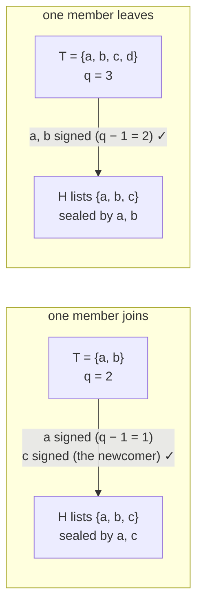

| n | q | q − 1 |
|---|---|---|
| 1 | 1 | 1 |
| 2 | 2 | 1 |
| 3 | 2 | 1 |
| 4 | 3 | 2 |
| 7 | 5 | 4 |
| 10 | 7 | 6 |
| 21 | 14 | 13 |

A set of one or two has no fault tolerance: one old key is enough to move it (with the newcomer's
key, for an addition). A set of three needs two signers for any change, and two is already its full
quorum. QBFT itself gives sets of this size no fault tolerance either.

`ClprQbftQuorum.verifyRotationStep` applies the three rules, and `trustLinkRequired` gives the rule 2
threshold.

## 3. Who builds what

The relay builds the **proof bytes** for each bundle. The relay also builds the **config proof** one
time, at channel setup. The verifier builds the **trust anchor**, and `ClprService` stores it on the
channel.

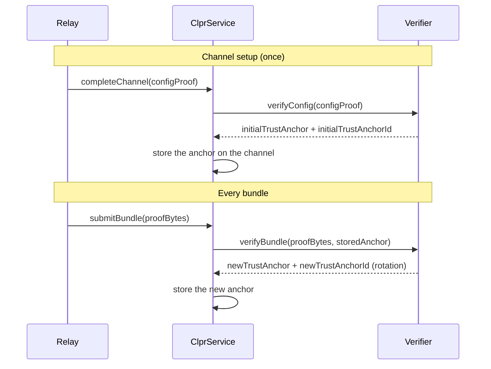

`verifyBundle` returns a new anchor only when the set changed or the bundle crossed hops; otherwise
`newTrustAnchor` and `newTrustAnchorId` are empty and `ClprService` keeps the stored anchor.

**Relay rule:** track two things. First, the anchor **id** (`newTrustAnchorId`): a **block number**
(8 bytes, big-endian). Use it as a cut-off when you select change blocks for the next proof. Every
hop and the current block must be after it. Second, the **member list at that block**: the anchor
stores only a hash of it, and a bundle carries the full list unless it uses the empty-list shortcut
(see [Field 1](#field-1-the-trusted-set-and-the-hops)). Read the list from `extraData.validators` of
the anchor block header.

## 4. The trust anchor (ClprService stores this)

The anchor is an `abi.encode` value. Word 0 is always the mode. The anchor stores **one hash of the
trusted set**, not the list. A list of tens of validators in storage would be too expensive. The
**relay sends the full list in the bundle**, or an empty list when the current header lists the same
set, and the verifier compares the list's hash with the anchor.

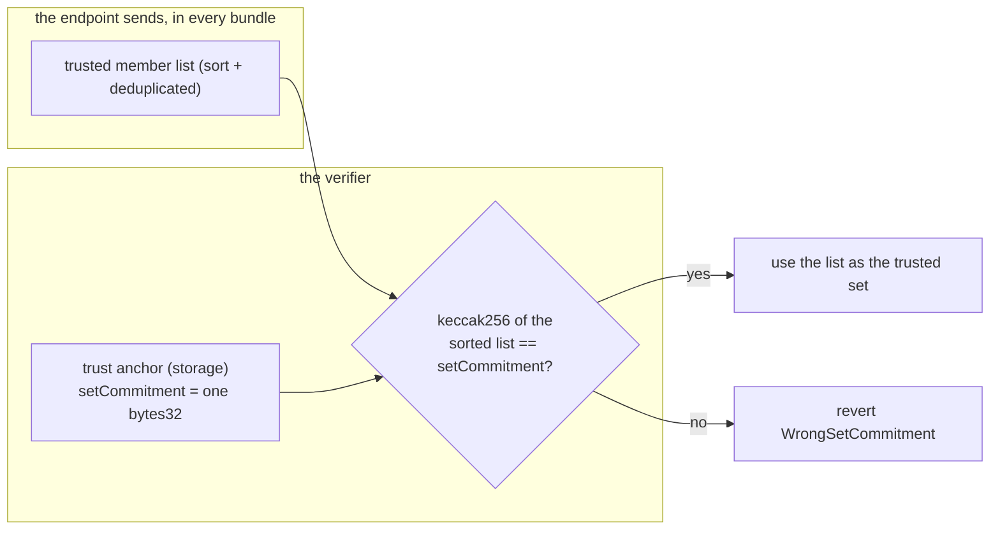

`setCommitment = keccak256(abi.encode(sortedMembers))`. One flat hash. The seals are ECDSA, so the
verifier needs **every** member for the membership test and the set size for the quorum. With the
full list always present, one hash is cheaper than member proofs.

| Word | Field | Type | Meaning |
|------|-------|------|---------|
| 0 | mode | uint8 | 0 = Header |
| 1 | setCommitment | bytes32 | keccak256 of the sorted, deduped trusted set |
| 2 | codeHash | bytes32 | the CLPR service code hash. Pins the account |
| 3 | anchorBlockNumber | uint64 | the block whose header listed this set |

Encoded as `abi.encode(uint8, bytes32, bytes32, uint64)`, 128 bytes (`_encodeHeaderAnchor`). The
anchor has a fixed size, for any set size. `_decodeTrustAnchor` reverts `InvalidTrustAnchor` on any
other length and `UnknownValidatorMode(mode)` when word 0 is not `0`.

## 5. The bundle proof bytes (the relay builds this)

The bundle proof is one RLP list of 5 fields, or 7 when it carries an endpoint-manifest update.

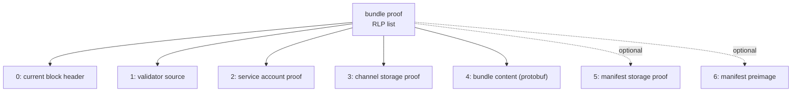

| Field | Name | What it holds |
|-------|------|---------------|
| 0 | current block header | the block to verify. Holds the state root, the block number, and in `extraData` the validator list and the seals |
| 1 | validator source | the trusted member list, then the hops |
| 2 | service account proof | proves the CLPR service account under the block state root |
| 3 | channel storage proof | proves the channel slots under the service storage root |
| 4 | bundle content | the protobuf messages |
| 5 | manifest storage proof | optional |
| 6 | manifest preimage | optional |

### Field 1: the trusted set and the hops

Field 1 is an RLP list of 2 items.

| Item | Name | What it holds |
|------|------|---------------|
| 0 | trusted set | the full member list behind the anchor's `setCommitment` (sort + dedup, the hash must equal it). An RLP list of at most 256 non-zero 20-byte address items, each the fixed 21-byte item Besu writes. **May be an empty list** when the current header lists the anchor's set, see below |
| 1 | hops | a list of block headers. Empty when no rotation occurred |

Any other item count in field 1 reverts `InvalidPayloadShape`.

A **hop** is one block header (at least 15 fields). Nothing else. The header's `extraData` holds
both the new set (`validators[]`) and the seals that prove it.

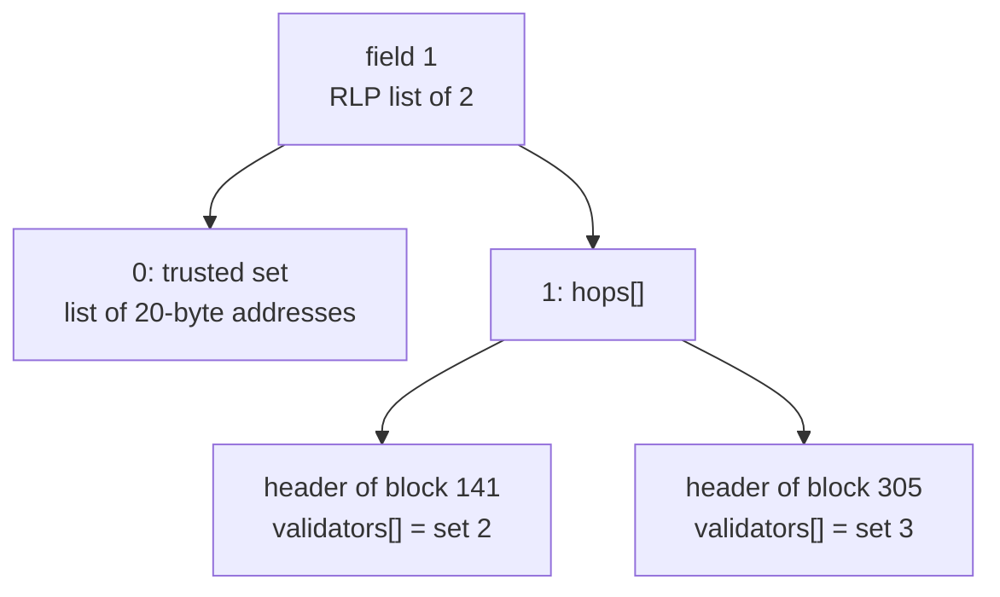

**Skipping the trusted set.** When no rotation is crossed, the current header already lists the
trusted set in its own `extraData.validators`. The relay may then send item 0 as an **empty list**
(`0xc0`) and save the calldata (`_trustedSet`). The verifier takes the current header's list
instead, sorts it, and checks its hash against the anchor exactly as it would check a submitted
list. If the header lists a different set, the hash does not match and the bundle reverts
`WrongSetCommitment`. So the shortcut works only when the current header lists the anchor's set:
in practice, a bundle with no hops whose current header is not a change block. `GAS_REPORT.md`
measures the saving.

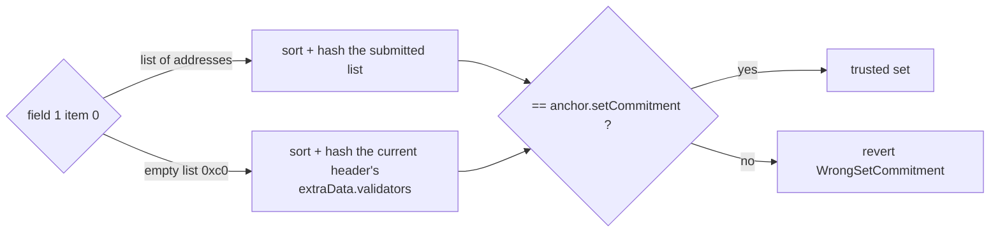

An empty **byte string** (`0x80`) is not the shortcut: it is a malformed list and reverts
`InvalidTrustedSet`.

**Rules for the hops:**

1. Put the hops in ascending block order. No repeats (`HandoffHeaderNotAscending`).
2. Include only hops with a block number after the anchor id.
3. Each hop must pass [the rule for a header](#2-the-rule-for-a-header) against the set trusted at
   that point.
4. Include a hop for **every** change block after the anchor block and before the current block. A
   hop moves the trusted set by one member at most, so two changes need two hops. A header that lists
   the trusted set again is a valid hop too; it only advances the anchor block. The current header
   may carry one more change itself, with no hop.
5. If no change occurred, send an empty hop list. This is the normal case. You may then also send
   the trusted set as an empty list (see above).
6. The current block must be after the last hop (`CurrentHeaderBehindWalk`).

**How to detect a change.** Compare `extraData.validators` of two consecutive headers. When they
differ, the later block is a change block. `eth_getBlockByNumber` returns the header; Besu also
offers `qbft_getValidatorsByBlockNumber`.

**Which header to send for a change.** Send the header whose `validators[]` already lists the new
set: the change block `N` itself. Rule 2 counts its signers against the previous set (`q − 1` of
it, plus the newcomer when one joined), and rule 3 counts them against the new list.

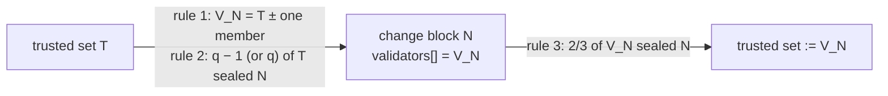

## 6. The config proof bytes

The config proof is one RLP list of 6 fields. It creates the first trust anchor. It is passed to
`verifyConfig(configProofBytes, channelId, endpointManifestProofBytes)`.

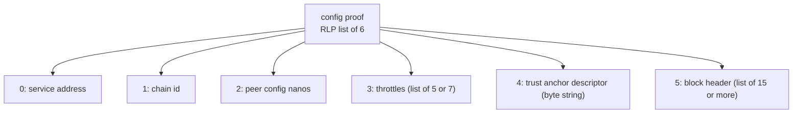

### 6.1 Top-level fields

| Field | Name | RLP type | Size | Value |
|-------|------|----------|------|-------|
| 0 | service address | byte string | 20 bytes | the peer CLPR service address |
| 1 | chain id | byte string | any | UTF-8, for example `eip155:1` |
| 2 | peer config nanos | scalar | ≤ 32 bytes, truncated to `uint96` | the config time |
| 3 | throttles | list | 5 or 7 scalars | see the throttles table below |
| 4 | trust anchor descriptor | byte string | any | wraps the descriptor list below |
| 5 | block header | list | 15 items or more | see the block header table below |

Any other count reverts `InvalidProofPayloadShape`; empty config bytes revert `InvalidPayloadShape`.

### 6.2 Field 3: throttles

| Item | Name | Type | Present |
|------|------|------|---------|
| 0 | maxMessagesPerBundle | uint32 | always |
| 1 | maxMessagePayloadBytes | uint64 | always |
| 2 | maxGasPerMessage | uint64 | always |
| 3 | maxQueueDepth | uint32 | always |
| 4 | maxSyncBytes | uint64 | always |
| 5 | maxLocalEndpoints | uint32 | 7-item list only; 0 otherwise |
| 6 | maxPeerEndpoints | uint32 | 7-item list only; 0 otherwise |

A 5-item list is the legacy shape. Any other count reverts `InvalidConfigThrottleFieldCount`.

### 6.3 Field 4: the trust anchor descriptor

Field 4 is a byte string. Its bytes are an RLP list of 2 items:

```
RLP([mode, codeHash])
```

| Item | Name | RLP type | Size | Value |
|------|------|----------|------|-------|
| 0 | mode | scalar | 1 byte | `0`. Any other value reverts `UnknownValidatorMode` |
| 1 | codeHash | byte string | 32 bytes | `keccak256` of the peer service code. Pinned in the anchor |

Any other item count reverts `InvalidTrustAnchorFields`.

### 6.4 Field 5: the block header

A Besu block header as the node returns it: an RLP list of at least 15 items (`InvalidConfigHeader`
otherwise; `verifyConfig` sets no upper bound). The verifier reads three
of them.

| Index | Name | Used for |
|-------|------|----------|
| 3 | stateRoot | not used at config time (no storage is proven here) |
| 8 | number | `anchorBlockNumber`, and the anchor id |
| 12 | extraData | byte string wrapping the QBFT list below |

`extraData` unwraps to an RLP list of 5 items:

| Item | Name | RLP type | Value |
|------|------|----------|-------|
| 0 | vanity | byte string, 32 bytes | ignored |
| 1 | validators | list of non-zero 20-byte addresses | **the initial trusted set** |
| 2 | vote | list | ignored |
| 3 | round | scalar | ignored |
| 4 | committedSeals | list of 65-byte strings | checked against item 1 |

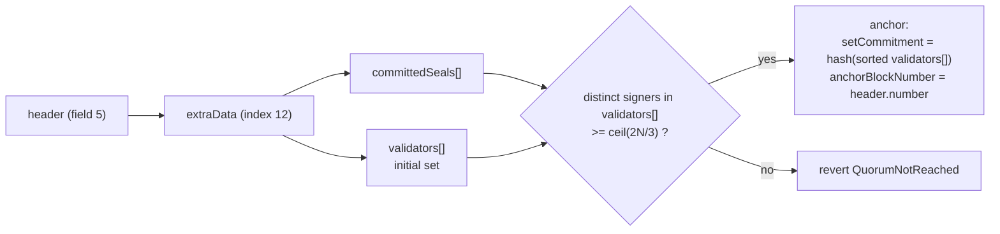

The config header is trusted by the channel creator. The quorum check on it only proves the header
is self-consistent: the set it lists did seal it.

### 6.5 What comes out

| Output | Value |
|--------|-------|
| channelContext | `channelId ‖ serviceAddress` (`ClprTypes.encodeChannelContext`, `abi.encodePacked`) |
| chainId | field 1 as a string |
| serviceAddress | field 0 |
| peerConfigNanos | field 2 |
| throttles | field 3 decoded |
| initialTrustAnchor | 128 bytes, the [trust anchor](#4-the-trust-anchor-clprservice-stores-this): mode 0, hash of the sorted set, codeHash, header number |
| initialTrustAnchorId | header number, 8 bytes big-endian |
| endpointManifest | from `endpointManifestProofBytes`, see below |

### 6.6 The endpoint manifest proof (second argument)

Empty bytes mean "no manifest yet" and return the uninitialised manifest at version 0. Otherwise:

```
RLP([blockHeader, accountProof, manifestStorageProof, manifestPreimage])
```

| Item | Name | Value |
|------|------|-------|
| 0 | blockHeader | a header of at least 15 fields, sealed by a quorum of the initial set (the set listed in field 5). Its own `validators[]` is not read |
| 1 | accountProof | the peer service account under `blockHeader.stateRoot`; no code-hash pin at config time |
| 2 | manifestStorageProof | storage proof of the manifest commitment slot (slot 18) |
| 3 | manifestPreimage | the `ClprEndpointManifest` protobuf; its `keccak256` must equal the proven slot |

## 7. How the verifier checks a bundle

`QbftHeaderModeVerifier.verifyBundle`, with the walk in `_walkHeaders`:

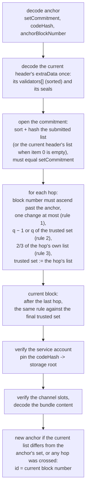

**Quorum** means: recover the seals in order, keep the signers that are in the set, and count the
distinct ones. The count must be at least `ceil(2N/3)`. This matches Besu. The loop stops once the
count is reached, so later seals are not recovered.

**The change** is found by one merge pass over the two sorted lists: members only in the header's
list were added, members only in the trusted set were removed. More than one in total reverts
before any seal is recovered.

**Recover once, count twice.** Each seal is one `ecrecover`. `_countSealers` recovers each seal
once, counts the recovered address against both sets, and notes whether it is the added member.
Rules 2 and 3 do not pay for the seals twice. It stops once both sets have a full quorum of signers.
When the lists are equal, only one set is counted.

**Decode once.** `ClprQbftSeal.decodeHeader` decodes each header's `extraData` once and returns the
validator list, the seals and the sealing digest together.

The current header's `validators[]` becomes the new trusted set whenever it differs from the
anchor's set. A bundle that crossed hops returns a new anchor even when the set nets to the anchor's
set: the commitment stays, and the anchor block moves to the current block, so the hops cannot be
replayed. With no change and no hops, `newTrustAnchor` and `newTrustAnchorId` are empty. One bundle
can cross many rotations, one hop for each change block.

## 8. What can go wrong

| Selector | Cause |
|---|---|
| `WrongSetCommitment(got, expected)` | the submitted list does not hash to the anchor; or item 0 was empty and the current header lists another set (it is a change block, or the bundle crossed hops) |
| `TooManySetChanges(added, removed)` | rule 1 failed: the header's list differs from the trusted set by more than one member |
| `TrustLinkNotReached(got, required)` | rule 2 failed: too few members of the trusted set sealed the header |
| `QuorumNotReached(got, required)` | rule 3 failed on a hop or on the current block, or the plain quorum check failed (list equal to the trusted set, the config header, the manifest header) |
| `HandoffHeaderNotAscending(got, lastSeen)` | hops out of order, or a hop at or before the anchor block |
| `CurrentHeaderBehindWalk(got, lastSeen)` | the current block is not after the last hop, or after the anchor block when there are no hops |
| `EmptyValidatorSet()` | a header lists no validators |
| `ValidatorSetTooLarge(n)` | a header or the trusted list has more than 256 members |
| `EmptySeals()` | a header carries no committed seals |
| `InvalidHeader()` | a header's `validators[]` item is not a list of non-zero 21-byte address items; the current header is outside [15, 22] fields; a hop has fewer than 15 fields |
| `InvalidTrustedSet()` | bundle field 1 item 0 is not a list of non-zero 21-byte address items (an empty byte string `0x80` included) |
| `InvalidPayloadShape()` | the payload is not 5 or 7 fields; bundle field 1 is not a list of 2 items; empty config bytes |
| `InvalidTrustAnchor()` / `UnknownValidatorMode(mode)` | the anchor is not 128 bytes, or word 0 is not `0`; also a descriptor mode other than `0` |
| `InvalidProofPayloadShape()` | the config proof is not 6 fields, or the manifest proof is not 4 items |
| `InvalidConfigHeader()` / `InvalidConfigThrottleFieldCount()` / `InvalidTrustAnchorFields()` | config or manifest header below 15 fields; throttles not 5 or 7 items; descriptor not 2 items |

Errors from the seal parser, the service account proof and the channel proof are listed in
[qbft-verifier.md](qbft-verifier.md#7-reverts).

## 9. A mode change on the chain is not supported

A chain can move between header mode and a validator contract at some block. Besu calls this a
transition. There is no on-chain proof of a transition. **A channel never changes its verifier**:
`completeChannel` sets `Channel.verifier` once, and only `verifyConfig` and `verifyBundle` results
ever write `Channel.trustAnchor`. If the chain makes a transition:

1. Stop the bundles on the old channel.
2. Establish a new channel, with a config proof for the new mode.
3. Continue on the new channel.

**Relay rule:** one channel keeps one mode for its full life. Never send a mode that differs
from the anchor mode.
