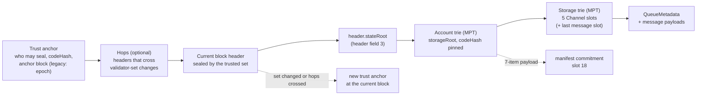
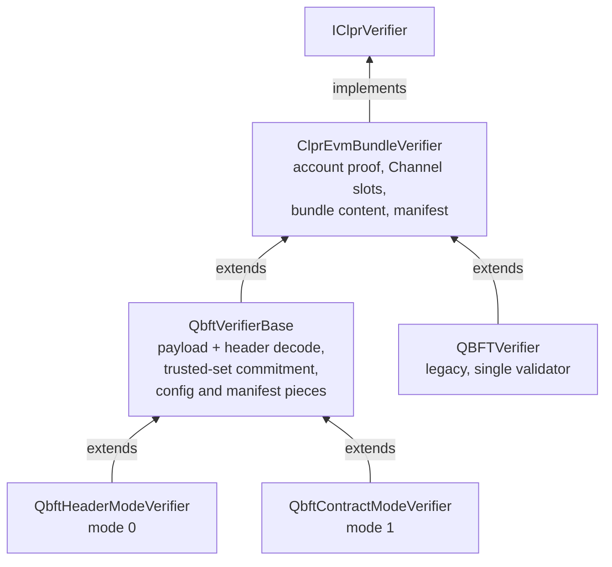
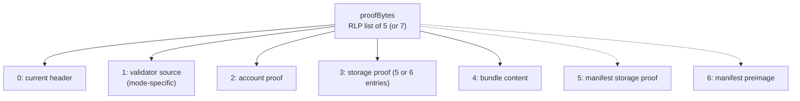
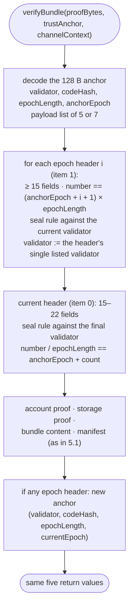
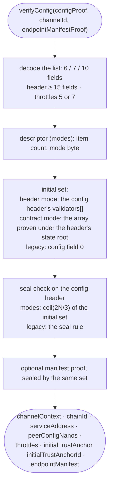
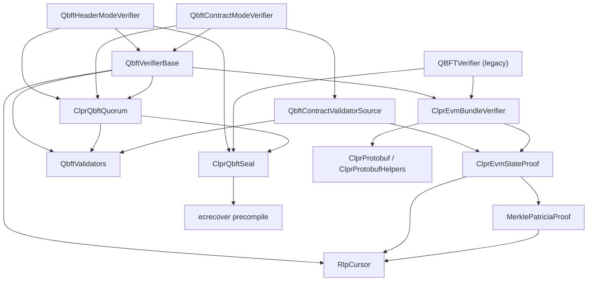

# QBFT verifiers

> **Sources**: [QbftHeaderModeVerifier.sol](./QbftHeaderModeVerifier.sol), [QbftContractModeVerifier.sol](./QbftContractModeVerifier.sol), [QbftVerifierBase.sol](./QbftVerifierBase.sol), [QBFTVerifier.sol](./QBFTVerifier.sol) (legacy)
> **Base**: [ClprEvmBundleVerifier.sol](../common/ClprEvmBundleVerifier.sol)
> **Interface**: [IClprVerifier.sol](../../../interfaces/IClprVerifier.sol)
> **Mode specs**: [qbft-header-mode.md](qbft-header-mode.md), [qbft-contract-mode.md](qbft-contract-mode.md) · **Gas**: [GAS_REPORT.md](GAS_REPORT.md)

---

## 1. The big picture

The QBFT verifiers prove that a bundle of CLPR messages exists in the peer `ClprService`'s storage on
a **Besu QBFT** chain. A QBFT block header carries the committed seals of its validators (ECDSA
signatures) in `extraData`. When enough seals from a trusted validator set recover correctly, the
header's `stateRoot` is trusted. Merkle-Patricia proofs under that root then prove the peer service
account and its channel storage.



Each arrow is a check the contract makes. If one fails, the whole call reverts.

The verifiers keep no storage. `QbftHeaderModeVerifier` and `QbftContractModeVerifier` are `pure`;
the legacy `QBFTVerifier` is `view` and reads one immutable, `MIN_COMMITTED_SEALS`. All trust comes
from the `trustAnchor` argument, which `ClprService` keeps in `Channel.trustAnchor`: `completeChannel`
stores the anchor that `verifyConfig` returns, and `submitBundle` replaces it when `verifyBundle`
returns a non-empty `newTrustAnchor` (`BundleLib`). `channelContext` is `channelId ‖
remoteServiceAddress` (`ClprTypes.encodeChannelContext`, which uses `abi.encodePacked`). The verifier
derives every storage slot it proves from that `channelId`.

### Trust assumption: validator keys identify the chain

A QBFT header is authenticated by its committed seals alone. The sealed hash carries no chain id, so
nothing in a header ties it to one network. The verifier trusts the validator **keys**, not a chain
identity. If the same keys seal blocks on more than one network — a fork, or a test network cloned
from production with the same contract addresses — a relay can present a header from the other
network and the verifier cannot tell them apart. The anchor's `codeHash` and the service address
narrow this, but a clone shares both. **Operators must not reuse validator keys across networks a
channel could be pointed at.** This applies to all three verifiers.

---

## 2. The three verifiers and how they differ

The verifiers differ in **where the validator set comes from** and how a change of that set is
crossed. Everything below the state root is shared.

| | `QbftHeaderModeVerifier` | `QbftContractModeVerifier` | `QBFTVerifier` (legacy) |
|---|---|---|---|
| Validator set comes from | `extraData.validators[]` of each header | an `address[]` array in a validator contract's storage, proven on every bundle | one validator address in the anchor, replaced at each epoch header |
| Extends | `QbftVerifierBase` | `QbftVerifierBase` | `ClprEvmBundleVerifier` |
| Header accepted when | `ceil(2N/3)` distinct in-set signers, plus the one-change rotation rule | `ceil(2N/3)` distinct in-set signers | at least `MIN_COMMITTED_SEALS` seals, and one of them recovers to the anchored validator |
| A set change is crossed by | one hop header per change block; at most one member changes per header | one hop `[header, contractProof]` per change block; any number of members may change | one header at every epoch boundary, each listing exactly one validator |
| Trust anchor | 128 B, mode byte `0` | 224 B, mode byte `1` | 128 B, no mode byte |
| Anchor id | block number, 8 bytes big-endian | block number, 8 bytes big-endian | epoch number, 8 bytes big-endian |
| Config proof | RLP list of 6 | RLP list of 7 | RLP list of 10 |
| Constructor | none | none | `uint8 _sealSignatures`, must be ≥ 1 |
| Spec | [qbft-header-mode.md](qbft-header-mode.md) | [qbft-contract-mode.md](qbft-contract-mode.md) | [The legacy QBFTVerifier](#66-the-legacy-qbftverifier) |



**Nothing routes between them.** Each verifier is a separate contract. `ClprService` calls the
verifier that `completeChannel` recorded in `Channel.verifier`, and nothing changes that field later.
A mode verifier rejects the other mode's anchor (`InvalidTrustAnchor`: the lengths differ) and
config proof (`InvalidProofPayloadShape`: the field counts differ); an anchor or descriptor of the
right size whose mode word is not this verifier's reverts `UnknownValidatorMode(mode)`. So one
channel keeps one verifier, and one mode, for its full life. A
chain that moves between header and contract validator selection (a Besu transition) needs a new
channel; see the mode specs.

**Deployment.** `deployCore.deployE2EWithQbftVerifier` (deploy mode `e2e-with-qbft-verifier`)
deploys `QbftHeaderModeVerifier`. `deployCore.deployQbftVerifier` (deploy mode `qbft-verifier`,
which `bin/verifier.sh qbft` runs) deploys the legacy `QBFTVerifier` with `MIN_COMMITTED_SEALS = 1`,
unless `QBFT_VERIFIER` names an existing address; it carries TODO #443 to deploy
`QbftHeaderModeVerifier` instead. No deploy mode deploys `QbftContractModeVerifier`. The release
bundle (`CONTRACTS` in `.github/workflows/support/scripts/pack_release_artifact.sh`) ships all three.

**Legacy status.** `QBFTVerifier.sol` carries TODO #443 to remove the file. Under the same TODO the
CI coverage run (`600-flow-pull-request-checks.yaml`) and
`VerifierComplianceCoverage._isExcluded` exclude it. No Forge suite tests it, and no builder in this
repository produces its config or bundle shapes.

### Compared with the other verifier families

| | QBFT | [Ethereum](../ethereum/README.md) | [Sei](../sei/README.md) | [Hiero](../../hiero/hiero-verifier.md) |
|---|---|---|---|---|
| Block authentication | ECDSA committed seals in the header's `extraData` | sync-committee BLS12-381 aggregate over the beacon header | CometBFT Ed25519 commit signatures, > 2/3 voting power | TSS aggregate signature (`TSSVerifier`) over the block root |
| State root from | `stateRoot` field of the EVM block header | SSZ branch from the beacon `bodyRoot` | ICS-23 multistore proof to `app_hash` | Hiero `StateProof` Merkle paths |
| Extends `ClprEvmBundleVerifier` | yes | yes | yes | no |

---

## 3. Configuration & trust anchors

Every anchor is an `abi.encode` value of fixed size. The two mode anchors hold **one hash of the
trusted set**, not the list: the relay sends the full list in every bundle that needs it, and the
verifier compares its hash with the anchor. The mode specs explain why a flat hash is used.

### 3.1 Header mode anchor

`QbftHeaderModeVerifier._encodeHeaderAnchor`:

| Word | Field | Type | Meaning |
|---|---|---|---|
| 0 | mode | `uint8` | `0` (`QbftValidatorMode.Header`) |
| 1 | setCommitment | `bytes32` | `QbftValidators.commit` of the sorted, deduped trusted set |
| 2 | codeHash | `bytes32` | the peer `ClprService` code hash |
| 3 | anchorBlockNumber | `uint64` | the block whose header listed this set |

`abi.encode(uint8, bytes32, bytes32, uint64)`, 128 bytes. `verifyConfig` takes the initial set from
the config header's own `extraData.validators`, and the header must be sealed by a quorum of that
set.

### 3.2 Contract mode anchor

`QbftContractModeVerifier._encodeContractAnchor`:

| Word | Field | Type | Meaning |
|---|---|---|---|
| 0 | mode | `uint8` | `1` (`QbftValidatorMode.Contract`) |
| 1 | setCommitment | `bytes32` | `QbftValidators.commit` of the sorted trusted set |
| 2 | codeHash | `bytes32` | the peer `ClprService` code hash |
| 3 | validatorContract | `address` | the contract that holds the validator array |
| 4 | arraySlot | `bytes32` | the storage slot of the `address[]` array |
| 5 | anchorBlockNumber | `uint64` | the block whose state gave this set |
| 6 | validatorCodeHash | `bytes32` | the validator contract's code hash, pinned at config time |

`abi.encode(uint8, bytes32, bytes32, address, bytes32, uint64, bytes32)`, 224 bytes. `verifyConfig`
proves the array under the config header's state root and takes `validatorCodeHash` from the proven
validator-contract account; the descriptor does not declare it.

### 3.3 Legacy anchor

`QBFTVerifier` has no mode byte:

| Offset | Type | Field | Meaning |
|---|---|---|---|
| 0x00 | `address` | validator | the validator whose seal must be among the seals of every header checked at this anchor |
| 0x20 | `bytes32` | codeHash | the peer `ClprService` code hash |
| 0x40 | `uint64` | epochLength | blocks per epoch |
| 0x60 | `uint64` | epochNumber | the epoch this anchor covers |

`abi.encode(address, bytes32, uint64, uint64)`, 128 bytes. A rotation returns
`abi.encode(validator, codeHash, epochLength, currentEpoch)` and `abi.encodePacked(currentEpoch)`;
`codeHash` and `epochLength` never change. The constructor argument sets `MIN_COMMITTED_SEALS` and
reverts `InvalidNumberOfSealSignatures` on 0.

### 3.4 The config proof

`verifyConfig(configProofBytes, channelId, endpointManifestProofBytes)` takes one RLP list. The two
mode verifiers share fields 0–4:

| Field | Header mode (6) | Contract mode (7) | Legacy (10) |
|---|---|---|---|
| 0 | service address (20 bytes) | service address | validator address |
| 1 | chain id (UTF-8, e.g. `eip155:1`) | chain id | service address |
| 2 | peer config nanos | peer config nanos | not read |
| 3 | throttles | throttles | chain id |
| 4 | descriptor: byte string wrapping `RLP([0, codeHash])` | descriptor: byte string wrapping `RLP([1, serviceAddress, codeHash, validatorContract, arraySlot])` | peer config nanos |
| 5 | block header (≥ 15 items) | validator contract proof, wrapped in a byte string | throttles |
| 6 | — | block header (≥ 15 items) | trust anchor: byte string wrapping `RLP([validator, _, codeHash])` |
| 7 | — | — | not read |
| 8 | — | — | block header (≥ 15 items) |
| 9 | — | — | epoch length |

In contract mode, descriptor item 1 (`serviceAddress`) is not read; the channel's service address is
field 0. In the legacy config, field 6 item 1 is not read, and the anchor's `validator` (field 6
item 0) is not compared with the validator whose seal is checked on the config header (field 0).

The throttles are a list of 5 or 7 scalars, decoded by `QbftVerifierBase._decodeConfigThrottles`
(the legacy verifier decodes the same shape inline):

| Item | Field | Type |
|---|---|---|
| 0 | `maxMessagesPerBundle` | `uint32` |
| 1 | `maxMessagePayloadBytes` | `uint64` |
| 2 | `maxGasPerMessage` | `uint64` |
| 3 | `maxQueueDepth` | `uint32` |
| 4 | `maxSyncBytes` | `uint64` |
| 5 | `maxLocalEndpoints` | `uint32`, 7-item list only; 0 otherwise |
| 6 | `maxPeerEndpoints` | `uint32`, 7-item list only; 0 otherwise |

Scalars are read as `uint256` and truncated to the field type; peer config nanos is truncated to
`uint96`. `ClprService` then rejects zero values in items 0–4 (`ClprTypes.validateThrottles`) and a
chain id that does not derive the channel id (`ChannelLogic._createChannel`).

**Outputs.** `channelContext = channelId ‖ serviceAddress`. The initial anchor is the mode's layout
above. `initialTrustAnchorId` is the header number (modes) or the epoch number `header.number /
epochLength` (legacy), 8 bytes big-endian.

The seal check on the config header only proves the header is self-consistent: the set it names did
seal it. The channel creator trusts that header.

**A zero `codeHash` disables the pin.** `ClprEvmBundleVerifier._verifyServiceStorageRoot` skips
the code-hash comparison when the expected hash is zero, and every `verifyBundle` passes the
anchor's `codeHash` to it.

### 3.5 The config-time endpoint manifest proof

Empty `endpointManifestProofBytes` returns the uninitialised manifest at version 0
(`_uninitializedEndpointManifest`); the first proven manifest then applies through `submitBundle`.
Otherwise:

```
RLP([blockHeader, accountProof, manifestStorageProof, manifestPreimage])
```

The header must have at least 15 fields. The mode verifiers check its seals with
`ClprQbftQuorum.verifyQuorum` against the initial set; the header's own validator list is not read.
The legacy verifier applies its single-validator seal rule. The account proof is checked with no
code-hash pin (the anchor pins it at bundle time); the storage proof must prove the manifest
commitment slot, and the preimage's `keccak256` must equal it.

---

## 4. Proof layout

`proofBytes` is one RLP list of **5** items, or **7** when the bundle carries an endpoint-manifest
update. All three verifiers use this shape; only item 1 differs.

| # | Item | Contents |
|---|---|---|
| 0 | current block header | RLP list of 15–22 fields. Field 3 = `stateRoot`, field 8 = `number`, field 12 = `extraData`. |
| 1 | validator source | Mode-specific, see below. |
| 2 | account proof | RLP list of MPT nodes for the peer service account under `header.stateRoot`. |
| 3 | storage proof | RLP list of **5 or 6** entries `[slot, proofNodes]`. No value field: the value is read from the leaf. |
| 4 | bundle content | Byte string: protobuf `ClprBundleContent`. |
| 5 | manifest storage proof | *(7-item only)* entries proving the manifest commitment slot. |
| 6 | manifest preimage | *(7-item only)* `ClprEndpointManifest` protobuf; its `keccak256` must equal the proven slot. |



**Item 1, the validator source:**

| Verifier | Item 1 | Hop |
|---|---|---|
| Header mode | `[trustedSet, hops[]]`; `trustedSet` may be an empty list (`0xc0`) when the current header lists the anchor's set | one block header (≥ 15 fields) |
| Contract mode | `[trustedSet, hops[], contractProof]`; `contractProof` is taken at the current block | `[blockHeader, contractProof]` |
| Legacy | `epochHeaders[]`, 0..N headers in ascending epoch order | — |

### Storage slots

The verifier derives every slot key from `channelId`; it never takes a key from the proof
(`ClprEvmBundleVerifier._channelMetadataSlots`, `_lastMessageRunningHashSlot`,
`ENDPOINT_MANIFEST_COMMITMENT_SLOT`):

```
cBase   = keccak256(abi.encode(channelId, 15))                   // _channels
qBase   = keccak256(abi.encode(channelId, 1))                    // _messageQueues
msgBase = keccak256(abi.encode(uint64(nextMessageId - 1), qBase))
manifest commitment = slot 18                                     // _endpointManifest (17) + commitment (+1)
```

| Entry | Slot key | `Channel` field(s) | Extracted |
|---|---|---|---|
| 0 | `cBase + 1` | `verifier(20) ‖ status(1) ‖ nextMessageId(8)` | `state = uint8(value >> 160)`, `nextMessageId = uint64(value >> 168)` |
| 1 | `cBase + 2` | `ackedMessageId(8) ‖ receivedMessageId(8) ‖ nextExpectedReplyId(8)` | `receivedMessageId = uint64(value >> 64)` |
| 2 | `cBase + 4` | `sentRunningHash` | `value` |
| 3 | `cBase + 5` | `receivedRunningHash` | `value` |
| 4 | `cBase + 16` | `endpointManifestVersion` | `uint64(value)` |
| 5 (optional) | `msgBase + 1` | `MessageValue.runningHashAfterProcessing` of the last sent message | `lastMessageRunningHash = value` |

Slot packing mirrors `ClprTypes.Channel` in `storage-layout.json`; a change to that struct needs a
change to `ClprEvmBundleVerifier._buildQueueMetadata`.

---

## 5. Step-by-step verification flow

### 5.1 `verifyBundle` in the mode verifiers

```mermaid
flowchart TD
    START(["verifyBundle(proofBytes, trustAnchor, channelContext)"]) --> S1
    S1["1 · decode the anchor<br/>length 128 (header) or 224 (contract)<br/>word 0 must be this verifier's mode"] --> S2
    S2["2 · decode channelContext and the payload<br/>list of 5 or 7 · current header 15–22 fields"] --> S3
    S3["3 · open the set commitment<br/>sort + hash the trusted list<br/>(header mode: or the current header's list)"] --> S4
    S4["4 · walk the hops (mode-specific)<br/>block numbers ascend past the anchor block<br/>each hop sealed by the set trusted before it"] --> S5
    S5["5 · current header<br/>after the last hop · sealed by the final set<br/>read the set at the current block"] --> S6
    S6["6 · account proof<br/>stateRoot → service account<br/>codeHash == anchor codeHash"] --> S7
    S7["7 · storage proof<br/>5 Channel slots (+ last message slot)<br/>→ QueueMetadata"] --> S8
    S8["8 · bundle content<br/>protobuf field 2 → messagePayloads[]"] --> S9
    S9["9 · manifest (7 items only)<br/>prove slot 18 · keccak(preimage) match"] --> S10
    S10["10 · new anchor<br/>if the set changed or hops were crossed:<br/>anchor at the current block number"] --> OUT
    OUT(["Returns: metadata · messagePayloads[] ·<br/>newTrustAnchor · newTrustAnchorId · newEndpointManifest"])

    style S3 fill:#2d1b69,color:#fff
    style S4 fill:#2d1b69,color:#fff
    style S5 fill:#2d1b69,color:#fff
    style S6 fill:#6b2d2d,color:#fff
    style S7 fill:#1b4332,color:#fff
    style S8 fill:#4a3728,color:#fff
    style S10 fill:#4a3728,color:#fff
```



Steps 3–5 (shaded purple) are mode-specific:

| Step | Header mode (`_trustedSet`, `_walkHeaders`) | Contract mode (`_openCommitment`, `_walkContractMode`) |
|---|---|---|
| 3 | An empty item 0 selects the current header's own list; otherwise the submitted list. Either must hash to `setCommitment`. | The submitted list must hash to `setCommitment`. |
| 4 | Each hop: `ClprQbftQuorum.verifyRotationStep(hopList, trusted, hop)`; the hop's list becomes the trusted set. | Each hop: `ClprQbftQuorum.verifyQuorum(trusted, hopHeader)`; the set proven under the hop's state root becomes the trusted set. |
| 5 | `verifyRotationStep(currentList, trusted, current)`. The current header's list is the set at the current block. | `verifyQuorum(trusted, header)`; then the set proven by item 1's `contractProof` under the current state root. |

Steps 6–9 are `QbftVerifierBase._verifyStorageAndContent` over the `ClprEvmBundleVerifier` helpers.

The optional 6th entry proves the running hash of the bundle's last message:

```
qBase   = keccak256(abi.encode(channelId, 1))               // _messageQueues
msgBase = keccak256(abi.encode(uint64(lastMessageId), qBase))
slot    = msgBase + 1
```

`nextMessageId`/`sentRunningHash` are the sender's latest state, and a bundle may carry only a prefix
of its queue. The verifier takes `lastMessageId` to be the id in `[ackedMessageId + messageCount,
nextMessageId - 1]` whose slot matches the entry's label (`LastMessageSlotNotFound` if none does).
Without the 6th entry, a message-bearing bundle is taken to end at the sender's latest message
(`lastMessageId = nextMessageId - 1`, `lastMessageRunningHash = sentRunningHash`). The entry is
ignored on a message-less bundle.

The manifest commitment slot (7-item shape) is `keccak256(abi.encode(channelId, 18))`.

### 5.2 `verifyBundle` in the legacy verifier



### 5.3 `verifyConfig`



## 6. Deep dives
### 6.1 Committed seals (`ClprQbftSeal`)

`extraData` (header field 12) is a byte string wrapping an RLP list of exactly 5 items:

```
[vanity, validators[], vote, round, committedSeals[]]
```

An empty `extraData`, or any other item count, reverts `InvalidExtraData`. The seals sign the
**sealing digest**: `keccak256` of the header re-encoded with `committedSeals` replaced by an empty
list (`_sealingDigest`, `_hashWithExtra`); the round stays in. `recoverSeal` requires 65 bytes
(`SealLengthMismatch`), moves `v` from {0, 1} to {27, 28}, and calls `ecrecover`; `address(0)`
reverts `SealRecoverFailed`. The digest uses no `\x19Ethereum Signed Message` prefix.

`decodeHeader` returns the digest, the seals and the validator list from one decode, so header mode
reads the list and checks the seals without decoding `extraData` twice. `decodeSealsContextFromHeader`
returns only the digest and the seals; contract mode, the legacy verifier and the config-time
manifest check use it, and ignore item 1.

### 6.2 Quorum counting (`ClprQbftQuorum`)

A set is a sorted, deduped `address[]` of 1 to `MAX_VALIDATORS = 256` members (`EmptyValidatorSet`,
`ValidatorSetTooLarge`). The quorum is `QbftValidators.quorum(n) = (2n + 2) / 3 = ceil(2n/3)`.

`verifyQuorum` recovers seals in order and marks each recovered signer by binary search in the set
(`_markSigner`): bit `i` of one `uint256` stands for member `i`. Signers outside the set are
ignored, and a repeated signer counts once. The loop stops when the quorum is reached, so seals after
that point are not recovered; a malformed seal before that point reverts. No seals revert
`EmptySeals`; too few distinct signers revert `QuorumNotReached(got, required)`.

`verifyRotationStep` is the header-mode rule: at most one member added or removed against the trusted
set (`TooManySetChanges`), `q − 1` (or `q`) trusted signers (`TrustLinkNotReached`), and a quorum
of the header's own list (`QuorumNotReached`). `_countSealers` recovers each seal once and counts it
against both sets. [qbft-header-mode.md](qbft-header-mode.md#2-the-rule-for-a-header) has the full
rule and its rationale.

### 6.3 The trusted-set commitment

`QbftValidators.commit(set) = keccak256(abi.encode(set.members))` over the members sorted ascending.
`QbftVerifierBase._readMemberList` parses a member list with `RlpCursor`, with no per-item slice
allocation. Each item must be a byte string of exactly 21 bytes (a 20-byte address with its one-byte
prefix) and must not be the zero address; more than 256 items revert `ValidatorSetTooLarge`.
`_sortedSet` sorts in place (`QbftValidators.sortInPlace`) and copies into a deduped array
(`sortedDedup`) only when it finds duplicates. `_openCommitment` then compares the hash with the
anchor (`WrongSetCommitment(got, expected)`); a malformed trusted list reverts `InvalidTrustedSet`,
and a malformed header list reverts `InvalidHeader`.

### 6.4 Hops, the anchor floor and new anchors

The anchor block is a floor. Every hop must be after the previous hop, and the first after the anchor
block (`HandoffHeaderNotAscending(got, lastSeen)`); the current header must be after the last hop, or
after the anchor block when there are none (`CurrentHeaderBehindWalk(got, lastSeen)`).

A mode verifier returns a new anchor when **either** holds:

- `rotate`: the set at the current block differs from the anchor's set, or
- `crossedHops`: the hop list is not empty, even if the set nets to the one the anchor holds.

The new anchor keeps the old commitment when `rotate` is false, and its `anchorBlockNumber` and id are
the current block number. So after a bundle that crossed hops, a replay of those hops fails the floor
check. Otherwise both return values are empty, and the next bundle may be proven at any block after
the anchor block. `BundleLib._checkBundleProgress` counts a non-empty `newTrustAnchor` as progress,
so a bundle that only crosses a rotation is accepted without message or acknowledgement progress.

### 6.5 The EVM storage tail (`ClprEvmBundleVerifier`)

- **Account proof.** `ClprEvmStateProof.verifyAccountFields` walks the state trie from `stateRoot` to
  `keccak256(serviceAddress)` with the strict walk (an absent account reverts) and decodes
  `[nonce, balance, storageRoot, codeHash]` in place. The service address must be 20 bytes
  (`InvalidServiceAddressLength`); `codeHash` must equal the anchor's (`CodeHashMismatch`) unless that
  is zero.
- **Channel slots.** `ClprEvmStateProof.indexEntries` validates every entry once. `verifyIndexedSlots`
  finds the entry for each derived slot with a rotating cursor, so entries in derived order cost one
  probe each and any order is accepted. Storage walks are lenient: an absent slot reads as zero. A
  missing entry reverts `SlotNotProven(slot)`.
- **The 6th entry.** With 6 entries the verifier also proves the last sent message's running-hash
  slot; `nextMessageId == 0` reverts `InvalidNextMessageId`. The verifier does not tie the 6-entry
  shape to the bundle carrying messages. `BundleLib` checks the payloads by folding
  `sha256(prev ‖ sha256(payload))` and comparing the result with the proven `sentRunningHash`.
- **Bundle content.** `_decodeBundleContent` returns every protobuf field 2 (wire type 2) of
  `ClprBundleContent`. It skips field 1: the queue metadata comes from the proven slots.
- **Manifest.** `_verifyEndpointManifest` proves slot 18 with `verifyProvenSlots`, requires
  `keccak256(preimage)` to equal it (`ManifestCommitmentMismatch`), decodes the manifest, and requires
  version ≥ 1 (`ManifestVersionZero`) and the channel's service address (`ManifestServiceAddressMismatch`).
  A 5-item payload returns the absent manifest (version 0), which `BundleLib` reads as "no update".

### 6.6 The legacy QBFTVerifier

`QBFTVerifier` tracks **one** validator. Its seal rule (`_verifySeal`) is:

1. The header carries at least `MIN_COMMITTED_SEALS` seals (`WrongSealCount(got, expected)`).
2. Seals are recovered in order until one recovers to the anchored validator; if none does, it
   reverts `ValidatorSealNotFound(expected)`.

There is no `ceil(2N/3)` quorum, no set-membership check and no count of distinct signers.

A rotation happens only at epoch boundaries. Item 1 carries one header per epoch boundary crossed
since the anchor, at block `(anchorEpoch + i + 1) × epochLength` (`InvalidHeader` otherwise). Each is
sealed under the rule above by the validator trusted before it. Its `extraData.validators[]` must
hold exactly one address (`EmptyValidator`, `MultiValidatorNotSupported`), which becomes the trusted
validator. The current header's epoch, `number / epochLength`, must equal `anchorEpoch + count`
(`EpochMismatch`). So a bundle proven in a later epoch must carry every boundary header in between.

`verifyConfig` checks the config header (field 8) and the manifest header against the field 0
validator with the same rule. A zero epoch length makes the epoch division revert with a Solidity
panic.

---

## 7. Reverts

The mode specs list the mode-specific causes in more detail.

### 7.1 `QbftVerifierBase` (both modes)

| Selector | Cause |
|---|---|
| `InvalidTrustAnchor()` | anchor length is not 128 (header mode) or 224 (contract mode) |
| `UnknownValidatorMode(mode)` | anchor word 0, or descriptor item 0, is not this verifier's mode |
| `InvalidPayloadShape()` | `proofBytes` shorter than 2 bytes; top-level list ∉ {5, 7}; item 1 has the wrong item count; a contract-mode hop is not 2 items; empty config bytes |
| `InvalidProofPayloadShape()` | config list is not 6 (header) / 7 (contract) fields; manifest proof is not 4 items |
| `InvalidHeader()` | current header outside [15, 22] fields; hop header below 15 fields; a header-mode `validators[]` list is malformed |
| `InvalidConfigHeader()` | config or manifest header below 15 fields |
| `InvalidConfigThrottleFieldCount()` | throttles list ∉ {5, 7} |
| `InvalidTrustAnchorFields()` | descriptor is not 2 (header) / 5 (contract) items |
| `InvalidTrustedSet()` | item 1's trusted list is not a list of 21-byte, non-zero address items (an empty byte string `0x80` included) |
| `WrongSetCommitment(got, expected)` | the trusted set does not hash to the anchor's commitment |
| `HandoffHeaderNotAscending(got, lastSeen)` | hops out of order, or a hop at or before the anchor block |
| `CurrentHeaderBehindWalk(got, lastSeen)` | current header at or before the last hop, or the anchor block |

### 7.2 Contract mode

| Selector | Cause | From |
|---|---|---|
| `WrongValidatorCodeHash(got, expected)` | a proven validator-contract account has another code hash than the anchor | `QbftContractModeVerifier` |
| `InvalidProofShape()` | a contract proof is not 4 items | `QbftContractValidatorSource` |
| `WrongValidatorContract(got, expected)` / `WrongArraySlot(got, expected)` | a contract proof names another contract or slot than the anchor | `QbftContractValidatorSource` |
| `TooManyStorageEntries(count)` | more than 257 storage entries | `QbftContractValidatorSource` |
| `EmptyValidatorSet()` / `TooManyValidators(count)` | proven array length is 0, or above 256 | `QbftContractValidatorSource` |
| `ZeroValidator()` / `DuplicateValidator(proven, distinct)` | the array holds the zero address, or duplicates | `QbftContractValidatorSource` |
| `RlpCursorUnexpectedList()` | a contract proof is a bare list, not a byte string | `RlpCursor` |

### 7.3 Seals and quorum

| Selector | Cause | From |
|---|---|---|
| `EmptyValidatorSet()` / `ValidatorSetTooLarge(n)` | a set is empty, or larger than 256 | `ClprQbftQuorum` |
| `EmptySeals()` | a header carries no committed seals | `ClprQbftQuorum` |
| `QuorumNotReached(got, required)` | fewer than `ceil(2N/3)` distinct in-set signers | `ClprQbftQuorum` |
| `TooManySetChanges(added, removed)` | header mode: a header's list differs from the trusted set by more than one member | `ClprQbftQuorum` |
| `TrustLinkNotReached(got, required)` | header mode: too few trusted-set signers for the one-change rule | `ClprQbftQuorum` |
| `InvalidExtraData()` | `extraData` is empty or not a 5-item list | `ClprQbftSeal` |
| `SealLengthMismatch(got)` | a seal is not 65 bytes | `ClprQbftSeal` |
| `SealRecoverFailed()` | `ecrecover` returned `address(0)` | `ClprQbftSeal` |

### 7.4 Legacy `QBFTVerifier`

| Selector | Cause |
|---|---|
| `InvalidNumberOfSealSignatures()` | constructor argument is 0 |
| `InvalidTrustAnchor()` | anchor length is not 128 |
| `InvalidPayloadShape()` | top-level list ∉ {5, 7}; empty config bytes |
| `InvalidProofPayloadShape()` | config list is not 10 fields; manifest proof is not 4 items |
| `InvalidHeader()` | an epoch header below 15 fields or off its boundary block; current header outside [15, 22] fields |
| `InvalidConfigHeader()` | config or manifest header below 15 fields |
| `InvalidConfigThrottleFieldCount()` | throttles list ∉ {5, 7} |
| `InvalidTrustAnchorFields()` | config field 6 is not 3 items |
| `EpochMismatch()` | current epoch ≠ anchor epoch + epoch-header count |
| `EmptyValidator()` / `MultiValidatorNotSupported()` | an epoch header lists no validator, or more than one |
| `WrongSealCount(got, expected)` | fewer than `MIN_COMMITTED_SEALS` seals |
| `ValidatorSealNotFound(expected)` | no seal recovers to the anchored validator |

### 7.5 Storage tail and decoding (all three)

| Selector | Cause | From |
|---|---|---|
| `ClprInvalidConfiguration()` | `channelContext` shorter than 32 bytes | `ClprTypes.decodeChannelContext` |
| `InvalidServiceAddressLength()` | the service address is not 20 bytes | `ClprEvmBundleVerifier` |
| `CodeHashMismatch()` | service account `codeHash` ≠ anchor `codeHash` (non-zero) | `ClprEvmBundleVerifier` |
| `InvalidStorageProofShape()` | channel storage proof ∉ {5, 6} entries | `ClprEvmBundleVerifier` |
| `InvalidNextMessageId()` | 6 entries while the proven `nextMessageId` is 0 | `ClprEvmBundleVerifier` |
| `ManifestCommitmentMismatch()` / `ManifestVersionZero()` / `ManifestServiceAddressMismatch()` | manifest preimage does not hash to slot 18; its version is 0; its service address is not the channel's | `ClprEvmBundleVerifier` |
| `InvalidAccount()` / `InvalidStorageProof()` / `InvalidStorageEntry()` / `SlotNotProven(slot)` | malformed account leaf, storage-proof list or entry; a derived slot has no entry | `ClprEvmStateProof` |
| `MPT*` (`MPTEmptyProof`, `MPTInvalidNode`, `MPTInvalidHashRef`, `MPTInvalidPathPrefix`, `MPTInlineNodeUnsupported`, `MPTKeyMismatch`, `MPTKeyAbsent`, `MPTProofEndedEarly`) | the Merkle-Patricia walk failed; account walks are strict, storage walks read an absent slot as zero | `MerklePatriciaProof` |
| `RlpCursorOutOfBounds()` / `RlpCursorUnexpectedList()` / `RlpCursorScalarTooLong()` | an RLP item overruns its range, is a list where a byte string is expected, or a scalar is longer than 32 bytes | `RlpCursor` |
| `TruncatedInput()` / `VarintOverflow()` / `"Unsupported wire type"` | malformed protobuf in the bundle content or the manifest preimage | `ClprProtobufHelpers` |
| `RLPInvalidEncoding()` | malformed RLP in a payload, config or header decode | OZ `RLP` |

---

## 8. Library dependency map



The verifiers and most of these libraries also use OpenZeppelin `RLP` and `Memory`.

| Library | Purpose | Used by (QBFT) |
|---|---|---|
| [ClprQbftSeal](../../../libraries/proof/qbft/ClprQbftSeal.sol) | `extraData` decode, sealing digest, seal `ecrecover` | all three |
| [ClprQbftQuorum](../../../libraries/proof/qbft/ClprQbftQuorum.sol) | quorum counting over a sorted set (256-bit signer mask), the header-mode rotation rule | both modes |
| [QbftValidators](../../../libraries/proof/qbft/QbftValidators.sol) | `ValidatorSet`, `QbftValidatorMode`, `quorum`, `commit`, sort and dedupe, `equals` | both modes |
| [QbftContractValidatorSource](../../../libraries/proof/qbft/QbftContractValidatorSource.sol) | proves the validator contract's `address[]` array and returns the set and the contract's code hash | contract mode |
| [ClprEvmStateProof](../../../libraries/proof/evm/ClprEvmStateProof.sol) | MPT account and storage-slot proofs | all three, through `ClprEvmBundleVerifier` |
| [MerklePatriciaProof](../../../libraries/proof/evm/MerklePatriciaProof.sol) / [RlpCursor](../../../libraries/proof/evm/RlpCursor.sol) | in-place MPT walk; allocation-free RLP reader | all three |
| [ClprProtobuf](../../../libraries/codec/ClprProtobuf.sol) / [ClprProtobufHelpers](../../../libraries/codec/ClprProtobufHelpers.sol) | bundle content and manifest decode | all three, through `ClprEvmBundleVerifier` |

---

## 9. Test infrastructure

| Path | Role |
|---|---|
| `test/verifiers/evm/qbft/QbftHeaderModeVerifier.t.sol` | Header-mode suite: rotation rule, hops, anchors, config, manifest, negative paths. |
| `test/verifiers/evm/qbft/QbftContractModeVerifier.t.sol` | Contract-mode suite: validator-contract proofs, pins, hops, config. |
| `test/verifiers/evm/qbft/QbftHeaderModeProofBuilders.sol`, `QbftContractModeProofBuilders.sol` | Assemble complete bundles, anchors and config proofs per mode. |
| `test/helpers/QbftSyntheticProofs.sol` | Sealed synthetic headers, service-account and channel storage proofs, config proofs. |
| `test/helpers/QbftContractProofs.sol` | Headers with explicit validator lists, validator-array storage proofs, contract-proof wrapping. |
| `test/helpers/QbftContractHarness.sol` | Harnesses that expose `QbftContractValidatorSource.resolveSet` and `_openCommitment`. |
| `test/libraries/proof/qbft/` | Unit tests of `ClprQbftSeal`, `ClprQbftQuorum` and `QbftValidators`. |
| `test/verifiers/compliance/QBFTComplianceTest.t.sol`, `QbftContractModeComplianceTest.t.sol` | Conformance-suite adapters for header mode and contract mode. |
| `test/verifiers/evm/qbft/GasUsage.t.sol`, `ContractModeGasUsage.t.sol` | Gas baselines per mode (`script/gas/baselines.yml`, `npm run gas:check`). |
| `test/verifiers/evm/qbft/QbftGasReport.t.sol` | The measurements behind `GAS_REPORT.md`. |
| `test/integration/IntegrationQBFT.t.sol` | Service lifecycle on the real Besu fixture with `QbftHeaderModeVerifier`, including a rotation. It fails, rather than skips, on a stale fixture. |
| `test/verifiers/evm/qbft/fixtures/` | Header-mode fixtures from `tools/qbft-proof-generator/generate-fixture.js`, committed: `bundlePayload.hex`, `bundlePayload.rotation.hex`, `configProof.hex`, `trustAnchor.hex`, `channelContext.hex`, `serviceAddress.hex`, `validatorAddress.hex`. `metadata.json` and `debug-proof-data.json` are gitignored. |
| `test/e2e/tests/verifiers/qbft-verifier.spec.ts` | Besu e2e: deploys `QbftHeaderModeVerifier` through `deployAll({mode: "qbft"})` and calls it with the `QBFTVerifier` artifact's ABI (the same `verifyBundle` signature). Proofs come from `test/e2e/relay/buildQbftProof.ts` and `test/e2e/lib/qbft.ts`. |
| `test/QbftE2EVerifier.sol` | Test-only wrapper that forwards to a QBFT verifier and returns configured seed endpoints as the initial manifest. |

The legacy `QBFTVerifier` has no Forge tests.

---

## 10. File map

| Path | Role |
|---|---|
| `src/verifiers/evm/qbft/QbftVerifierBase.sol` | Shared payload and header decode, trusted-set commitment, storage tail, config and manifest pieces. |
| `src/verifiers/evm/qbft/QbftHeaderModeVerifier.sol` | Header mode ([qbft-header-mode.md](qbft-header-mode.md)). |
| `src/verifiers/evm/qbft/QbftContractModeVerifier.sol` | Contract mode ([qbft-contract-mode.md](qbft-contract-mode.md)). |
| `src/verifiers/evm/qbft/QBFTVerifier.sol` | Legacy single-validator verifier (TODO #443). |
| `src/verifiers/evm/common/ClprEvmBundleVerifier.sol` | Shared EVM storage tail: service account, channel slots, bundle content, manifest. |
| `src/libraries/proof/qbft/ClprQbftSeal.sol` | `extraData` decode, sealing digest, seal `ecrecover`. |
| `src/libraries/proof/qbft/ClprQbftQuorum.sol` | Quorum counting and the header-mode rotation rule. |
| `src/libraries/proof/qbft/QbftValidators.sol` | `ValidatorSet`, `QbftValidatorMode`, `quorum`, `commit`, sorting. |
| `src/libraries/proof/qbft/QbftContractValidatorSource.sol` | Contract mode: the validator contract's array proof. |
| `src/libraries/proof/evm/ClprEvmStateProof.sol`, `MerklePatriciaProof.sol`, `RlpCursor.sol` | Account and storage proofs, MPT walk, allocation-free RLP reader. |
| `src/verifiers/evm/qbft/GAS_REPORT.md` | Measured gas for both modes. |
| `tools/qbft-proof-generator/` | Besu QBFT stack and generator for the header-mode fixtures. |
