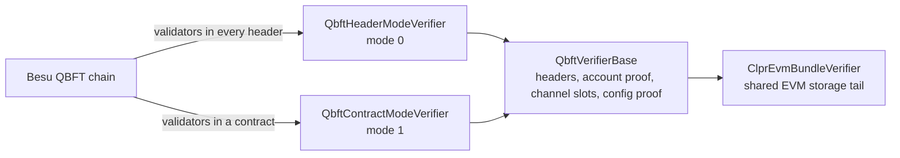
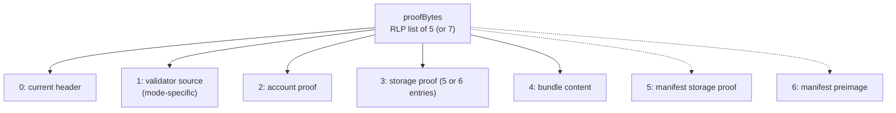

# QBFT verifiers — overview

**Scope:** `IClprVerifier` implementations for bundles that come from a Besu QBFT chain. A QBFT
block header carries committed seals; Merkle-Patricia proofs under the header's state root prove
the peer CLPR service's storage.
**Anchors to:** `IClprVerifier`, CLPR §3.1, `hiero-verifier.md` (sibling implementation).

There are two verifiers. They differ in **where the validator set comes from**.

| Verifier | Validator set comes from | Mode byte | Spec |
|---|---|---|---|
| `QbftHeaderModeVerifier` | `extraData.validators[]` of each block header | `0` | [`qbft-header-mode.md`](qbft-header-mode.md) |
| `QbftContractModeVerifier` | the storage of an on-chain validator contract | `1` | [`qbft-contract-mode.md`](qbft-contract-mode.md) |

Both extend `QbftVerifierBase`, which holds everything this page describes: the payload shape, the
header decode, the service account and channel storage proofs, the config-proof shape and the
endpoint manifest proof. Read the mode spec for the part that differs: bundle field 1, the trust
anchor and config field 4.



One channel keeps one mode for its full life. Pick the verifier that matches the source chain when
the channel is created. `QBFTVerifier` is a thin router that deploys both and forwards each call by
the mode byte (word 0 of the trust anchor, item 0 of the config descriptor); it adds no checks of
its own and is planned to be removed.

## Trust assumption: validator keys identify the chain

A QBFT header is authenticated by its committed seals alone. The sealed hash carries no chain id,
so nothing in a header ties it to one network. The verifier trusts the validator **keys**, not a
chain identity. If the same keys seal blocks on more than one network — a fork, or a test network
cloned from production with the same contract addresses — a relay can present a header from the
other network and the verifier cannot tell them apart. The anchor's `codeHash` and the service
address narrow this, but a clone shares both. **Operators must not reuse validator keys across
networks a channel could be pointed at.** This applies to both modes.

## verifyBundle

```solidity
function verifyBundle(bytes calldata proofBytes, bytes calldata trustAnchor, bytes calldata channelContext)
  external view
  returns (
    ClprTypes.QueueMetadata memory metadata,
    bytes[] memory messagePayloads,
    bytes memory newTrustAnchor,
    bytes memory newTrustAnchorId,
    ClprTypes.ClprEndpointManifest memory manifest
  )
```

The verifier is **view**: it reads no contract storage. All trust is in the per-call
`trustAnchor`, which `ClprService` stores per channel. `channelContext` is
`abi.encode(channelId, remoteServiceAddress)` (`ClprTypes.encodeChannelContext`).

### Payload shape

`proofBytes` is one RLP list of **5** items, or **7** when the bundle carries an endpoint-manifest
update.

| Index | Item | Notes |
|---|---|---|
| 0 | Current block header | RLP list of 15–22 fields; field 3 = `stateRoot`, field 8 = `number`, field 12 = `extraData`. |
| 1 | Validator source | **Mode-specific.** Header mode: `[trustedSet, hops[]]`, where `trustedSet` may be an empty list when no rotation is crossed. Contract mode: `[trustedSet, hops[], contractProof]`. See the mode spec. |
| 2 | Account proof | MPT proof for the peer CLPR service under `header.stateRoot`. |
| 3 | Storage proof | RLP list of **5 or 6** entries `[slotKey32, proofNodes]` (see [Storage layout](#storage-layout)). No value field: the value is read from the leaf. |
| 4 | Bundle content | Byte string: protobuf `ClprBundleContent`. |
| 5 | Manifest storage proof | *(7-item only)* one entry: the manifest commitment slot. |
| 6 | Manifest preimage | *(7-item only)* `ClprEndpointManifest` protobuf; its `keccak256` must equal the proven slot. |



### Steps every mode shares

1. Decode the anchor. Its length and mode byte must match the verifier.
2. Decode the payload; check the item count.
3. **Mode-specific:** resolve the validator set and walk the hops, then check the current header's
   seals against the set. The current header must be after the last hop and after the anchor
   block. See the mode spec.
4. Walk the account proof from `header.stateRoot` to the peer service; the leaf's `codeHash` must
   equal the anchor's `codeHash`.
5. Prove the channel slots under the account's `storageRoot` and read the queue metadata.
6. Decode the message payloads from the bundle content (field 2 of the protobuf, repeated).
7. With 7 items: prove the manifest commitment slot and check the preimage's `keccak256`.
8. Return `newTrustAnchor` and `newTrustAnchorId` when the set changed (hops were walked);
   otherwise both are empty.

### Storage layout

Slot keys are derived from the `channelId` in `channelContext`:

```
cBase = keccak256(abi.encode(channelId, 17))   // _channels mapping on the peer chain
```

| Entry | Slot key | Field | Extracted |
|---|---|---|---|
| 0 | `cBase + 1` | `Channel` slot+1 | `state = uint8(value >> 160)`, `nextMessageId = uint64(value >> 168)` |
| 1 | `cBase + 2` | `Channel` slot+2 | `receivedMessageId = uint64(value >> 64)` |
| 2 | `cBase + 4` | `sentRunningHash` | `value` |
| 3 | `cBase + 5` | `receivedRunningHash` | `value` |
| 4 | `cBase + 16` | `endpointManifestVersion` | `uint64(value)` |
| 5 (optional) | see below | `MessageValue.runningHashAfterProcessing` | verified, not surfaced |

The optional 6th entry is present when the bundle carries messages:

```
qBase   = keccak256(abi.encode(channelId, 1))               // _messageQueues
msgBase = keccak256(abi.encode(uint64(nextMessageId - 1), qBase))
slot    = msgBase + 1
```

The manifest commitment slot (7-item shape) is `keccak256(abi.encode(channelId, 18))`.

Entries may come in any order; the matcher keeps a rotating cursor, so the derived order (the five
channel slots, then the message slot) is found in one probe each. Slot packing mirrors the
`ClprTypes.Channel` struct; a change to the struct on the peer chain needs a change here.

## verifyConfig

```solidity
function verifyConfig(bytes calldata configProofBytes, bytes32 channelId, bytes calldata endpointManifestProofBytes)
  external view
  returns (
    bytes memory channelContext,
    string memory chainId,
    bytes memory serviceAddress,
    uint96 peerConfigNanos,
    ClprTypes.Throttles memory throttles,
    bytes memory initialTrustAnchor,
    bytes memory initialTrustAnchorId,
    ClprTypes.ClprEndpointManifest memory endpointManifest
  )
```

`configProofBytes` is one RLP list: **6** fields in header mode, **7** in contract mode. The block
header's seals are verified, so `verifyConfig` is authenticated by the set the header (or the
contract) names; the channel creator trusts that header.

| Field | Content | Mode-specific? |
|---|---|---|
| 0 | Service address (20 bytes) | no |
| 1 | Chain id (UTF-8, e.g. `eip155:1`) | no |
| 2 | Peer config nanos (uint96) | no |
| 3 | Throttles: list of 5 (legacy) or 7 scalars | no |
| 4 | Trust anchor descriptor: byte string wrapping `RLP([mode, …])` | **yes** — header mode `[0, codeHash]`; contract mode `[1, serviceAddress, codeHash, validatorContract, arraySlot]` |
| 5 | Header mode: the block header. Contract mode: the validator contract proof (the same 4-item shape as in bundle field 1, wrapped in a byte string) | **yes** |
| 6 | Contract mode only: the block header (list of 15–22 items) | **yes** |

Outputs: `channelContext = abi.encode(channelId, field 0)`, `initialTrustAnchor` in the mode's
layout, `initialTrustAnchorId = header.number` as 8 bytes big-endian.

### Endpoint manifest proof

Empty `endpointManifestProofBytes` returns the uninitialised manifest at version 0. Otherwise:

```
RLP([blockHeader, accountProof, manifestStorageProof, manifestPreimage])
```

The header must be sealed by a quorum of the initial set. The account proof and the single-entry
storage proof are checked as in `verifyBundle`; the preimage's `keccak256` must equal the proven
commitment.

## Reverts

Mode-specific reverts are listed in each mode spec. The shared ones:

| Selector | Cause | From |
|---|---|---|
| `InvalidTrustAnchor()` | anchor length is wrong for this verifier | base |
| `UnknownValidatorMode(mode)` | anchor or descriptor mode byte is not this verifier's mode (or not 0/1 at the router) | base / router |
| `InvalidPayloadShape()` | top-level list ∉ {5, 7}, or field 1 has the wrong item count, or a hop has the wrong shape; empty config bytes | base |
| `InvalidProofPayloadShape()` | config list has the wrong field count for the mode (6 / 7), or manifest proof ≠ 4 items | base |
| `InvalidHeader()` | header field count outside [15, 22], or a header-mode `validators[]` item is not a list of non-zero 20-byte addresses (each the fixed 21-byte RLP item Besu writes) | base |
| `InvalidConfigHeader()` | config or manifest header has fewer than 15 fields | base |
| `InvalidConfigThrottleFieldCount()` | throttles list ∉ {5, 7} | base |
| `InvalidTrustAnchorFields()` | descriptor item count is wrong for the mode (or empty at the router) | base |
| `InvalidTrustedSet()` | field 1 item 0 is not a list of non-zero 20-byte addresses (each the fixed 21-byte RLP item; a shorter scalar form or the empty string is rejected) | base |
| `WrongSetCommitment(got, expected)` | the submitted trusted set (or, in header mode with an empty item 0, the current header's list) does not hash to the anchor | base |
| `HandoffHeaderNotAscending(got, lastSeen)` | hops out of order, or a hop at or before the anchor block | base |
| `CurrentHeaderBehindWalk(got, lastSeen)` | current header at or before the last hop / anchor block | base |
| `EmptyValidatorSet()` / `ValidatorSetTooLarge(n)` | a set is empty, or larger than 256 | `ClprQbftQuorum` |
| `EmptySeals()` | a header carries no committed seals | `ClprQbftQuorum` |
| `QuorumNotReached(got, required)` | fewer than `ceil(2N/3)` distinct in-set signers | `ClprQbftQuorum` |
| `TooManySetChanges(added, removed)` | header mode: a header's list differs from the trusted set by more than one member | `ClprQbftQuorum` |
| `TrustLinkNotReached(got, required)` | header mode: too few trusted-set signers for the one-change rule | `ClprQbftQuorum` |
| `InvalidExtraData()` | `extraData` is empty or not a 5-item list | `ClprQbftSeal` |
| `SealLengthMismatch(got)` | a seal is not 65 bytes | `ClprQbftSeal` |
| `SealRecoverFailed()` | `ecrecover` returned `address(0)` | `ClprQbftSeal` |
| `CodeHashMismatch()` | service account `codeHash` ≠ anchor `codeHash` | `ClprEvmBundleVerifier` |
| `InvalidStorageProofShape()` | storage entries ∉ {5, 6} | `ClprEvmBundleVerifier` |
| `InvalidStorageProof()` / `InvalidStorageEntry()` / `InvalidAccount()` / `SlotNotProven(slot)` | malformed storage proof, entry or account leaf; an expected slot has no entry | `ClprEvmStateProof` |
| `MPT*` (`MPTEmptyProof`, `MPTInvalidNode`, `MPTInvalidHashRef`, `MPTInvalidPathPrefix`, `MPTInlineNodeUnsupported`, `MPTKeyMismatch`, `MPTKeyAbsent`, `MPTProofEndedEarly`) | Merkle-Patricia walk failed; account walks are strict, storage walks read an absent slot as zero | `MerklePatriciaProof` |
| `RlpCursorOutOfBounds()` / `RlpCursorUnexpectedList()` / `RlpCursorScalarTooLong()` | an RLP item inside a proof overruns its range, is a list where a byte string was expected, or a scalar is longer than 32 bytes | `RlpCursor` |
| `RLPInvalidEncoding()` | malformed RLP in the payload / config / header decode | OZ `RLP` |

## Test infrastructure

| Path | Role |
|---|---|
| `test/helpers/QbftSyntheticProofs.sol` | Synthetic headers, seals, account and storage proofs, config proofs. |
| `test/verifiers/evm/qbft/QbftHeaderModeProofBuilders.sol` | Header-mode scenarios: steady state, rotations, config. |
| `test/verifiers/evm/qbft/QbftContractProofs.sol` | Contract-mode scenarios: validator contract storage, hops, config. |
| `test/verifiers/evm/qbft/QbftHeaderModeVerifier.t.sol`, `QbftContractModeVerifier.t.sol` | Per-mode suites. |
| `test/verifiers/evm/qbft/QBFTVerifier.t.sol` | Router tests. |
| `test/verifiers/evm/qbft/GasUsage.t.sol`, `QbftGasReport.t.sol` | Gas baselines (`npm run gas:check`) and the breakdown behind `GAS_REPORT.md`. |
| `test/libraries/proof/qbft/` | Unit tests of the seal, quorum and validator-set libraries. |
| `test/verifiers/compliance/QBFTComplianceTest.t.sol`, `QbftContractModeComplianceTest.t.sol` | Cross-verifier conformance suite adapters. |
| `test/integration/IntegrationQBFT.t.sol` | Lifecycle test on the real Besu fixture; skips when the fixture is missing or stale. |
| `test/verifiers/evm/qbft/fixtures/` | Generated by `tools/qbft-proof-generator/` (gitignored): `bundlePayload.hex`, `configProof.hex`, `trustAnchor.hex`, `channelContext.hex`, `serviceAddress.hex`. |

The negative-path tests build minimal synthetic payloads in-test; the happy paths run on synthetic
proofs too, so the suites do not depend on the generated fixture.

## File map

| Path | Role |
|---|---|
| `src/verifiers/evm/qbft/QbftVerifierBase.sol` | Shared decode, walk helpers, storage tail, config-proof and manifest handling. |
| `src/verifiers/evm/qbft/QbftHeaderModeVerifier.sol` | Header mode (`qbft-header-mode.md`). |
| `src/verifiers/evm/qbft/QbftContractModeVerifier.sol` | Contract mode (`qbft-contract-mode.md`). |
| `src/verifiers/evm/qbft/QBFTVerifier.sol` | Router by mode byte. |
| `src/verifiers/evm/common/ClprEvmBundleVerifier.sol` | Shared EVM storage tail: service account, channel slots, bundle content, manifest. |
| `src/libraries/proof/qbft/ClprQbftSeal.sol` | `extraData` decode, sealing digest, `ecrecover` of seals. |
| `src/libraries/proof/qbft/ClprQbftQuorum.sol` | Quorum counting over a sorted set (256-member bitmask) and the header-mode one-change rotation rule. |
| `src/libraries/proof/qbft/QbftValidators.sol` | `ValidatorSet`, sort/dedupe, `commit`, `quorum`, `QbftValidatorMode`. |
| `src/libraries/proof/qbft/QbftContractValidatorSource.sol` | Contract mode: the validator contract's storage layout. |
| `src/libraries/proof/evm/ClprEvmStateProof.sol`, `MerklePatriciaProof.sol`, `RlpCursor.sol` | Account/storage proofs, MPT walk, allocation-free RLP reader. |
| `src/verifiers/evm/qbft/GAS_REPORT.md` | Measured gas for both modes. |
