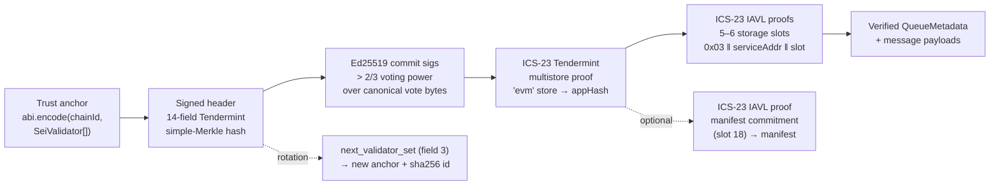
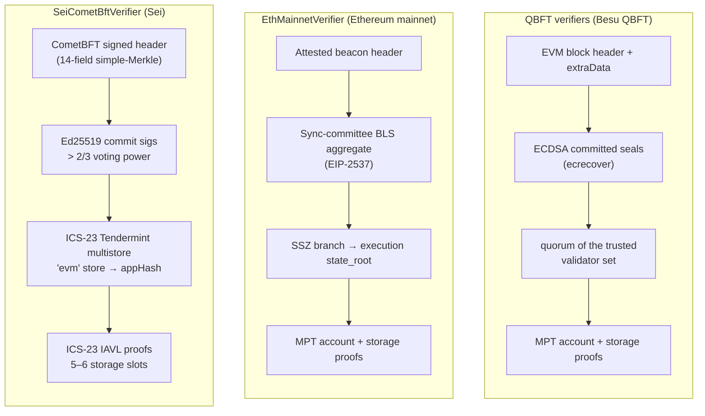
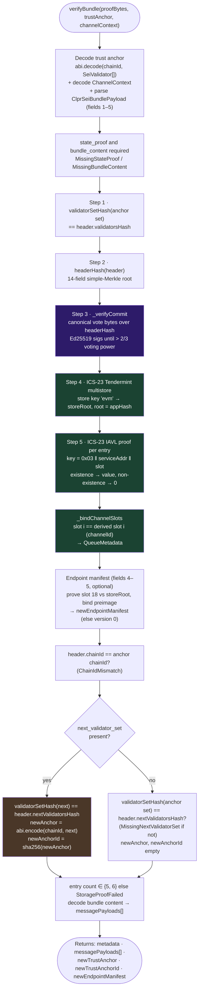
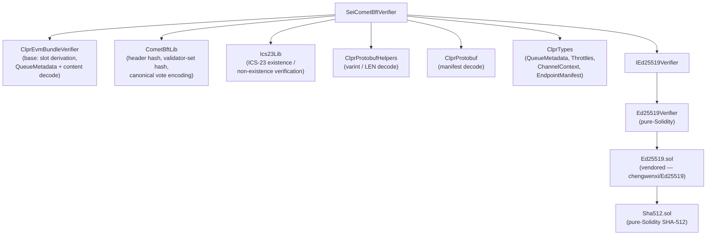

# SeiCometBftVerifier

> **Source**: [SeiCometBftVerifier.sol](./SeiCometBftVerifier.sol)
> **Base contract**: [ClprEvmBundleVerifier.sol](../common/ClprEvmBundleVerifier.sol)
> **Interface**: [IClprVerifier.sol](../../../interfaces/IClprVerifier.sol)

---

## 1. The big picture

The CLPR protocol needs to **trustlessly verify state from a peer Sei chain** entirely on-chain. `SeiCometBftVerifier` answers: *"prove to me that this bundle of cross-chain messages actually existed in the peer CLPR service contract's EVM storage on Sei."*

It is a real **CometBFT light client**: it builds a chain of cryptographic trust from a trust anchor holding the active validator set, through Ed25519 multi-signature commits, and down through two layers of ICS-23 Merkle proofs to individual IAVL storage slots.



Each arrow is a proof verified on-chain. If any link breaks, the whole call reverts. The verifier's only state is the immutable `ED25519` dependency — trust is carried entirely in the per-channel anchor `ClprService` stores, an `abi.encode(chainId, SeiValidator[])` blob whose size scales with the validator set.

> [!IMPORTANT]
> **Ed25519 is injected, not assumed.** On Sei, address `0x09` maps to BLAKE2F, not the EIP-665 Ed25519 precompile. The constructor takes an `IEd25519Verifier` address (`ZeroEd25519Verifier` if zero). The deploy CLI (`deployCore.deploySeiVerifierStack`) deploys the pure-Solidity `Ed25519Verifier` and passes its address. A chain with an EIP-665 precompile can pass a thin precompile-backed adapter instead.

---

## 2. Differences with the QBFT verifiers and EthMainnetVerifier

Ethereum mainnet uses BLS sync-committee signatures ([EthMainnetVerifier](../ethereum/README.md)); Besu uses ECDSA committed seals in `extraData` ([QBFT verifiers](../qbft/qbft-verifier.md): `QbftHeaderModeVerifier`, `QbftContractModeVerifier`, and the single-validator `QBFTVerifier`); Sei uses **Ed25519 multi-signatures** over CometBFT canonical vote bytes. The state commitment also differs: instead of an RLP block header `stateRoot` (QBFT) or SSZ `execution.state_root` (ETH), the verifier proves against CometBFT's `appHash` using **ICS-23 proofs** — a two-level Merkle system (Tendermint multistore spec at the top, IAVL spec per storage key below). There is no account trie, so there is no code-hash pinning.



The **shared** part comes from [ClprEvmBundleVerifier](../common/ClprEvmBundleVerifier.sol): the channel slot derivation (`_channelMetadataSlots`, `_lastMessageRunningHashSlot`), the queue-metadata decode (`_buildQueueMetadata`), the bundle-content decode (`_decodeBundleContent`) and the version-0 manifest sentinels. Sei proves the slots with its own IAVL code, binds them by position rather than by lookup (see [Storage slots](#storage-slots)), and runs its own manifest binding (`_verifySeiEndpointManifest`). The base's MPT helpers are unused.

---

## 3. Configuration & trust anchor

The peer contract identity is not in the trust anchor. It comes from the per-channel `ChannelContext` (`remoteServiceAddress`, set by `verifyConfig`), and every IAVL key must carry it: `0x03 ‖ serviceAddress ‖ slot`.

The **trust anchor** is ABI-encoded and carries the active validator set in full:

```solidity
abi.encode(string chainId, CometBftLib.SeiValidator[] validatorSet)
// SeiValidator = (bytes32 ed25519PubKey, int64 votingPower)
```

| Element | Description |
|---|---|
| `chainId` | The Sei chain this anchor authenticates. Every bundle's signed header must carry the same `chainId` (`ChainIdMismatch`); the chain id is also inside the header hash and the signed vote bytes. |
| `validatorSet` | The active validators and their voting power, stored **in full**. An empty anchor or an empty set reverts `InvalidTrustAnchor`. |

Per bundle the verifier re-derives `CometBftLib.validatorSetHash(validators)` and requires it to equal the signed header's `validators_hash` (`ValidatorSetHashMismatch`). That is what binds the anchor's keys to the header being verified.

`initialTrustAnchorId` and `newTrustAnchorId` are `sha256` of the corresponding anchor (32 bytes). `newTrustAnchorId` is empty when the bundle carries no `next_validator_set`.

`HeightTooOld` is declared but never raised: `verifyBundle` does not check the header height or time against anything. Freshness relies on `BundleLib`'s replay defence (`ClprReplayDetected` when the proven `nextMessageId` is behind the channel's `receivedMessageId + 1`).

### verifyConfig

`verifyConfig` parses the three required fields of `ClprSeiLedgerConfigurationPayload` and verifies the config state proof against the validator set **carried in the same payload**. So the validator set is trusted input supplied to `ClprService.completeChannel` at channel setup; the proof shows that this set signed a header whose state holds the declared service address.

- The state proof is taken at the service address the ledger configuration declares, so one verifier instance can serve channels to any peer CLPR service on the chain.
- It must carry exactly one storage entry (`InvalidStorageProofCount`), whose value must equal the Solidity short-`bytes` encoding of that address, `address ‖ 0x00…00 ‖ 0x28` (`ServiceAddressSlotMismatch`). The entry's slot number is not compared.
- The returned `chainId` is the signed header's chain id. `peerConfigNanos` and `throttles` come from the ledger configuration and, like the validator set, are not covered by the state proof; its chain-id field is not used.
- The initial anchor is `abi.encode(header.chainId, validators)`.
- An empty config proof reverts `InvalidPayloadShape`.

The optional endpoint-manifest proof (`verifyConfig`'s third argument) is verified against the `storeRoot` the config state proof authenticates. An empty proof returns the uninitialized (version 0) manifest; the first manifest-carrying bundle then populates the channel's peer manifest.

---

## 4. Proof layout

All payloads are protobuf. Unknown fields are skipped, with two exceptions: the multistore `CommitmentProof` accepts only field 1 (`OnlyExistenceProofsSupported`), and `_parseThrottles` reads every field as a varint without checking its wire type.

### Bundle proof (`ClprSeiBundlePayload`)

| # | Field | Wire | Contents |
|---|---|---|---|
| 1 | `state_proof` | LEN | `SeiStateProof`. **Required** (`MissingStateProof`). |
| 2 | `bundle_content` | LEN | `ClprBundleContent` — field 2 (repeated) carries the message payloads; field 1 is ignored, since metadata comes from the proven slots. **Required**, non-empty (`MissingBundleContent`). |
| 3 | `next_validator_set` | LEN (optional) | `SeiValidatorSet` — the rotation target; hashed and matched against `header.next_validators_hash`. |
| 4 | `endpoint_manifest_storage_proof` | LEN (optional) | `SeiStorageProofEntry` for the manifest-commitment slot (18). |
| 5 | `endpoint_manifest_preimage` | LEN (optional) | `ClprEndpointManifest` protobuf; its `keccak256` must equal the proven commitment. |

Fields 4 and 5 are **both-present or both-absent** (`ManifestProofPairMismatch`).

### Config proof (`ClprSeiLedgerConfigurationPayload`)

| # | Field | Wire | Contents |
|---|---|---|---|
| 1 | `validator_set` | LEN | `SeiValidatorSet` (`MissingValidatorSet`) |
| 2 | `ledger_configuration` | LEN | `LedgerConfiguration`: chain id (1), service address (2, 20 bytes), nanos (3), throttles (4) (`MissingLedgerConfig`) |
| 3 | `state_proof` | LEN | `SeiStateProof` with exactly one storage entry proving the service address (`MissingStateProof`) |

All three are required; there is no height field.

### Config-time endpoint-manifest proof (`verifyConfig` argument 3)

| # | Field | Contents |
|---|---|---|
| 1 | storage-proof entry | `SeiStorageProofEntry` for manifest-commitment slot 18 |
| 2 | preimage | The `ClprEndpointManifest` protobuf |

### State proof and its parts

| Message | Fields |
|---|---|
| `SeiStateProof` | 1 `SeiSignedHeader` · 2 store key (must be `"evm"`) · 3 multistore `CommitmentProof` (ICS-23 Tendermint spec, existence only) rooted at `header.appHash` · 4 repeated `SeiStorageProofEntry` |
| `SeiSignedHeader` | 1 header · 2 commit |
| header | 1 version.block · 2 version.app · 3 chain_id · 4 height · 5 time · 6 last_block_id (flat: hash, part_set_total, part_set_hash) · 7 last_commit_hash · 8 data_hash · 9 validators_hash · 10 next_validators_hash · 11 consensus_hash · 12 app_hash · 13 last_results_hash · 14 evidence_hash · 15 proposer_address (20 bytes) |
| commit | 1 round · 2 part_set_total · 3 part_set_hash · 4 signers_bits · 5 repeated signature `{1 timestamp, 2 signature64}` |
| `SeiValidatorSet` | 1 repeated validator `{1 ed25519_pub_key (32 bytes), 2 voting_power}` |
| `SeiStorageProofEntry` | 1 key · 2 value · 3 IAVL `CommitmentProof` (existence or non-existence) |

The commit carries no height and no block id: the vote bytes take the height from the header and the block-id hash from the recomputed header hash.

---

## 5. Step-by-step verification flow

This is the core of [`verifyBundle`](./SeiCometBftVerifier.sol):



Steps 1–5 are `_verifyStateProof`; `_verifyChannelStateProof` wraps it with `_bindChannelSlots`. `verifyConfig` calls `_verifyStateProof` directly, since its one entry is not a channel slot.

| Step | Principal reverts |
|---|---|
| decode | `InvalidTrustAnchor`, `InvalidServiceAddressLength`, `MissingStateProof`, `MissingBundleContent` |
| 1 | `CometBftLib.EmptyValidatorSet`, `ValidatorSetHashMismatch` |
| 3 | `InvalidSignersBitsLength`, `SignersBitOutOfRange`, `TooFewSignatures`, `ExtraSignatures`, `InvalidSignature`, `QuorumNotMet` |
| 4 | `InvalidStoreKey`, `OnlyExistenceProofsSupported`, Ics23Lib `KeyMismatch` / `ValueMismatch` / `RootMismatch` |
| 5 | `StorageKeyMismatch`, `InvalidStorageValueLength`, `NonExistenceSlotNotEmpty`, `UnsupportedProofType`, Ics23Lib leaf / inner-op / neighbour errors |
| bind | `StorageKeyMismatch` |
| manifest | `ManifestProofPairMismatch`, `StorageKeyMismatch`, `OnlyExistenceProofsSupported`, `ManifestCommitmentMismatch`, `ManifestVersionZero`, `ManifestServiceAddressMismatch` |
| chain id | `ChainIdMismatch` |
| rotation | `NextValidatorSetHashMismatch`, `MissingNextValidatorSet` |
| count | `StorageProofFailed` |

---

## 6. Deep dive: key steps

### Ed25519 commit verification

`_verifyCommit` checks the commit shape before any signature work:

- `signers_bits` must be exactly `ceil(n/8)` bytes (`InvalidSignersBitsLength`), with padding bits beyond `n` clear (`SignersBitOutOfRange`). Bit `i` is `0x80 >> (i % 8)` of byte `i / 8` (**MSB-first**) — the opposite of the LSB-first `Bitvector[512]` convention `EthMainnetVerifier` uses for the sync committee.
- The signature count must equal the number of set bits (`TooFewSignatures` / `ExtraSignatures`). Signatures are consumed in validator order, one per set bit.
- `totalPower` is summed over the **full** trusted set in this pre-pass, so the bits cannot shrink the quorum denominator.

Then, for each validator with its bit set, in validator order:

1. Build the CometBFT **canonical precommit sign bytes** (`CometBftLib.precommitSignBytesHoisted`, length-delimited `CanonicalVote`): `type = PRECOMMIT (2)`, `height` (from the header), `round` (from the commit), `block_id = {hash: computedHeaderHash, part_set_header: {total, hash}}`, the signature's own `timestamp`, and `chain_id`. The `block_id.hash` is the **computed** header hash, which binds each signature to the proven header.
2. Call `IEd25519Verifier.verify(pubKey32, signBytes, signature64)`; `false` reverts `InvalidSignature`.
3. Add the validator's voting power to `signedPower`.

The loop **stops as soon as `signedPower × 3 > totalPower × 2`**: each Ed25519 check is expensive (the `_verifyCommit` comment puts it at ~600K gas), and power beyond the quorum adds no security. Signatures after the quorum point are never verified, so an invalid one there does not revert. If the loop ends below quorum, `QuorumNotMet`.

The header hash is the Tendermint **simple-Merkle root** (`sha256(0x00 ‖ leaf)`, `sha256(0x01 ‖ left ‖ right)`) over 14 cdc-encoded fields (`version{block,app}`, `chainId`, `height`, `time`, `lastBlockId`, `lastCommitHash`, `dataHash`, `validatorsHash`, `nextValidatorsHash`, `consensusHash`, `appHash`, `lastResultsHash`, `evidenceHash`, `proposerAddress`), computed on-chain by `CometBftLib.headerHash`. The validator-set hash is the same simple-Merkle root over `SimpleValidator{pubKey, votingPower}` leaves (`CometBftLib.validatorSetHash`).

### ICS-23 proof verification

Both levels use the same leaf spec, enforced by `Ics23Lib.existenceRoot` (`LeafOpSpecMismatch`, `LeafPrefixMismatch`):

- Leaf: `sha256(prefix ‖ varint(len(key)) ‖ key ‖ varint(32) ‖ sha256(value))` — the value is **SHA-256-prehashed**, the prefix must begin with `0x00`, and the leaf op must declare `hashOp = SHA256, prehashKey = NO_HASH, prehashValue = SHA256, lengthOp = VAR_PROTO`. Empty keys or values revert `EmptyKey` / `EmptyValue`.
- Inner ops: `hashOp = SHA256` (`HashOpNotSha256`), a prefix that does not start with `0x00` (`PrefixCollidesWithLeaf`), and `node = sha256(prefix ‖ child ‖ suffix)`.

| Spec | Used for | Inner-op prefix length | Suffix length |
|---|---|---|---|
| Tendermint | `"evm"` store root → `appHash` | 1 – 33 | multiple of 32 |
| IAVL | storage slot → store root | 4 – 45 | multiple of 33 |

A prefix or suffix outside these bounds reverts `InvalidPrefixLength` / `InvalidSuffixLength`. The store key must equal `"evm"`, both in field 2 and in the multistore proof's own key (`InvalidStoreKey`); the proven value is the 32-byte store root.

**Non-existence proofs** (IAVL only) require at least one neighbour (`NonExistenceMissingNeighbour`). Each present neighbour must verify to the same `storeRoot` and sit on the correct side of the key (`LeftNeighbourRootMismatch`, `LeftNeighbourNotBeforeKey`, `RightNeighbourRootMismatch`, `RightNeighbourNotAfterKey`). Tree adjacency is checked too: a missing left neighbour requires the right one to be leftmost, a missing right neighbour requires the left one to be rightmost, and two present neighbours must be genuine tree neighbours (`RightNeighbourNotLeftMost` / `LeftNeighbourNotRightMost` / `LeavesNotNeighbours`). The adjacency checks read each IAVL inner op's branch from its shape (`Ics23Lib.iavlBranch`):

| Shape | Branch |
|---|---|
| suffix 33 bytes, prefix 4–12 | left child — the right sibling is in the suffix |
| suffix 0, prefix 37–45 | right child — the left sibling is in the prefix after the 4–12-byte header |
| anything else | invalid (`iavlBranch` returns 255) |

A non-existent key's slot value is `bytes32(0)`. Sei's `x/evm` module deletes zero-valued slots from the IAVL tree, so zero `Channel` fields arrive as non-existence proofs.

### Storage slots

IAVL keys are `0x03 ‖ serviceAddress(20 B) ‖ slot(32 B)`, 53 bytes, with the service address from `ChannelContext` (`StorageKeyMismatch` otherwise). An existence proof's value must be 32 bytes (`InvalidStorageValueLength`); a non-existence proof's must be empty (`NonExistenceSlotNotEmpty`).

The slots come from the `_channels` mapping (base slot **15**, `storage-layout.json`):

```
cBase = keccak256(abi.encode(channelId, 15))
```

| Entry | Slot | Field | Decoded |
|---|---|---|---|
| 0 | `cBase + 1` | `verifier(20) ‖ status(1) ‖ nextMessageId(8)` | `state`, `nextMessageId` |
| 1 | `cBase + 2` | `acked(8) ‖ received(8) ‖ nextExpectedReply(8)` | `receivedMessageId` |
| 2 | `cBase + 4` | `sentRunningHash` | `sentRunningHash` |
| 3 | `cBase + 5` | `receivedRunningHash` | `receivedRunningHash` |
| 4 | `cBase + 16` | `endpointManifestVersion` | `endpointManifestVersion` |
| 5 (with outbound messages) | `_messageQueues[channelId][nextMessageId − 1]` + 1 | `runningHashAfterProcessing` | verified; not surfaced |

A bundle proves 5 entries (ACK-only) or 6 (message-bearing); any other count reverts `StorageProofFailed`.

> [!NOTE]
> `_bindChannelSlots` binds slots **positionally**: it reads the slot number out of each proven
> IAVL key and compares entry `i` with derived slot `i`, reverting `StorageKeyMismatch`. A 6th entry
> with a proven `nextMessageId` of 0 also reverts `StorageKeyMismatch`. The MPT verifiers instead
> *search* the proof for each derived slot and revert `SlotNotProven` if it is absent. Either way the
> slot is never taken from the proof — but Sei does not accept reordered entries.

### Endpoint manifest

The manifest proof targets the fixed, channel-independent slot **18** (`EndpointManifestState.commitment`). `_verifySeiEndpointManifest` matches its IAVL key in full — prefix, service address, *and* the exact slot number (`StorageKeyMismatch`) — and requires an existence proof (`OnlyExistenceProofsSupported`) against the bundle's `storeRoot`. The supplied preimage must `keccak256` to the proven commitment (`ManifestCommitmentMismatch`), decode with `version >= 1` (`ManifestVersionZero`), and carry the expected service address (`ManifestServiceAddressMismatch`). With both fields absent, the verifier returns a version-0 manifest, which `BundleLib` treats as "no update".

### Validator-set rotation

A CometBFT header commits to its own validator set (`validators_hash`) and the set for the next height (`next_validators_hash`). Every bundle must account for the next set:

- **`next_validator_set` present** — its hash must equal `next_validators_hash` (`NextValidatorSetHashMismatch`). The verifier returns `abi.encode(header.chainId, nextValidators)` and its `sha256`. It does this whenever the field is present, including when the next set equals the current one.
- **absent** — the anchored set's hash must equal `next_validators_hash` (`MissingNextValidatorSet`), and no anchor is returned.

Because every header must be signed by the anchored set (`ValidatorSetHashMismatch`), a channel follows validator-set changes one at a time: the anchor moves only on a bundle proven at a header whose `next_validators_hash` commits to the new set. There is no multi-step catch-up in one bundle.

---

## 7. Library dependency map



| Library | Purpose | Shared with QBFT/ETH? |
|---|---|---|
| [ClprEvmBundleVerifier](../common/ClprEvmBundleVerifier.sol) | Base contract: channel slot derivation, queue-metadata decode, bundle-content decode, version-0 manifest sentinels | Shared |
| [CometBftLib](../../../libraries/proof/cometbft/CometBftLib.sol) | Tendermint header hash, validator-set simple-Merkle hash, canonical precommit sign bytes | Sei-only |
| [Ics23Lib](../../../libraries/proof/cometbft/Ics23Lib.sol) | ICS-23 existence / non-existence verification (Tendermint + IAVL specs) | Sei-only |
| [ClprProtobufHelpers](../../../libraries/codec/ClprProtobufHelpers.sol) | Varint / length-delimited decode | Shared |
| [ClprProtobuf](../../../libraries/codec/ClprProtobuf.sol) | Endpoint-manifest decode | Shared |
| [ClprTypes](../../../libraries/ClprTypes.sol) | Shared structs: `QueueMetadata`, `Throttles`, `ChannelContext`, `ClprEndpointManifest` | Shared |
| [IEd25519Verifier](./lib/IEd25519Verifier.sol) | Injected signature verifier interface | Sei-only |
| [Ed25519Verifier](./Ed25519Verifier.sol) | Pure-Solidity Ed25519, for Sei (0x09 = BLAKE2F) | Sei-only |
| [Ed25519.sol](./lib/Ed25519.sol) | Vendored Ed25519 (chengwenxi, Apache-2.0, ported 0.6→0.8) | Sei-only |
| [Sha512.sol](./lib/Sha512.sol) | Pure-Solidity SHA-512 (used by Ed25519.sol) | Sei-only |

`SeiCometBftVerifier` parses its protobuf payloads with its own internal `_parse*` functions; [SeiProtoDecoder.sol](./lib/SeiProtoDecoder.sol) is not imported by it and is exercised only by `test/verifiers/evm/sei/SeiProtoDecoder.t.sol`.

---

## 8. SeiCometBftVerifier vs the QBFT verifiers vs EthMainnetVerifier

The QBFT column describes `QbftHeaderModeVerifier` / `QbftContractModeVerifier`; the single-validator `QBFTVerifier` shares their payload shape — see [qbft-verifier.md](../qbft/qbft-verifier.md).

| Aspect | QBFT verifiers | EthMainnetVerifier | SeiCometBftVerifier |
|---|---|---|---|
| Proof items | 5 RLP items (7 with manifest) | 11 RLP items (13 with manifest) | **5 proto fields** (bundle) / **3 proto fields** (config) |
| Block authentication | QBFT committed seals in `extraData` | Sync-committee BLS aggregate (EIP-2537) | Ed25519 multi-sig over canonical vote bytes, > ⅔ voting power |
| Signature scheme | ECDSA secp256k1 (`ecrecover`) | BLS12-381 aggregate | Ed25519 (injected `IEd25519Verifier`) |
| State commitment | `stateRoot` in RLP EVM block header | `execution.state_root` via SSZ branch | `appHash` in CometBFT signed header |
| State proof | MPT (Merkle-Patricia) | MPT via SSZ branch | ICS-23 (two levels: Tendermint multistore + IAVL slot) |
| Trust anchor | header mode 128 B `abi.encode(mode, setCommitment, codeHash, anchorBlockNumber)`; contract mode 224 B, adding `validatorContract`, `arraySlot`, `validatorCodeHash` | flat 428 B window: `gvr ‖ forkVersion ‖ channelId ‖ codeHash ‖ period ‖ [aggregate ‖ committeeRoot] × 2` | `abi.encode(chainId, SeiValidator[])`, size scales with the set |
| Trust-anchor id | block number (8 B) | window start period (8 B) | `sha256(anchor)` (32 B) |
| Peer contract identity | `ChannelContext` address + anchor `codeHash` | `ChannelContext` address + anchor `codeHash` | `ChannelContext` address (no code hash) |
| Rotation | validator-set hops in proof item 1 | SSZ `next_sync_committee` branch advances a `{ current, next }` window | `next_validator_set`, one change per bundle |
| Hash functions | keccak256 (MPT) | sha256 (SSZ) + keccak256 (MPT) | sha256 (CometBFT + ICS-23), SHA-512 inside Ed25519 |
| Storage slots | caller-derived from `channelId`, matched by label | caller-derived from `channelId`, matched by label | caller-derived from `channelId`, matched by position |
