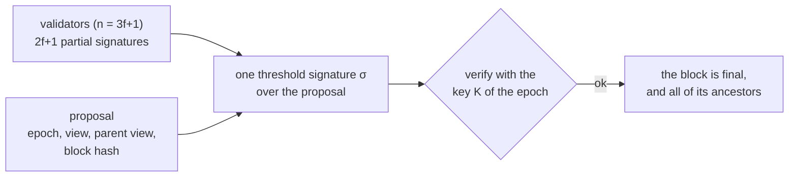
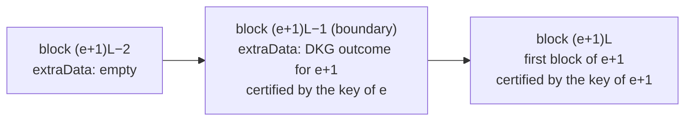
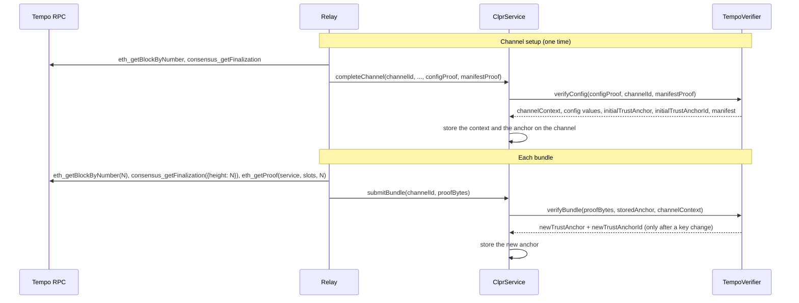
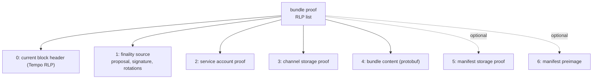
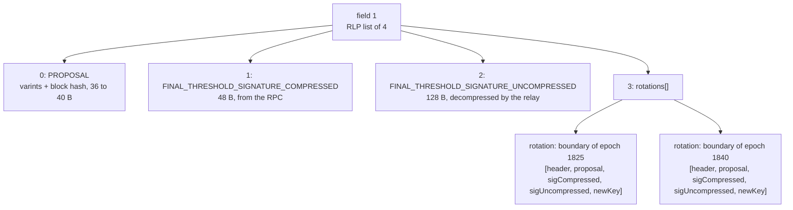
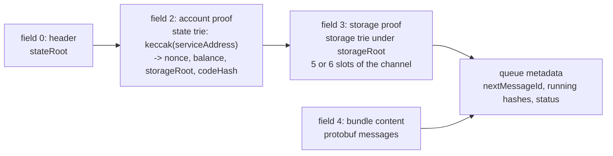
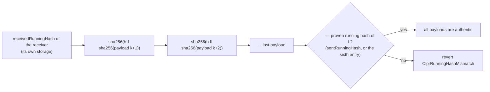
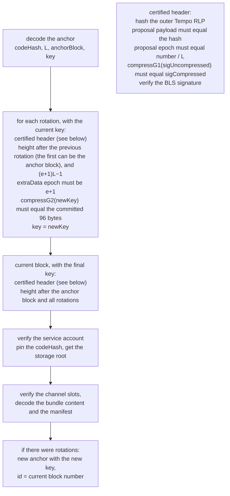

# Tempo verifier

`TempoVerifier` verifies bundles from a Tempo chain. Tempo is an EVM chain (a reth fork). It uses
Commonware **Simplex** consensus with a **BLS12-381 threshold** signature scheme.

A Tempo block header has no seals. The proof of finality is a separate object, the **finalization
certificate** (the certificate). The certificate is one 48-byte threshold signature over the block
hash. The validators make it with their DKG shares. One group public key (the key) verifies it.

The verifier has these properties:

- In the steady state, the cost does not change with the size of the validator set. The signature is
  always one point.
- After setup, the key is the only source of trust for finality. The chain itself proves each key change.
- The key changes only at an epoch boundary. One bundle can cross any number of epochs.

## 1. How Tempo finality works

Validators sign a `finalize` vote for a proposal. The proposal names the block by its hash. With
`n = 3f+1` validators, when `2f+1` partial signatures exist, any node can recover one threshold
signature. This signature and the proposal are the certificate.

Each validator and each certified follower keeps the certificates by height. They serve them over
JSON-RPC with `consensus_getFinalization`. The public RPCs `rpc.presto.tempo.xyz` (mainnet) and
`rpc.moderato.tempo.xyz` (testnet) also serve them.



**Epochs.** Tempo divides time into epochs of `L` blocks. Genesis sets `L` (`epochLength`). On both
public networks, `L` is `21600`. Epoch `e` contains the heights `e·L` to `(e+1)·L − 1`.

**Keys.** Each epoch has one key, which comes from a DKG. Most epochs run a **reshare**, which keeps
the same key. Sometimes the chain runs a **full DKG**, which makes a new key.

**The boundary block.** The last block of epoch `e` is at height `(e+1)·L − 1`. Its `extraData`
contains the DKG outcome for epoch `e+1`. Each validator compares this outcome with its own outcome
before it votes. Thus consensus approves the outcome.

The outcome contains the public polynomial of epoch `e+1`. The constant term of this polynomial is
the key of epoch `e+1`. The other blocks of the epoch have an empty `extraData` or a dealer log.



The old key certifies the boundary block, and the boundary block contains the new key. This is the
key hand-off. A verifier that trusts the key of epoch `e` can verify the boundary header and read the
key of `e+1` from it.

**Certificates for ancestors.** A certificate for block `M` makes `M` and all of its ancestors
final. Thus a height can be final without its own certificate. On both public networks, each recent
height had its own certificate. The verifier requires the certificate of the exact current block
(see "Covering certificates" in [Not supported](#7-not-supported)).

## 2. Who makes what

- The relay makes the **bundle proof** for each bundle.
- The relay makes the **config proof** one time, at channel setup.
- The verifier makes the **trust anchor** (the anchor) and the **channel context**. `ClprService`
  stores both on the channel.



**What the relay keeps.**

1. Keep the anchor id (`newTrustAnchorId`). It is a block number, 8 bytes, big-endian.
2. Keep the key of the anchor (the `identity` bytes).
3. If a full DKG changed the key after the anchor block, add the rotations to the bundle.
4. If only reshares occurred, send no rotations.
5. Get the certificates near the tip. The public RPCs keep them for about the last one million
   heights.
6. If a channel is idle across a full DKG for longer than that, get the rotation from an archive
   node.

## 3. The trust anchor

The anchor is an `abi.encode` value of 416 bytes. It starts with the code hash of the peer service.
It has no mode byte. Its size does not change with the size of the validator set.

| Word | Field | Type | Content |
|------|-------|------|---------|
| 0 | codeHash | bytes32 | the code hash of the peer `ClprService`. Each bundle pins the account to it. Zero turns the pin off |
| 1 | epochLength | uint64 | `L`, from the config proof. It does not change for the life of the channel |
| 2 | anchorBlockNumber | uint64 | the Tempo block whose certificate the verifier verified when it made this anchor |
| 3 | identity offset | uint256 | `0x80`, the `abi.encode` offset of the key |
| 4 | identity length | uint256 | 256 |
| 5 to 12 | identity | bytes (256) | the key, as an uncompressed EIP-2537 G2 point |

The anchor stores the full key in uncompressed form. The key is one point, so it costs less to
store it than to send it in each bundle. The verifier makes a new anchor only when the rotations change
the key. A rotation that keeps the key still verifies, but the anchor does not move.

The verifier rejects an anchor with `InvalidTrustAnchor` in three cases: the anchor is not 416 bytes,
the key is not 256 bytes, or `L` is less than 2.

**No key epoch.** Each bundle must be for a block after `anchorBlockNumber`. Thus the epoch of each
certificate is at least the epoch of the anchor block. A reshare keeps the key, so the key stays
valid until a full DKG replaces it. After a full DKG, the old key does not verify the signature. The
relay then adds the rotations. Because a reshare keeps the key, a threshold of past share holders of
the key can also sign later certificates.

The anchor does not record the last epoch of its key. Thus, until a rotation moves the anchor past a
full DKG, a threshold of past share holders of the anchor key can sign a certificate for any later
block. They can also sign a false boundary block that names a key of their own. The verifier then
puts that key in the anchor, and correct certificates fail from then on. The channel does not
recover. The verifier sees only one block at each height, so it cannot find the false block. To keep
this window short, send the rotation soon after each full DKG.

**The key identifies the chain.** The key is the output of the DKG of one network. Two networks
cannot have the same key unless they share the validators and the ceremony. Thus a testnet
certificate does not verify on a mainnet channel.

**Compressed and uncompressed points.** The chain uses compressed points: 96-byte G2 keys in
`extraData` and 48-byte G1 signatures in certificates. The EIP-2537 precompiles need uncompressed
points: 256-byte G2 and 128-byte G1. On-chain decompression costs too much gas, because it needs a
field square root. On-chain compression costs little: take the x coordinate and set the flag bits
from the sign of y.

Thus the relay sends both forms of each point. The verifier compresses the uncompressed form and
requires the result to equal the compressed form. Compression is injective, so equal results prove
that the two forms are the same point. Then the verifier gives only the uncompressed bytes to the
precompiles.

| Point | Compressed form from | Uncompressed form from | Rule |
|---|---|---|---|
| threshold signature | the RPC certificate (48 bytes), sent by the relay | the relay (128 bytes) | `compressG1(uncompressed) == compressed` |
| key at a rotation | the `extraData` of the boundary header (96 bytes) | the relay (256 bytes) | `compressG2(uncompressed) == committed key` |
| key at setup | the config descriptor (96 bytes) | the config descriptor (256 bytes) | `compressG2(uncompressed) == compressed` |

`ClprBls12381.compressG1` compresses a G1 point. `ClprBls12381.compressG2` uses the same rule on
Fp2. Its sign flag comes from `y.c1`, or from `y.c0` if `y.c1` is zero. This is the zkcrypto and
blst convention that Tempo uses. Neither function uses a precompile.

## 4. The bundle proof

The bundle proof is one RLP list of 5 fields, or 7 fields with an endpoint-manifest update. A
different count reverts with `InvalidPayloadShape`.

Fields 0 and 1 prove that a block is final. Fields 2 to 6 prove the storage of the peer
`ClprService` under that block. This storage is the content of the bundle. `ClprEvmBundleVerifier`,
the base contract of `TempoVerifier`, verifies fields 2 to 6.



| Field | Name | Content |
|-------|------|---------|
| 0 | current block header | the block to verify, as Tempo header RLP |
| 1 | finality source | the certificate of this block, then the rotations |
| 2 | service account proof | proves the peer service account under the state root of the block |
| 3 | channel storage proof | proves the channel slots under the storage root of the service |
| 4 | bundle content | the protobuf messages |
| 5 | manifest storage proof | optional |
| 6 | manifest preimage | optional |

### Field 0: the Tempo header

A Tempo header is an RLP list of 4 or 5 items. Item 3 is the inner EVM header:

```
TempoHeader = RLP([generalGasLimit, sharedGasLimit, timestampMillisPart, innerHeader, consensusContext?])
consensusContext = RLP([epoch, view, parentView, proposer(32 bytes ed25519)])
```

`innerHeader` is the usual list of at least 15 fields. Field 3 is `stateRoot`, field 8 is `number`,
and field 12 is `extraData`. A shorter list reverts with `InvalidHeader`. On mainnet, the list has 21
fields: the 15 legacy fields, then `baseFeePerGas`, `withdrawalsRoot`, `blobGasUsed`, `excessBlobGas`,
`parentBeaconBlockRoot` and `requestsHash`.

The block hash is the `keccak256` of the outer list. Blocks after the fork that added
`consensusContext` have this item, and older blocks do not. The verifier accepts both forms and
hashes the bytes that it receives.

`eth_getBlockByNumber` returns all Tempo fields: `mainBlockGeneralGasLimit`, `sharedGasLimit`,
`timestampMillisPart`, and a `consensusContext` object. In this object, `epoch`, `view` and
`parentView` are plain JSON integers, not hex quantities.

When the relay encodes these fields as shown above, it gets the exact block hash. This encoding gave
the correct hash on both public networks. The header is about 670 bytes. The certificate payload
names this hash. A hash of the inner EVM header alone is a different value.

### Field 1: the certificate and the rotations

**The RPC certificate.** The `certificate` field of `consensus_getFinalization` is the Commonware
`Finalization` of the block, as hex. On mainnet, it is 132 to 136 bytes. The view varints get longer
during each epoch.

Read it from the end. The two signatures at the end have fixed sizes. Only the varints at the start
change size.

| From the end | Content | Size | Use |
|--------------|---------|------|-----|
| the last 48 bytes | seed signature (VRF randomness, not related to the block) | 48 | discard |
| the 48 bytes before them | final threshold signature, compressed G1 | 48 | keep |
| the 32 bytes before them | payload = block hash | 32 | keep, part of the proposal |
| all bytes before them | epoch, view, parent view: three protobuf varints | 3 to 30, 4 to 8 on mainnet | keep, part of the proposal |

The **proposal** is all bytes except the last 96. The validators signed these bytes, so the relay
must send them without change. For a 136-byte certificate, the bytes are:

| Bytes (0-based) | Content |
|---|---|
| 0 to 39 | PROPOSAL (8 bytes of varints and the 32-byte block hash), 40 bytes |
| 40 to 87 | FINAL_THRESHOLD_SIGNATURE_COMPRESSED, 48 bytes |
| 88 to 135 | seed signature, 48 bytes, discarded |

CAUTION: Do not hard-code the offset 40. Each varint is 1 to 10 bytes, and the varints get longer
when the epoch and the view increase.

**Relay procedure for field 1.**

1. Call `consensus_getFinalization({"height": N})`.
2. If the call returns JSON-RPC error `503` with data `"certificate"`, select a different block.
   Block `N` has no certificate of its own.
3. Decode the `certificate` hex to bytes.
4. Remove the last 48 bytes and discard them. They are the seed signature.
5. Remove the next 48 bytes from the end. They are `FINAL_THRESHOLD_SIGNATURE_COMPRESSED`.
6. Keep the remaining bytes, from byte 0, as `PROPOSAL`. Do not encode them again.
7. Decompress the signature off-chain to the 128-byte EIP-2537 G1 form. This is
   `FINAL_THRESHOLD_SIGNATURE_UNCOMPRESSED`.

**The shape of field 1.** Field 1 is an RLP list of 4 items. A different count reverts with
`InvalidPayloadShape`.

| Item | Name | Content |
|------|------|---------|
| 0 | PROPOSAL | the RPC certificate without its last 96 bytes |
| 1 | FINAL_THRESHOLD_SIGNATURE_COMPRESSED | the 48 bytes before the last 48 bytes |
| 2 | FINAL_THRESHOLD_SIGNATURE_UNCOMPRESSED | the same signature, as a 128-byte uncompressed G1 point |
| 3 | rotations | the list of rotations. It is empty when the key of the anchor still verifies |

**A rotation** is one key change that the bundle crosses. It is an RLP list of 5 items. A different
count reverts with `InvalidPayloadShape`.

```
rotation = RLP([boundaryHeader, PROPOSAL, FINAL_THRESHOLD_SIGNATURE_COMPRESSED,
                FINAL_THRESHOLD_SIGNATURE_UNCOMPRESSED, newKey])
```

- `boundaryHeader` is the last block of an epoch, as Tempo header RLP.
- The three certificate items come from `consensus_getFinalization` at that height. The relay cuts
  them in the same way as items 0 to 2 above.
- `newKey` is the key of the next epoch, as a 256-byte uncompressed G2 point. The relay decompresses
  it off-chain from the 96 bytes in the `extraData` of the boundary header.

The relay does not send the compressed key again. The verified header contains it, and the verifier
compares the new key with it.



**How to find a key change.**

1. Read the boundary block of each epoch.
2. Decode its `extraData` (see below).
3. Compare the key with the key of the previous epoch.

A certified follower also logs each key hand-off. The outcome also has the flag `is_next_full_dkg`.
When this flag is set in the outcome of epoch `e`, the key of epoch `e+1` is different.

**Rules for the rotations.**

1. Put the rotations in ascending height order. Do not repeat a rotation.
2. The first rotation can be the anchor block itself. Do not use a boundary block before it.
3. Add one rotation for each epoch whose key is different from the previous key.
4. Do not add a rotation for a reshare.
5. Use the boundary block itself, at height `(e+1)·L − 1`. The verifier rejects all other heights.
6. If the key did not change, send an empty rotation list. This is the usual case, also across many
   epochs.

**The `extraData` of a boundary block.** It is the Commonware `OnchainDkgOutcome`:

```
varint(epoch) ‖ summary(32) ‖ mode(1) ‖ validatorCount(4, big-endian) ‖ varint(coefficientCount)
‖ coefficient[0] = group key (96, compressed G2) ‖ coefficient[1..] ‖ other fields
```

The verifier reads `epoch`, skips 37 bytes, reads the coefficient count, and takes the next 96 bytes
as the committed key. It does not read the other bytes. It reads each varint with
`ClprProtobufHelpers.decodeVarint`. On mainnet at height 39571199 (`presto-boundary.json`), the key
starts at byte 40. The
epoch varint is 2 bytes there, with 15 validators and 11 coefficients.

### Fields 2 to 6: the state of the peer service, from `eth_getProof`

These fields are the purpose of the bundle. Finality alone proves nothing about messages. Fields 2
and 3 prove the channel state of the peer `ClprService` under the state root of the final block.
This state is the next message id, the running hashes, the status and the manifest version.

Field 4 contains the messages. The receiver compares them with the proven state. Tempo uses reth,
so the proofs are usual Merkle-Patricia proofs. One `eth_getProof` call gives all of them, with the
value of each slot and its proof.



**How the messages are proven.** There is no storage proof for each message, and it is not
necessary. When the peer service queues a message, it sets the slot `sentRunningHash` to
`sha256(previousHash ‖ sha256(payload))`. It also stores this value in the
`runningHashAfterProcessing` slot of the message. Thus each of these values is a hash chain over the
payloads sent on the channel up to that message, in order.

A bundle carries the messages after the receiver's own `receivedMessageId`, up to a last message L.
L is `nextMessageId − 1`, or an earlier message when the relay sends only a part of the queue. On
receipt, `ClprService` starts from its own `receivedRunningHash`. It adds each payload from field 4
with the same formula. The result must equal the proven running hash of L, else the bundle reverts
with `ClprRunningHashMismatch`:

- If L is `nextMessageId − 1`, field 3 has 5 entries, and the proven value is `sentRunningHash`.
- If L is earlier, field 3 has a sixth entry: the `runningHashAfterProcessing` slot of L. Its proven
  value is the running hash, and its slot identifies L.

A payload that the peer did not queue, a missing payload, or a changed order changes the chain. Thus
one proven slot authenticates any number of messages. The payloads are plain bytes in field 4, and
the hash chain is their proof.



**Relay procedure for fields 2 to 6.** Use the same block `N` as in fields 0 and 1.

1. Read the channel on the peer service. Get `nextMessageId`, and find out whether there are messages to
   send. Select the last message L of the bundle. The channel view function or the slot values from
   step 3 give this data.
2. Calculate the slot keys as shown below. The verifier calculates the same keys from `channelId`.
   It accepts only proofs for these keys. A proof for a different slot reverts with `SlotNotProven`.

   ```
   cBase   = keccak256(abi.encode(channelId, 15))           // _channels mapping, base slot 15
   slots   = [cBase + 1, cBase + 2, cBase + 4, cBase + 5, cBase + 16]

   // only when L is before nextMessageId − 1:
   qBase   = keccak256(abi.encode(channelId, 1))            // _messageQueues mapping, base slot 1
   msgBase = keccak256(abi.encode(uint64(L), qBase))
   slots  += [msgBase + 1]                                  // runningHashAfterProcessing of L

   // only with a manifest update (7-field proof):
   manifestSlot = 18                                        // _endpointManifest (17) + commitment (1), a plain slot
   ```

   The base slots come from the `storage-layout.json` of the peer service. They are constants in the
   verifier. A peer service with a different storage layout needs a different verifier.

   | Slot | Channel field | Packing |
   |------|---------------|---------|
   | `cBase + 1` | `verifier`, `status`, `nextMessageId` | `status = uint8(value >> 160)`, `nextMessageId = uint64(value >> 168)` |
   | `cBase + 2` | `ackedMessageId`, `receivedMessageId`, `nextExpectedReplyId` | `ackedMessageId = uint64(value)`, `receivedMessageId = uint64(value >> 64)` |
   | `cBase + 4` | `sentRunningHash` | whole word |
   | `cBase + 5` | `receivedRunningHash` | whole word |
   | `cBase + 16` | `endpointManifestVersion` | `uint64(value)` |
   | `msgBase + 1` | `runningHashAfterProcessing` of L | whole word, the running hash the bundle must end at |
   | `18` | manifest `commitment` | `keccak256(manifest protobuf)` |

3. Make one call: `eth_getProof(serviceAddress, [slot keys in the order above], "0x" + hex(N))`.
4. Use the block number, not `latest`. The proof must be under the state root of the certified
   block.
5. Read the reply. It has `accountProof` (a list of RLP trie nodes) and one `storageProof` entry for
   each key, with `key`, `value` and `proof`.
6. If the node returns the entries in a different order, put them back in the order of your request.
7. Encode the fields:

   ```
   field 2 = RLP([node, node, ...])                         // accountProof, each node a byte string
   field 3 = RLP([[slotKey32, [node, ...]], ...])           // 5 entries, or 6 with the slot of L
   field 5 = RLP([[bytes32(18), [node, ...]]])              // optional, one entry
   ```

   Do not add a value field. The verifier reads each value from the proven leaf. A proof for an
   empty slot is a valid exclusion proof, and the value is zero.
8. Encode field 4 as the `ClprBundleContent` protobuf. It contains the queue metadata from the proven
   slots and the payloads of the messages after the receiver's own `receivedMessageId`, up to L. The e2e
   relay gets the canonical bytes with one `eth_call` to `BundleEncoderHelper.encode(metadata, payloads)`.
9. If the bundle has a manifest update, encode field 6 as the `ClprEndpointManifest` protobuf. Its
   `keccak256` must equal the value that field 5 proves.

**What the verifier does with fields 2 to 6.**

- It walks field 2 from `stateRoot` to `keccak256(serviceAddress)`. The service address comes from
  the channel context. It must be 20 bytes, else `InvalidServiceAddressLength`.
- The `codeHash` of the account must equal the `codeHash` of the anchor, else `CodeHashMismatch`. A
  zero `codeHash` in the anchor turns this rule off.
- The `storageRoot` of the account is the root for field 3. The verifier proves each slot of field 3
  under this root and decodes the queue metadata.
- It decodes field 4. With messages and 5 entries, the bundle ends at `nextMessageId − 1`, and its
  first message must be after the proven `ackedMessageId`, else `ClprBundleStartsAtOrBeforeAcked`.
  With messages and 6 entries, the sixth entry must be the running-hash slot of a message from
  `ackedMessageId + message count` to `nextMessageId − 1`, else `LastMessageSlotNotFound`. Without
  messages, a sixth entry is ignored.
- With 7 fields, it proves slot 18. Then `keccak256(field 6)` must equal the proven value, else
  `ManifestCommitmentMismatch`.
- The manifest version must not be zero (`ManifestVersionZero`). The service address in the manifest
  must equal the service address of the channel (`ManifestServiceAddressMismatch`).

## 5. The config proof

The config proof is one RLP list of 7 fields. It makes the first anchor. An empty config proof
reverts with `InvalidPayloadShape`. A different field count reverts with `InvalidProofPayloadShape`.

| Field | Name | Content |
|-------|------|---------|
| 0 | service address | the address of the peer service, 20 bytes |
| 1 | chain id | for example `eip155:4217` |
| 2 | peer config nanos | the time of the config |
| 3 | throttles | an RLP list of 5 or 7 items, else `InvalidConfigThrottleFieldCount` |
| 4 | trust anchor descriptor | `RLP([codeHash, epochLength, identityCompressed, identityUncompressed])` as a byte string. The key in both forms, 96 and 256 bytes |
| 5 | certificate | `RLP([PROPOSAL, FINAL_THRESHOLD_SIGNATURE_COMPRESSED, FINAL_THRESHOLD_SIGNATURE_UNCOMPRESSED])` of the block in field 6, cut as for field 1 |
| 6 | block header | a recent block, as Tempo header RLP |

**What the verifier requires.**

- The descriptor has 4 items, else `InvalidTrustAnchorFields`.
- `epochLength` is at least 2 and fits in 64 bits, else `InvalidEpochLength`.
- The key forms are 256 and 96 bytes, else `InvalidKeyLength`.
- `compressG2(identityUncompressed)` equals `identityCompressed`, else `KeyEncodingMismatch`.
- The key is not the point at infinity, else `InfinityPoint`.
- The service address is 20 bytes, else `InvalidServiceAddressLength`.
- The certificate has 3 items, else `InvalidProofPayloadShape`.
- The certificate certifies the header of field 6 under the key. The rules are the same as for a
  bundle block: the proposal payload equals the header hash, the epoch equals `number / L`, the
  signature forms agree, and the BLS signature verifies.

**What the verifier returns.**

- The anchor, with the uncompressed key. The initial anchor id is the block number of field 6.
- The channel context `channelId ‖ serviceAddress` (`ClprTypes.encodeChannelContext`).
- The service address, the chain id, the peer config nanos and the throttles from fields 0 to 3.
- The endpoint manifest of the peer (see below).

**Trust on first use.** The certificate only proves that the key is live on the chain now. The key,
the code hash, the epoch length, the service address, the chain id, the config time and the
throttles are declared values. Tempo
nodes use their compiled start key in the same way.

**The manifest proof at setup.** If the peer has no manifest yet, the third argument of
`verifyConfig` is empty. Then the verifier returns the uninitialized manifest, at version 0. Else the
argument is one RLP list of 7 items. A different count reverts with `InvalidProofPayloadShape`.

```
RLP([blockHeader, PROPOSAL, FINAL_THRESHOLD_SIGNATURE_COMPRESSED, FINAL_THRESHOLD_SIGNATURE_UNCOMPRESSED,
     accountProof, manifestStorageProof, manifestPreimage])
```

- The header is any block that is final under the config key. The verifier verifies its certificate
  with the same rules as the config header.
- The account proof is for the peer service under the state root of this header.
- The storage proof is for slot `18`. `keccak256(manifestPreimage)` must equal the proven value.
- The code hash of the account must equal the code hash of the descriptor, else `CodeHashMismatch`.
  A zero code hash turns this rule off.

**Where the relay gets the key.**

1. Read the last boundary block before the block of field 6.
2. Decode its `extraData`.
3. Decompress the key.

A node also has the key of the current key epoch in its compiled `NetworkIdentity`. The boundary
block is the better source, because it is on the chain.

## 6. How the verifier verifies a bundle



**Point forms first.** The verifier binds each uncompressed point to its compressed form before it
uses the point in a pairing. The signature binds to the 48 bytes from the RPC certificate. A new key
binds to the 96 bytes in the boundary `extraData`. The setup key binds to the compressed key in the
descriptor. A key or a signature at infinity reverts with `InfinityPoint`, because the identity key and
the identity signature verify any message.

**The BLS verification.** Tempo uses the `MinSig` variant: signatures are in G1 and keys are in G2.

1. The message is `0x0e ‖ "TEMPO_FINALIZE" ‖ proposal`. The first byte is the varint length of the
   namespace (14). The namespace is the chain namespace `TEMPO` with the suffix `_FINALIZE`.
2. The verifier hashes the message to G1 with `expand_message_xmd(SHA-256)` and the DST
   `BLS_SIG_BLS12381G1_XMD:SHA-256_SSWU_RO_POP_`. This gives two field elements. Two
   `BLS12_MAP_FP_TO_G1` calls and one `BLS12_G1ADD` call give the point.
3. The pairing is `e(σ, −G2) · e(H(m), K) = 1`. This is one `BLS12_PAIRING_CHECK` call with two
   pairs.

The pairing precompile rejects points that are not on the curve or not in the subgroup. Thus a separate subgroup
test is not necessary. The verifier does not verify the seed signature, and the relay does not send
it.

**Epoch consistency.** The proposal contains its epoch. The verifier requires `epoch == number / L`,
else `EpochMismatch`. Without this rule, a relay can pair a header with a certificate from a
different epoch whose key still verifies. The Tempo follower applies the same rule.

**Wrong or missing rotations.** The key that the verifier trusts certifies each rotation header.
Thus the `extraData` of the header is authentic. If a necessary rotation is missing, the signature
of the current block does not verify. An unnecessary rotation, where the key did not change, only
costs gas. A replayed old boundary block fails the height rule.

**Revert reasons.**

| Error | Cause |
|-------|-------|
| `InvalidTrustAnchor` | the anchor is not 416 bytes, the key is not 256 bytes, or `L` is less than 2 |
| `InvalidPayloadShape` | the proof is not 5 or 7 fields, field 1 is not 4 items, or a rotation is not 5 items |
| `InvalidHeader` | the outer header list is not 4 or 5 items, or the inner list has fewer than 15 items |
| `InvalidProposal` | the proposal is not three varints and 32 bytes |
| `TruncatedInput`, `VarintOverflow` | a varint is not complete, or it is larger than 64 bits |
| `BlockDigestMismatch` | the proposal payload is not the header hash |
| `EpochMismatch` | the proposal epoch is not `number / L` |
| `InvalidSignatureEncoding` | the signature forms are not 48 and 128 bytes |
| `SignatureEncodingMismatch` | `compressG1(uncompressed)` is not the compressed signature |
| `BadLength`, `BlsPrecompileCallFailed`, `BlsSignatureInvalid` | the BLS verification failed |
| `HandoffHeaderNotAscending` | a rotation is before the anchor block, or not after the previous rotation |
| `RotationNotEpochBoundary` | a rotation header is not the last block of an epoch |
| `InvalidDkgOutcome` | the coefficient count in `extraData` is 0, or `extraData` ends before the key |
| `OutcomeEpochMismatch` | the outcome epoch is not the epoch of the boundary block plus 1 |
| `InvalidKeyLength` | the new key is not 256 bytes, or the committed key is not 96 bytes |
| `KeyEncodingMismatch` | `compressG2(newKey)` is not the committed key |
| `InfinityPoint` | the key or the signature is the point at infinity |
| `CurrentHeaderBehindWalk` | the current block is not after the anchor block and all rotations |
| `CodeHashMismatch`, `SlotNotProven`, `InvalidServiceAddressLength` | the service account or a channel slot did not prove |
| `InvalidAccount`, `InvalidStorageProof`, `InvalidStorageEntry` | the account proof, a storage proof or a storage entry is malformed |
| `InvalidStorageProofShape` | field 3 does not have 5 or 6 entries |
| `ClprBundleStartsAtOrBeforeAcked` | field 3 has 5 entries, and the first message of the bundle is at or before the proven `ackedMessageId` |
| `LastMessageSlotNotFound` | field 3 has 6 entries, but the sixth entry is not the running-hash slot of a message that can end the bundle |
| `ManifestCommitmentMismatch`, `ManifestVersionZero`, `ManifestServiceAddressMismatch` | the manifest update did not prove |

## 7. Not supported

**Covering certificates.** If block `N` has no certificate of its own, a certificate for a later
block `M` also makes `N` final. To support this, the proof needs the headers `N+1` to `M` and a
`parentHash` walk, one `keccak256` for each header. The verifier does not have this extension. The
relay must select a block that has its own certificate. On both public networks, each recent block
has one.

**Headers before `consensusContext`.** Blocks from before the fork that added `consensusContext`
have a 4-item outer list. The verifier hashes the bytes that it receives, so these blocks verify.
But the public RPCs do not keep certificates this old. Do not anchor a channel at such a block.

**A change of the epoch length.** The anchor pins `L`. If the chain changes `epochLength`, the
boundary arithmetic breaks. No on-chain proof of such a change exists. If it occurs, stop the
channel. Then open a new channel with a new config proof.

**Relay rule:** one channel keeps one `L` and one key lineage for its full life.

## 8. Gas

The certificate is one point. In the steady state, no part of the proof gets larger with the number
of validators.
`test/verifiers/tempo/TempoGasReport.t.sol` gives these values:

| Scenario | Execution | Calldata |
|---|---|---|
| `verifyBundle`, steady state | 229,177 | 18,284 |
| `verifyBundle`, one rotation | 416,821 | 29,444 |
| `verifyBundle`, two rotations | 603,124 | 40,456 |
| `verifyConfig` | 219,430 | 11,780 |
| BLS verification only (`verifyMinSig`) | 131,672 | — |

The rotation rows use a synthetic boundary header. A real boundary header is larger, because its
`extraData` holds the DKG outcome, which grows with the validator count. On mainnet, with 15
validators, the boundary header is 3,150 bytes and one rotation is about 3.6 kB.

In the steady state, the cost does not change with the size of the validator set. The real limits
are calldata and the certificate retention of the RPC that the relay uses.

The Calldata column counts the proof, the anchor and the context. Only the proof is transaction
calldata. A steady bundle proof is about 1.3 kB.
