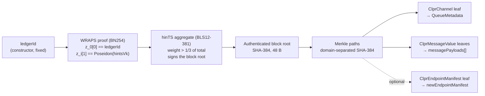
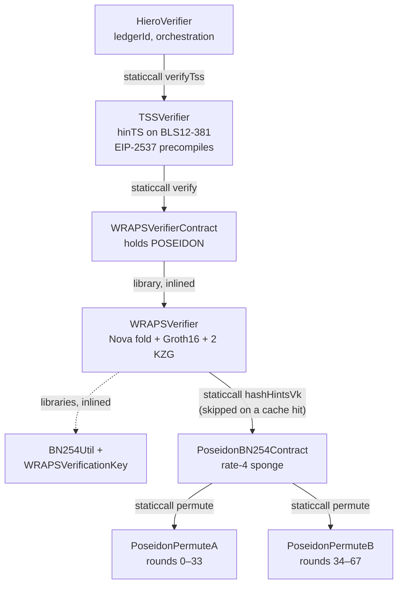
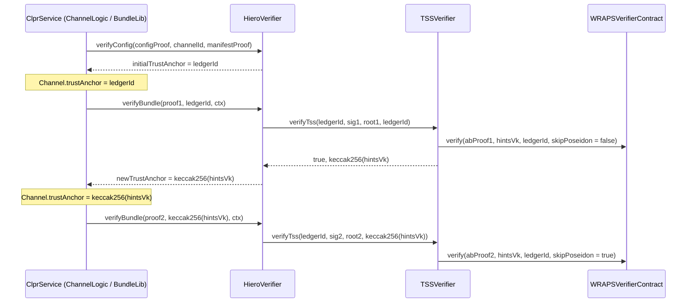
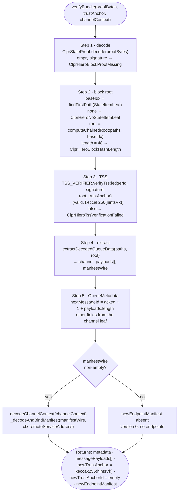
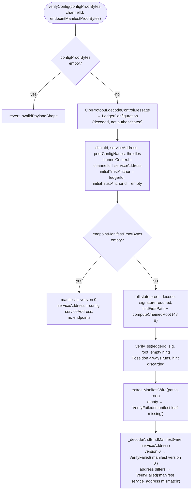
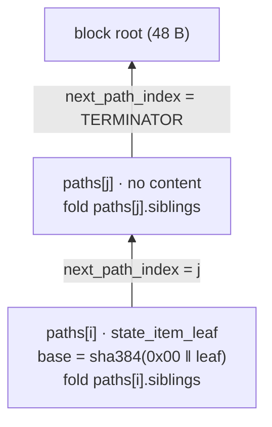
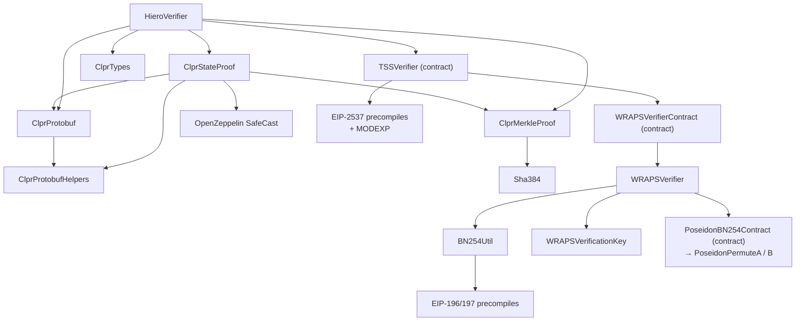

# HieroVerifier

> **Source**: [HieroVerifier.sol](./HieroVerifier.sol) · [TSSVerifier.sol](./TSSVerifier.sol) · [wraps/](./wraps/)
> **Proof libraries**: [ClprStateProof.sol](../../libraries/proof/hiero/ClprStateProof.sol) · [ClprMerkleProof.sol](../../libraries/proof/hiero/ClprMerkleProof.sol)
> **Interface**: [IClprVerifier.sol](../../interfaces/IClprVerifier.sol)
> **Gas**: [GAS_REPORT.md](./GAS_REPORT.md)

---

## 1. The big picture

`HieroVerifier` is the `IClprVerifier` for a channel whose peer is a CLPR service on a **Hiero** ledger. It answers one question: *"is this `ClprChannel` record, and are these queued messages, in the Hiero ledger's state at a block that the ledger's validators signed?"*

Hiero has no EVM block header, no Merkle-Patricia trie and no storage slots. It publishes a **block-stream `StateProof`**: protobuf Merkle paths that hash up to a SHA-384 block root, and a TSS block signature over that root. The signature is a **hinTS** aggregate on BLS12-381. A **WRAPS** proof on BN254 binds the hinTS verification key (`hintsVk`) to the ledger's `ledgerId`.



The block root is computed from the first state-item path, and the TSS signature must verify over that root before any leaf is decoded. *Deep dive: the state proof and Merkle paths* lists which leaves are re-rooted against it.

`ledgerId` is the verifier's only identity anchor. The `newTrustAnchor` that `verifyBundle` returns is `keccak256(hintsVk)`, a cache hint that lets the next bundle skip the Poseidon hash (see *Construction and trust model*).

---

## 2. How Hiero differs from the EVM families

| | HieroVerifier | EVM families ([QBFT](../evm/qbft/qbft-verifier.md), [Ethereum](../evm/ethereum/README.md), [Sei](../evm/sei/README.md)) |
|---|---|---|
| Base contract | None: implements `IClprVerifier` directly | [`ClprEvmBundleVerifier`](../evm/common/ClprEvmBundleVerifier.sol) |
| What is proven | Native Hiero CLPR state items: `ClprChannel`, `ClprMessageValue`, `ClprEndpointManifest` | Storage slots of the peer `ClprService`: the `Channel` fields at `keccak256(abi.encode(channelId, 15))` + {1, 2, 4, 5, 16}, plus the last message's running-hash slot when the proof carries one |
| Tree and hash | Binary Merkle with an `is_left` sibling list; SHA-384 in Solidity ([`Sha384`](../../libraries/crypto/Sha384.sol)) | Merkle-Patricia trie with keccak256 (Sei: ICS-23 / IAVL with sha256) |
| Encoding | protobuf throughout | RLP envelope (Sei: protobuf and ICS-23) |
| Root authentication | TSS signature over the block root, carried in the same proof | QBFT committed seals, sync-committee BLS, or CometBFT commit signatures over a header |
| Leaf selection | The proof declares its leaves; the verifier dispatches on each leaf's `StateValue` tag | The verifier derives the slots from `channelId` and requires exactly those |
| `nextMessageId` | Derived: `ackedMessageId + 1 + payloads.length` | Proven from `Channel` slot `+1` |
| Message payloads | Read from proven `ClprMessageValue` leaves | Decoded from the unproven `ClprBundleContent` by `ClprEvmBundleVerifier._decodeBundleContent` |
| Trust anchor | `ledgerId`, fixed at deploy; `newTrustAnchor` is a cache hint | Validator set or committee window, advanced by proofs |

In both families, `BundleLib._validateAndPrepare` binds the new payloads to the proven `sentRunningHash` with the fold `sha256(prev ‖ sha256(payload))`.

---

## 3. Construction and trust model

### Contract stack

Six contracts are deployed separately, so that each one stays under EIP-170 (24,576 B runtime) and EIP-3860 (49,152 B initcode):



Deploy order (`deployHieroVerifierStack` in `script/deploy/deployCore.ts`): `PoseidonPermuteA` → `PoseidonPermuteB` → `PoseidonBN254Contract(a, b)` → `WRAPSVerifierContract(poseidon)` → `TSSVerifier(wrapsVerifier)` → `HieroVerifier(ledgerId, tssVerifier)`. Each step reuses an existing address when its env var is set: `POSEIDON_PERMUTE_A`, `POSEIDON_PERMUTE_B`, `POSEIDON_BN254`, `WRAPS_VERIFIER`, `TSS_VERIFIER`, `HIERO_VERIFIER`. Entry points: `bin/verifier.sh hiero --rpc-url anvil --ledger-id 0x…`, or the deploy CLI modes `hiero-verifier` and `e2e-with-hiero-verifier`. The `hiero-verifier` mode takes the ledger id from `--ledger-id`. Without it, and always in `e2e-with-hiero-verifier`, `loadLedgerIdBytes` reads `LEDGER_ID` or `TRUST_ANCHOR`, else `test/verifiers/hiero/fixtures/trustAnchor.bin`.

```solidity
constructor(bytes memory ledgerId_, TSSVerifier tssVerifier_)  // ClprHieroEmptyLedgerId if ledgerId_ is empty
bytes public ledgerId;                              // raw bytes in storage, written once, no setter
TSSVerifier public immutable TSS_VERIFIER;
address public immutable CLPR_SERVICE;              // declared, never assigned: reads address(0)
bytes32 public immutable INITIAL_PINNED_KEY_HASH;   // declared, never assigned: reads bytes32(0)
```

No code reads `CLPR_SERVICE` or `INITIAL_PINNED_KEY_HASH`. The NatSpec on `ledgerId` describes it as a keccak256 hash and refers to `_verifyHintsVkAgainstLedger`; the variable holds the raw bytes, and that function does not exist.

### `ledgerId`: the identity anchor

`ledgerId` is opaque bytes: 32 bytes in the fixture (`trustAnchor.bin`), any non-empty length at the constructor. Rotating it means deploying a new `HieroVerifier`. It is enforced inside WRAPS, not in `HieroVerifier`: `WRAPSVerifier.verify` compares the first 32 bytes of `ledgerId` with the proof's public input `z_0[0]` and reverts `WRAPSLedgerIdMismatch` on a difference.

`verifyConfig` returns `initialTrustAnchor = ledgerId` and an empty `initialTrustAnchorId`, and `ChannelLogic._createChannel` stores both on the `Channel`. The `trust_anchor` and `trust_anchor_id` fields (7 and 8) of the peer's `LedgerConfiguration` are decoded but not used.

### `newTrustAnchor`: the Poseidon-skip cache hint

`BundleLib` passes the stored `Channel.trustAnchor` into `verifyBundle`, and `HieroVerifier` forwards it to `TSSVerifier.verifyTss` as `validHintVk`:

- `TSSVerifier` computes `keccak256(hintVk)` for the key set in this bundle.
- `skipPoseidon` is true when `validHintVk` is 32 bytes and equals that hash.
- `WRAPSVerifierContract` then passes `address(0)` as the Poseidon address, and `WRAPSVerifier` skips the `z_i[1] == Poseidon(hintsVk)` check, which is the largest single cost in the verification (see [GAS_REPORT.md](./GAS_REPORT.md)).
- `verifyTss` returns `abi.encodePacked(keccak256(hintVk))`. `HieroVerifier` returns it as `newTrustAnchor`, with an empty `newTrustAnchorId`, and `BundleLib` Step 1c writes it to `Channel.trustAnchor`.



The first bundle after channel creation, and the first bundle after the key set changes, run Poseidon. Bundles after that under the same `hintsVk` skip it. The value caches the fact *"this key set has already been bound to a WRAPS proof for this ledger"*. The ledger identity does not change.

When the hint matches, the Groth16 check still runs with the proof's own `z_i[1]` as a public input, but nothing compares `z_i[1]` with this bundle's `hintsVk`. The binding of that key set to the ledger rests on the earlier bundle that stored its hash.

The `trustAnchor` NatSpec in `IClprVerifier` and on `ClprTypes.Channel.trustAnchor` says that Hiero leaves the anchor empty. The behaviour described above is what the code does.

---

## 4. Proof layout

### StateProof wire shape

From `ClprStateProof` (mirroring `block/stream/state_proof.proto` in `clpr-hiero`):

```
StateProof          { repeated MerklePath paths = 1; oneof proof { TssSignedBlockProof signed_block_proof = 2; } }
TssSignedBlockProof { bytes block_signature = 1; }
MerklePath          { repeated SiblingNode siblings = 1; uint32 next_path_index = 2;
                      oneof content { bytes hash = 3; bytes state_item_leaf = 4;
                                      bytes block_item_leaf = 5; bytes timestamp_leaf = 6; } }
SiblingNode         { bool is_left = 1; bytes hash = 2; }
StateItem           { StateKey key = 2; StateValue value = 3; }      // only field 3 is read
```

Decoder behaviour (`ClprStateProof.decode`):

- A proof holds at most **64 paths**, and a path holds at most **64 siblings**. These are fixed-size scratch arrays, and the 65th entry reverts with a Panic (array index out of bounds).
- An omitted `next_path_index` decodes as `0`, not as the terminator. A standalone path must set `0xFFFFFFFF` (`ClprMerkleProof.TERMINATOR`). A value above `uint32` reverts `SafeCastOverflowedUintDowncast`.
- The `content` oneof is not enforced. A decoded path keeps every content field that the wire carries.
- Unknown fields are skipped. Wire types other than 0 (varint) and 2 (length-delimited) revert `"Unsupported wire type"`. Truncated input reverts `TruncatedInput` or `VarintOverflow` (`ClprProtobufHelpers`).

### State items the verifier reads

`extractDecodedQueueData` reads the first varint of each `StateValue` (its field key) as the tag, and takes the first length-delimited field as the inner message:

| `StateValue` field | Tag (key varint) | Constant | Decoded as | Multiplicity |
|---|---|---|---|---|
| 60 | 482 | `SV_CHANNEL_TAG` | `ClprProtobuf.decodeChannelFromMemory` → `ClprTypes.Channel` | At least one (`StateProofMissingChannel`); the last one wins |
| 62 | 498 | `SV_MESSAGE_TAG` | payload (field 1); `running_hash_after_processing` (field 2) is decoded and not used | Zero or more, in path order |
| 64 | 514 | `SV_ENDPOINT_MANIFEST_TAG` | raw bytes, decoded by `HieroVerifier` via `ClprProtobuf.decodeEndpointManifest` | Zero or one; the last one wins |

Leaves with any other tag, or with an empty `StateValue` or inner message, are skipped.

`ClprChannel` fields that `decodeChannelFromMemory` reads (field `0` or any field above `20` reverts `ClprUnknownWireField`; the other fields are skipped):

| Field | Name | Use |
|---|---|---|
| 3 | `service_address` | `Channel.peerServiceAddress` |
| 7 | `status` | `metadata.state`; a value outside `ChannelStatus` reverts `ClprBundleVerificationFailed` |
| 8 | `next_message_id` | Decoded, not used |
| 9 | `acked_message_id` | Input to the derived `nextMessageId` |
| 10 | `sent_running_hash` | `metadata.sentRunningHash` (a value that is not 32 bytes stays zero) |
| 11 | `received_message_id` | `metadata.receivedMessageId` |
| 12 | `received_running_hash` | `metadata.receivedRunningHash` (a value that is not 32 bytes stays zero) |
| 20 | `endpoint_manifest_version` | `metadata.endpointManifestVersion` |

### Block signature

`block_signature` is split by `TSSVerifier.splitTssBlockSignature`:

| Bytes | Part | Contents |
|---|---|---|
| `[0, 1096)` | `hintVk` | `n` (u64 LE), total weight (Fr LE), SRS points `g0`, `h0`, `h1`, and the committed `L_{n-1}`, `W`, `SK`, `Z` |
| `[1096, 2728)` | `hintSig` | `aggPk`, `aggWeight`, `aggSig`, the commitments `B`, `Qx`, `Qx·τ`, `Qz`, `parsum`, `Q1`, `Q3`, `Q2`, `Q4`, two KZG openings, and eight Fr evaluations |
| `[2728, len)` | `abProof` | 704 B WRAPS proof (total 3,432 B), or 192 B genesis Schnorr (total 2,920 B) |

Any other total length reverts `ClprHieroSignatureLength(len)`. A 2,920-byte signature runs the hinTS check and then reverts `ClprHieroWrapsProofRequired`: only WRAPS-settled signatures are accepted. The byte offsets of every element are the `VK_OFFSET_*` and `SIG_OFFSET_*` constants in `TSSVerifier`. The layout of the 704-byte `abProof` is in the `WRAPSVerifier` NatSpec.

---

## 5. Step-by-step verification flow

### verifyBundle



`QueueMetadata` as returned:

| Field | Source |
|---|---|
| `nextMessageId` | `channel.ackedMessageId + 1 + payloads.length` |
| `sentRunningHash` | `channel.sentRunningHash` (field 10) |
| `receivedMessageId` | `channel.receivedMessageId` (field 11) |
| `receivedRunningHash` | `channel.receivedRunningHash` (field 12) |
| `state` | `channel.status` (field 7) |
| `endpointManifestVersion` | `channel.endpointManifestVersion` (field 20); `BundleLib` does not read it |

What the service does with it, in `BundleLib._validateAndPrepare`:

- Because `nextMessageId` is derived from the count, `payloads[i]` stands for the peer's message `acked_message_id + 1 + i`. The proof must carry the peer's queue from `acked_message_id + 1` up to the message whose running hash is `sent_running_hash`. That range includes messages that this side has already received.
- Leading payloads at or below the local `receivedMessageId` are skipped: they are not hashed and not dispatched. The rest are folded from the local `receivedRunningHash` with `sha256(prev ‖ sha256(payload))`, and the result must equal `sentRunningHash` (`ClprRunningHashMismatch`).
- A returned manifest applies only when `version > Channel.endpointManifestVersion` (Step 1b). The endpoint list is truncated to the local `maxPeerEndpoints` before it is stored in `_peerEndpointManifests`.

### verifyConfig



- `configProofBytes` is a `ClprMessagePayload` that wraps a `ControlMessage` `config_update`, not a proof. No Merkle path and no signature is checked against it. `ChannelLogic._createChannel` then checks the throttles (`validateThrottles`) and requires `_deriveChannelId(chainId, pubKey, salt)` to equal the channel id. The other fields are used as supplied.
- The decoder is strict. An unknown `LedgerConfiguration` field reverts `ClprUnknownWireField`; this includes field 6 (`seed_endpoints`), which is not part of the configuration. A control oneof other than `config_update` reverts `ClprBundleVerificationFailedOneOfVariant`. `protocolVersion` is decoded and not used.
- `extractManifestWire` re-roots the manifest leaf unless it is the first state-item leaf. It does not require a `ClprChannel` leaf.
- `_decodeAndBindManifest` compares `serviceAddress` only when the expected address is non-empty.
- An empty manifest proof starts the channel with a version-0 manifest. `ChannelLogic._createChannel` stores it, and the first manifest-carrying bundle with version ≥ 1 replaces it.
- `ClprTypes.Endpoint` carries `ipAddress`, `port`, `tlsCertificate` and `accountId`, and no signing key. The verifier passes the endpoints through unchanged.

---

## 6. Deep dive: TSS and WRAPS

Two curves are used:

- **BLS12-381** for the hinTS aggregate, through the EIP-2537 precompiles (`0x0c` G1MSM, `0x0d` G2ADD, `0x0e` G2MSM, `0x0f` pairing, `0x11` map-Fp2-to-G2) and MODEXP (`0x05`).
- **BN254** for the WRAPS proof and its Poseidon hash, through EIP-196/197 (`0x06` ecAdd, `0x07` ecMul, `0x08` ecPairing).


*Threshold-signature verification over the block root. The block is authentic only when this succeeds, and the Merkle paths are trusted only after that.*

### `TSSVerifier.verifyTss`

```solidity
function verifyTss(bytes ledgerId, bytes tssSignature, bytes message, bytes validHintVk)
    external view returns (bool, bytes memory hintVkHash)
```

1. `splitTssBlockSignature` → `hintVk`, `hintSig`, `abProof`, `isWrapsSettled`.
2. `_verifyHintsAggregate(hintVk, hintSig, message)`. It reverts on every failure.
3. If WRAPS-settled: `WRAPS_VERIFIER.verify(abProof, hintVk, ledgerId, skipPoseidon)`, then return `(valid, abi.encodePacked(keccak256(hintVk)))`. Otherwise revert `ClprHieroWrapsProofRequired`.

`_verifyHintsAggregate` and `WRAPSVerifier.verify` both revert instead of returning `false`. With the deployed stack, `ClprHieroTssVerificationFailed` is therefore reachable only through a `TSSVerifier` that returns `false` (`test_verifyBundle_tssReturnsFalse_reverts` mocks one).

### hinTS aggregate (BLS12-381)

hinTS is a weighted-threshold BLS signature with a polynomial-IOP proof that the claimed signer set and weight are consistent. Signatures are in G2 and keys are in G1. The checks, in `_verifyHintsAggregate` order:

| Step | Function | Check | Error |
|---|---|---|---|
| 0a | `_verifyHintsAggregate` | `hintVk` 1,096 B, `hintSig` 1,632 B, `message` 48 B | `HieroHintsBadVkLen` / `HieroHintsBadSigLen` / `HieroHintsBadBlockRootLen` |
| 0b | `_checkThreshold` | `3 · aggWeight > totalWeight` (weight strictly above 1/3); both Fr, read LE and reduced mod r | `HieroHintsBelowThreshold` |
| — | `_verifyHintsAggregate` | `n` (address-book size, `hintVk[0..8]` LE) is a power of two with `2 ≤ n ≤ 2^32` | `HieroHintsBadN` |
| 3 | `_computeFiatShamirChallenge` | `r` = hash-to-Fr of a 752-byte transcript of 14 elements: 2 G2 and 11 G1 points, ArkWorks-compressed (96 B and 48 B each), and `aggWeight` (32 B Fr); DST `HINTS_SIG_BLS12381:FIAT_SHAMIR` | — |
| 4 | `_verifyBls12381SignaturePairing` | `e(aggPk, H(m)) · e(−g0, aggSig) == 1`; `H` is RFC 9380 hash-to-G2, DST `BLS_SIG_BLS12381G2_XMD:SHA-256_SSWU_RO_POP_` | `HieroHintsFinalPairingFailed` |
| 5 | `_verifyMergedKzgOpening` | Batched KZG opening at `r`: a 9-term G1MSM, a 2-term G2MSM and one pairing | `HieroHintsKzgMergedFailed` |
| 6 | `_verifyShiftedKzgOpening` | `parsum` opening at `r/ω` | `HieroHintsKzgShiftedFailed` |
| 7 | `_verifyBskIdentity` | `B·SK = Qz·Z + Qx·h1 + aggPk·h0` (4-pair pairing) | `HieroHintsBSkIdentityFailed` |
| 8 | `_verifyFieldIdentities` | parsum recurrence and endpoint; bitmap binary and endpoint | `HieroHintsParsumBadRecurrence` / `HieroHintsBitmapNotBinary` |
| 9 | `_verifyDegreeBound` | `e(Qx, [τ]₂) · e(−Qx·τ, [1]₂) == 1` | `HieroHintsDegreeBoundFailed` |

A failed precompile call reverts `ClprHieroPrecompileFailure(address)`. The in-source comment in `_computeFiatShamirChallenge` says "800-byte"; the 14 elements beside it add up to 752 bytes.

> [!WARNING]
> **The wire formats are ArkWorks formats, not EIP-2537.** `hintVk` and `hintSig` hold ArkWorks-*uncompressed* points: G1 is 96 B `x ‖ y`, and G2 is 192 B with the imaginary part first. `_arkG1ToEip2537` / `_arkG2ToEip2537` pad them to 128 / 256 B and swap c0/c1 for G2. The Fiat–Shamir transcript uses ArkWorks-*compressed* points (`_compressG1Ark` / `_compressG2Ark`), and Fr scalars are 32-byte little-endian. `_hashToFr` uses `expand_message_xmd` with a 48-byte `Z_pad` where RFC 9380 uses 64, to match ArkWorks 0.4.2. The transcript order is load-bearing: a different order changes `r`, and every check after it fails.

### WRAPS (BN254)

`WRAPSVerifierContract.verify(abProof, hintsVk, ledgerId, skipPoseidon)` calls `WRAPSVerifier.verify` with `skipPoseidon ? address(0) : POSEIDON`. The 704-byte `abProof` is a Nova IVC proof with a Groth16 decider and two KZG openings:

1. The length must be 704 (`WRAPSInvalidProofLength`).
2. `z_0[0]` must equal the first 32 bytes of `ledgerId` (`WRAPSLedgerIdMismatch`). This is the ledger binding.
3. Unless Poseidon is skipped, `z_i[1]` must equal `PoseidonBN254Contract.hashHintsVk(hintsVk)` (`WRAPSPoseidonMismatch`). This is the key-set binding.
4. The G1 commitments and the G2 point `B` are decompressed (`BN254G2SqrtFailed` on a bad G2 point). `u_i.cmE` must carry the infinity flag (`WRAPSCmENotInfinity`).
5. Nova fold: `cmW = U.cmW + r·u.cmW`, `cmE = U.cmE + r·cmT`.
6. 40 public inputs: `PP_HASH`, `i`, `z_0[0..1]`, `z_i[0..1]`, the folded `cmW` and `cmE` and the proof's `cmT` as 5 × 55-bit limbs per coordinate, and the KZG challenges and evaluations. `vk_x` is accumulated over the 41 `gamma_abc` points of `WRAPSVerificationKey`.
7. One 8-pair `ecPairing`: four pairs for Groth16 and two for each KZG opening (`WRAPSPairingFailed`). The static operands are sliced from the 704-byte `WRAPSVerificationKey.VK_PAIRING_STATIC`.

`PoseidonBN254Contract.hashHintsVk` reproduces the Rust `hash_hints_vk()`. It splits `hintsVk` into 32-byte little-endian Fr elements (the last one partial) and absorbs them four at a time into a rate-4 / capacity-1 sponge. The 68-round permutation is split across `PoseidonPermuteA` and `PoseidonPermuteB` so that each fits under EIP-170.

---

## 7. Deep dive: the state proof and Merkle paths

### Hashing: domain-separated SHA-384

`ClprMerkleProof` hashes with [`Sha384`](../../libraries/crypto/Sha384.sol), a pure-Solidity implementation (the EVM has no SHA-384 precompile):

| Operation | Computation |
|---|---|
| Base hash of a path (`_baseHashOf`) | `hash` if non-empty; else `sha384(0x00 ‖ leaf)` for the first non-empty of `state_item_leaf`, `block_item_leaf`, `timestamp_leaf`; else `MerkleProofNoBaseHash` |
| Empty sibling (unary climb) | `sha384(0x01 ‖ acc)` |
| Sibling with `is_left` | `sha384(0x02 ‖ sib ‖ acc)` |
| Sibling without `is_left` | `sha384(0x02 ‖ acc ‖ sib)` |

### Chaining



`computeChainedRoot(paths, start)` folds the start path's siblings, then follows `next_path_index` until `TERMINATOR` (`type(uint32).max`). Every hop must point inside `paths` (`MerkleProofChainOutOfRange`), must carry no content (`MerkleProofChainHasContent`), and the hop count cannot exceed `paths.length` (`MerkleProofChainCycle`). A start index outside `paths` reverts `MerkleProofStartIndexOutOfRange`. The previous-block-root and block-root spine paths (content `hash`) and the timestamp-leaf path appear in the proto's documented layout. No walk starts at them, and a leaf chain cannot pass through them because they carry content. The fixture's two paths are both standalone: each one terminates directly at the block root.


*State-proof Merkle tree: the `ClprChannel` leaf carries the queue metadata, and one or more `ClprMessageValue` leaves carry the payloads. The verifier proves inclusion against the block root and extracts the messages.*

### Which leaves are authenticated

The block root is derived from the path at `baseIdx = findFirstPath(paths, StateItemLeaf)`, the first path with a non-empty `state_item_leaf`. `extractDecodedQueueData` then tracks `firstStateItemLeaf`, the first path whose leaf has a non-empty `StateValue` and inner message, and does not walk that path again:

| Leaf | Re-rooted against the block root? |
|---|---|
| The leaf at `baseIdx` | It is the source of the root that the TSS signature covers |
| `ClprChannel` | Yes, each one, unless it is at `firstStateItemLeaf` |
| `ClprEndpointManifest` | Yes, unless it is at `firstStateItemLeaf` |
| `ClprMessageValue` | Only the last one, unless it is at `firstStateItemLeaf` |
| Other tags | No; not used |

Each re-rooted path costs one full SHA-384 walk. The number of walks does not grow with the message count: one for the root, one for each channel or manifest leaf that is not at `firstStateItemLeaf`, and one for the last message. Each additional message leaf adds decode work and proof bytes, which `BundleLib` bounds by `maxSyncBytes`.

---

## 8. Error catalogue

**`HieroVerifier`**

| Error | Raised in | Condition |
|---|---|---|
| `ClprHieroEmptyLedgerId()` | constructor | `ledgerId_` is empty |
| `ClprHieroBlockProofMissing()` | `verifyBundle`, `verifyConfig` (manifest proof) | No `block_signature` |
| `ClprHieroNoStateItemLeaf()` | both | No path carries `state_item_leaf` |
| `ClprHieroBlockHashLength(uint256 got)` | both | The derived root is not 48 bytes. Every SHA-384 step yields 48 bytes, so only a base path whose `hash` has another length, with no sibling folded above it, produces this |
| `ClprHieroTssVerificationFailed()` | both | `verifyTss` returned `false` |
| `InvalidPayloadShape()` | `verifyConfig` | `configProofBytes` is empty |

**`TSSVerifier`**: `ClprHieroSignatureLength(uint256)`, `ClprHieroWrapsProofRequired()`, `ClprHieroPrecompileFailure(address)`, `HieroHintsBadVkLen(uint256)`, `HieroHintsBadSigLen(uint256)`, `HieroHintsBadBlockRootLen(uint256)`, `HieroHintsBadN(uint64)`, `HieroHintsBelowThreshold()`, `HieroHintsFinalPairingFailed()`, `HieroHintsKzgMergedFailed()`, `HieroHintsKzgShiftedFailed()`, `HieroHintsBSkIdentityFailed()`, `HieroHintsParsumBadRecurrence()`, `HieroHintsBitmapNotBinary()`, `HieroHintsDegreeBoundFailed()`. Each maps to a step in the hinTS table above.

**WRAPS stack**: `WRAPSInvalidProofLength`, `WRAPSLedgerIdMismatch`, `WRAPSPoseidonMismatch`, `WRAPSCmENotInfinity`, `WRAPSPairingFailed`, `WRAPSSliceOutOfBounds` (`WRAPSVerifier`); `WRAPSGammaAbcIndexOutOfRange` (`WRAPSVerificationKey`); `BN254G2SqrtFailed` (`BN254Util`). A failed BN254 precompile call reverts with empty data.

**Proof libraries**: `StateProofPathInvalid`, `StateProofMissingChannel` (`ClprStateProof`); `MerkleProofNoBaseHash`, `MerkleProofChainCycle`, `MerkleProofChainOutOfRange(uint256)`, `MerkleProofChainHasContent(uint256)`, `MerkleProofStartIndexOutOfRange(uint256)` (`ClprMerkleProof`).

**Propagated from codecs and types**:

| Error | Source |
|---|---|
| `TruncatedInput`, `VarintOverflow`, `"Unsupported wire type"` | `ClprProtobufHelpers` |
| `ClprUnknownWireField(uint64)` | `decodeChannelFromMemory` (field 0 or above 20); `decodeControlMessage` (unknown config field) |
| `ClprBundleVerificationFailed()` | Channel status out of range; a config `uint32` field overflows; a manifest endpoint port above 65535 |
| `ClprBundleVerificationFailedOneOfVariant()` | Control message is not `config_update` |
| `ClprInvalidConfiguration()` | `decodeChannelContext` with fewer than 32 bytes (manifest-leaf path only) |
| `VerifyFailed(string)` | `"manifest leaf missing"`, `"manifest version 0"`, `"manifest service_address mismatch"` |
| `SafeCastOverflowedUintDowncast` | `next_path_index` above `uint32` |
| Panic `0x32` | More than 64 paths, or more than 64 siblings in one path |

---

## 9. Library dependency map



| Component | Purpose |
|---|---|
| [ClprStateProof](../../libraries/proof/hiero/ClprStateProof.sol) | `StateProof` protobuf decode; leaf dispatch on the `StateValue` tag; `extractDecodedQueueData`, `extractManifestWire` |
| [ClprMerkleProof](../../libraries/proof/hiero/ClprMerkleProof.sol) | `findFirstPath`, `computeChainedRoot`, domain-separated SHA-384 sibling folds |
| [Sha384](../../libraries/crypto/Sha384.sol) | SHA-384 in Solidity |
| [ClprProtobuf](../../libraries/codec/ClprProtobuf.sol) / [ClprProtobufHelpers](../../libraries/codec/ClprProtobufHelpers.sol) | `decodeChannelFromMemory`, `decodeControlMessage`, `decodeEndpointManifest`; bounds-checked wire primitives |
| [ClprTypes](../../libraries/ClprTypes.sol) | `QueueMetadata`, `Channel`, `ChannelContext`, `ClprEndpointManifest`, `VerifyFailed` |
| [TSSVerifier](./TSSVerifier.sol) | hinTS aggregate verification and the WRAPS dispatch |
| [wraps/](./wraps/) | `WRAPSVerifierContract`, `WRAPSVerifier`, `WRAPSVerificationKey`, `BN254Util`, `PoseidonBN254Contract`, `PoseidonPermuteA`, `PoseidonPermuteB` |

---

## 10. Gas and determinism

- `verifyBundle` and `verifyConfig` are `view`, and the verifier writes no storage after construction. Each call reads `ledgerId` from storage.
- The returned values depend only on `proofBytes`, `channelContext` and `ledgerId`. `trustAnchor` decides only whether the Poseidon check runs (see *`newTrustAnchor`: the Poseidon-skip cache hint*).
- The verifier needs a chain with the EIP-2537 precompiles; the repo builds for `evm_version = "osaka"`.
- The full cost model is in [GAS_REPORT.md](./GAS_REPORT.md): transaction totals for the first bundle and the steady state, the per-step split between decode, the two SHA-384 Merkle walks, hinTS, Poseidon and the rest of WRAPS, and the per-step hinTS profile. The regression baselines are the `Hiero verifier breakdown` and `HieroVerifier.verifyBundle (success-only path)` entries in `script/gas/baselines.yml`, driven by `test/verifiers/hiero/GasUsage.t.sol` (`npm run gas:check`).

---

## 11. Testing references

| Path | Covers |
|---|---|
| `test/verifiers/hiero/HieroVerifier.t.sol` | Real fixture: decode, block root, `extractDecodedQueueData`, the full pipeline (`test_verifyBundle_fullPipeline`), constructor, `verifyConfig` decoding, negative paths (`test_verifyBundle_shortBlockRoot_reverts`, `test_verifyBundle_tssReturnsFalse_reverts`, `test_verifyBundle_noStateItemLeaf_revertsNoStateItemLeaf`) |
| `test/verifiers/hiero/HieroManifestLeaf.t.sol` | Manifest leaves in bundles and config-time manifest proofs, on synthetic proofs with the TSS check mocked |
| `test/verifiers/hiero/TSSVerifier.t.sol` | Signature split, hinTS shape, threshold and `n` checks, pairing failures, ArkWorks compression |
| `test/verifiers/hiero/wraps/WRAPSVerifier.t.sol`, `BN254Util.t.sol`, `PoseidonBN254.t.sol` | WRAPS checks, BN254 helpers, the Poseidon sponge |
| `test/libraries/proof/hiero/ClprStateProof.t.sol`, `ClprMerkleProof.t.sol` | Decoder edge cases and the chain walk |
| `test/logic/bundle-logic/HieroSubmitBundle.t.sol` | A real `ClprService` with a real `HieroVerifier` and the fixture through `submitBundle` (`test_submitBundle_realStateProof`) |
| `test/verifiers/hiero/GasUsage.t.sol`, `HieroGasReport.t.sol`, `HintsGasProfile.t.sol` | Gas baselines and the measurements behind [GAS_REPORT.md](./GAS_REPORT.md) |
| `test/helpers/TSSVerifierHarness.sol`, `test/helpers/WrapsVerifierHarness.sol` | Harnesses that expose internal steps |
| `test/HieroE2EVerifier.sol` | Test-only wrapper for the e2e suite: it delegates both calls to a `HieroVerifier` and replaces the config-time manifest with configured seed endpoints |

**Fixtures** (`test/verifiers/hiero/fixtures/`): `stateProof.bin` is a `StateProof` captured from a localnet block. It has two standalone paths (a `ClprChannel` leaf and one `ClprMessageValue` leaf) and a 3,432-byte WRAPS-settled signature with `n = 4`. `stateProof.json` is the same proof as JSON, and `trustAnchor.bin` is the 32-byte ledger id. They are committed binaries, and this repo has no script that generates them.

**Scripts**: `npm run verify:establish-channel` deploys the Hiero stack and wires a channel on a local chain, and `npm run verify:proof` submits `stateProof.bin` through `submitBundle` (`test/verification-inputs/README.md`).

**E2E**: in `test/e2e/tests/besu-solo-roundtrip.spec.ts`, the Solo → Besu direction (`HieroVerifier` on Besu) is `it.skip` because block node v0.33 does not implement `ProofService.getStateProof` (`test/e2e/README.md`). Its proof builder, `test/e2e/relay/buildHieroProof.ts`, requests proofs for EVM storage `SlotKey`s of the Solo-deployed `ClprService`. `ClprStateProof` dispatches only on the three CLPR state-value tags listed in *Proof layout*.

**Compliance**: `test/verifiers/compliance/` has no Hiero suite.
